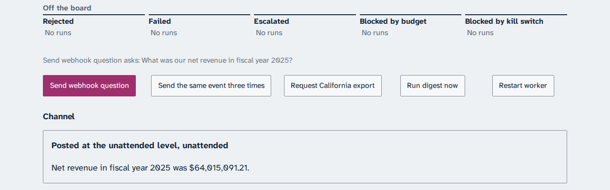

# Module: Loop Engineering

New here? [Start here](docs/start-here.md).

This module builds four loops around one analytics agent, DataPilot, and measures each one live on
the same benchmark of business questions.

## The problem

A finance manager at Harbor & Pine Outfitters asks the analytics agent for last fiscal year's net
revenue. The agent reads the schema, sums an order column over the calendar year, and answers in
one confident sentence. The number goes into a board deck. Nobody can say where it came from.

The team adds checks. Every check on the query passes: one statement, allowed tables, a fair cost,
a read-only role. The answer is still wrong, because no check knows what "net revenue" means at
Harbor & Pine.

Then the team wires the agent to a webhook. A retried webhook posts the same answer three times.
An export that waited for approval vanishes when the worker restarts. The stop button stops new
jobs but not the run already in flight.

So the team writes rules from the failures. The score on its own test questions rises, and the
rules quote those questions. A new rule fixes one revenue question and quietly breaks another that
used to pass.

Each failure has a price: a wrong number in front of the board, duplicate posts in a shared
channel, a lost approval, and a regression shipped as an improvement. A stronger model fixes none
of them, because each one is a missing loop around the model, not a weak model.

> **Terms on this page**
>
> - **Agent loop**: The model calls tools, reads the results, and repeats until it answers.
> - **Verification loop**: Graders check each query and answer, and send failures back to the agent.
> - **Event loop**: Events become jobs that workers run, with approvals, budgets, and a kill switch.
> - **Hill-climbing loop**: Experiments find failures, an analyzer team proposes rules, and a gate
>   decides.
> - **Knowledge version**: A numbered set of business rules given to the agent in its prompt.
> - **Dev split**: The benchmark questions the analyzer team may learn from.
> - **Holdout split**: The benchmark questions the analyzer team never sees; the gate decides on them.
> - **Autonomy level**: How much DataPilot may do unattended: report-only, assisted, or unattended.
>
> All terms: [glossary](docs/glossary.md).

## Why it happens

1. **The rules live in people's heads, not in the schema.**
   [BIRD](https://arxiv.org/abs/2305.03111) calls them external knowledge and hands models the
   missing rules as evidence. [Spider 2.0](https://arxiv.org/abs/2411.07763) shows large language
   model (LLM) agents do much worse on real enterprise schemas than on benchmark schemas.
2. **A check on the query is not a check on the answer.** A Structured Query Language (SQL)
   result that matches on one database can still be wrong:
   [Semantic Evaluation for Text-to-SQL with Distilled Test Suites](https://arxiv.org/abs/2010.02840)
   measures how often single-database execution match gives false positives.
3. **A queue delivers at least once, and memory does not survive a restart.** A Postgres job queue
   can hand the same work out twice
   ([You don't need a job queue: Postgres already has SKIP LOCKED](https://www.prisma.io/blog/you-dont-need-a-job-queue-postgres-already-has-skip-locked)). A pending
   approval is an interrupted run, and its state must outlive the process
   ([Human-in-the-loop](https://docs.langchain.com/oss/python/langchain/human-in-the-loop)).
4. **Rules written from failures do not reliably transfer.**
   [MAGIC](https://arxiv.org/abs/2406.12692) turns failures into a self-correction guideline; a
   [table agents survey](https://arxiv.org/html/2507.10281) re-ran it and found small gains.

The four loops follow [The art of loop engineering](https://www.langchain.com/blog/the-art-of-loop-engineering).
Every source and finding is on the [evidence page](docs/evidence.md).

## The approach


*Notice that the application programming interface (API), the worker, and the runner never call each other: they meet in the ops schema, and the agents read the warehouse through a read-only role.*

- **Section 1: Agent loop.** The analyst gets better tools before it gets more rules: a table
  description with sample values, a row cap, and a structured answer. A stateless schema scout
  suggests tables and joins.
- **Section 2: Verification loop.** Deterministic graders and a read-only role stop unsafe
  SQL before and during execution. A retry cap and an independent
  reviewer bound the loop, and a gold check on two databases shows what the graders miss.
- **Section 3: Event loop.** Webhooks, schedules, and people become jobs in Postgres, with
  idempotent effects and approvals that survive a restart. A kill switch stops runs in flight and
  drops DataPilot to the report-only level.
- **Section 4: Hill-climbing loop.** An analyzer team writes rules from failed dev items, and an
  overfit guard and a gate on holdout items decide. A person approves, and a metric family earns
  the unattended level only when every holdout item of that family passes on the gate's confirmed
  standard.

Every demo runs live in class, on the class model, with a live stamp on every result.

## The class plan

| Section | Folder | What you see in class | Time |
|---|---|---|---|
| Section 1: Agent loop | [section-1-agent-loop/](section-1-agent-loop/README.md) | The simple question, the confident wrong answer, unbounded rows | 0:10-0:55 |
| Section 2: Verification loop | [section-2-verification-loop/](section-2-verification-loop/README.md) | Malicious SQL, the retry cap, every grader passes, still wrong | 0:55-1:45 |
| Section 3: Event loop | [section-3-event-loop/](section-3-event-loop/README.md) | The webhook question, the approval across a restart, duplicates, the kill switch | 1:55-2:50 |
| Section 4: Hill-climbing loop | [section-4-hill-climbing-loop/](section-4-hill-climbing-loop/README.md) | The baseline and candidate experiments, the analyzer team, the gate, the finale | 3:05-3:50 |

The class runs four hours. It opens at 0:00 with the setup checks and the spine question, and
closes at 3:50 with all results. There are two breaks, 1:45-1:55 and 2:55-3:05, and a poll at
2:50, when the baseline experiment starts and runs through the second break. The minute-by-minute
plan is in the [instructor guide](docs/instructor-guide.md); the step-by-step demo guide is in
[guide/](guide/README.md).

After class: four assignments, one per section, each checked live; the
[final project](final-project/README.md); and a review session on Thursday.

## What we measured

Calibration ran every core demo and the benchmark live on 22 and 23 October 2026, on gpt-6-luna,
with business date 31 January 2026; the live sessions of 23 October, afternoon and evening, ran them
again on the current code. Each count below is in the [calibration report](docs/calibration-report.md). For each loop measured with its protection off
and on, on the same questions, including where a loop did not help, see
[what each loop is worth](docs/benefits.md).

| Section | What we measured | Result |
|---|---|---|
| Section 1: Agent loop | Trap item runs that passed under the starting knowledge v1 | 0 of 99 |
| Section 2: Verification loop | Reviewer verdicts on the wrong spine answer, that one question only | Concern in 6 of 7 runs |
| Section 2: Verification loop | Reviewer on six wrong trap answers | 2 concerns, 1 answer held |
| Section 3: Event loop | Same event three times: one run, 2 duplicates absorbed | 5 of 5 demo runs |
| Section 3: Event loop | Pending approval survived a worker restart | 5 of 5 demo runs |
| Section 4: Hill-climbing loop | Holdout items passed, v1 against the promoted v8, then v9 | 2 of 15 against 14 of 15, twice |
| Section 4: Hill-climbing loop | The finale's spine answer after those promotions | Correct, at the unattended level, twice |
| Section 4: Hill-climbing loop | Candidate experiments with 0 regressions | 9 of 10; the other had 1 dev regression |

> Your output will differ: run times, ids, and the agent's wording change on every run.


*Section 1: each wrong fragment of the SQL carries its trap note, and the answer does not match gold.*


*Section 4: in the captured run of 23 October, the candidate v9 fixes 12 holdout items and breaks none.*



*The finale on 23 October: the spine question answered correctly under the promoted version v9, posted at the unattended level, without approval.*

In plain words:

- Under the starting knowledge, the class model fails every trap and passes 6 of 7 easy items.
  Better tools and graders alone do not change that: the gold check is what exposes it.
- Turning the schema scout and the reviewer off made no measurable difference to the gold result
  on four questions. With both on, a run used 8,648 tokens on average; with both off, 3,337.
- The hill-climbing loop works, but its candidate varies. Three analyzer runs from the same 21
  failed dev items gave 11, 3, and 6 holdout passes of 15, against 2 for v1. With two candidates
  chosen on the dev split, measured twice so far, the kept candidate passed 14 of 15 both times.

What it costs: about 0.001 dollars per analyst run, and 0.0594 to 0.0914 dollars per 70-run
experiment, which took 182 to 459 seconds at concurrency 8. By the end of the calibration night of
23 October 2026, OpenAI had billed the build 1.78 dollars. What each command calls is on the
[costs page](docs/costs.md).

### Known limitations

- Revenue was cleared for the unattended level in 2 of 6 live promotions, the two latest. In the
  other four the finale posted at the assisted level, and in three of them its answer was wrong.
- One analyzer run does not guarantee a strong candidate; the two-candidate method has two
  measurements, and the class depends on a rehearsal-time check of the candidate.
- One holdout trap item, business-day orders in November 2025, still fails under v8.
- The baseline experiment took 266 to 285 seconds in every demo run, over its 3-minute target, and
  two candidate experiments took 6.8 and 7.6 minutes.
- Every demo and planted half was measured a few times at most, so each count is a small sample.
- gpt-6-luna has no dated snapshot. The drift canary in `make preflight` checks that it still
  behaves as measured.

All results, with run ids and captures: [evidence](docs/evidence.md).

## Quick start

On Windows, run every command in Ubuntu on WSL2.

```bash
git clone https://github.com/ANI-IN/loop-engineering.git ~/datapilot
cd ~/datapilot
make setup
```

`make setup` creates `.env`. Put your OpenAI key from the operations team and your LangSmith key in
it (`OPENAI_API_KEY` and `LANGSMITH_API_KEY`), then:

```bash
make up
make seed
make preflight PURPOSE=development
make demo NAME=agent-simple-question
```

Open the console at http://localhost:8501 to watch the run. `make preflight` asks five canary
questions with your key, each one agent run (about 40 model calls, under a cent). For a first install, follow [setup/](setup/README.md).

## Where next

- [Section 1: Agent loop](section-1-agent-loop/README.md): the first loop and its demos.
- [Setup](setup/README.md): a machine with nothing installed to a first live demo.
- [Use it in your repository](use-in-your-repo/README.md): the four loops on your own Postgres.

### Getting help

- [Troubleshooting](docs/troubleshooting.md): exact messages and their fixes.
- [Frequently asked questions](docs/faq.md): keys, setup, demos, and assignments.
- A key problem goes to the operations team. Never share your `.env` or a key.

### Licence

The MIT License in [LICENSE](LICENSE) covers the code and the course text and images. The
console's fonts keep their own licence, the SIL Open Font License, version 1.1: Atkinson
Hyperlegible Next and Mono in `platform/console/static/fonts/`, with their licence files.

## Sources

- Source 1: Can LLM Already Serve as A Database Interface? A BIg Bench for Large-Scale Database Grounded Text-to-SQLs, <https://arxiv.org/abs/2305.03111>, Jinyang Li et al., 2023-05-04
- Source 2: Spider 2.0: Evaluating Language Models on Real-World Enterprise Text-to-SQL Workflows, <https://arxiv.org/abs/2411.07763>, Fangyu Lei et al., 2024-11-12
- Source 3: Semantic Evaluation for Text-to-SQL with Distilled Test Suites, <https://arxiv.org/abs/2010.02840>, Ruiqi Zhong et al., 2020-10-06
- Source 4: You don't need a job queue: Postgres already has SKIP LOCKED, <https://www.prisma.io/blog/you-dont-need-a-job-queue-postgres-already-has-skip-locked>, Prisma, 2026-07-17
- Source 5: LangChain human-in-the-loop, <https://docs.langchain.com/oss/python/langchain/human-in-the-loop>, LangChain, n.d.
- Source 6: MAGIC: Generating Self-Correction Guideline for In-Context Text-to-SQL, <https://arxiv.org/abs/2406.12692>, Arian Askari et al., 2024-06-18
- Source 7: Toward Real-World Table Agents: Capabilities, Workflows, and Design Principles for LLM-based Table Intelligence, <https://arxiv.org/html/2507.10281>, Jiaming Tian et al., 2025-07-14
- Source 8: The art of loop engineering, <https://www.langchain.com/blog/the-art-of-loop-engineering>, Sydney Runkle (LangChain), 2026-06-16
