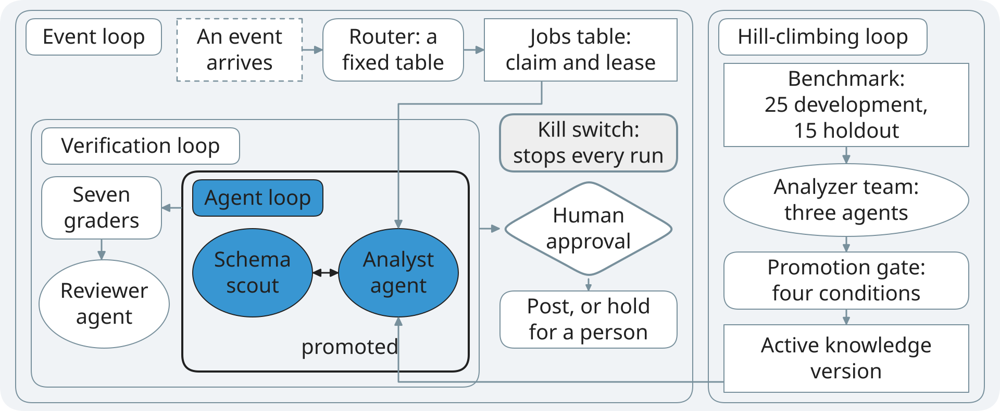
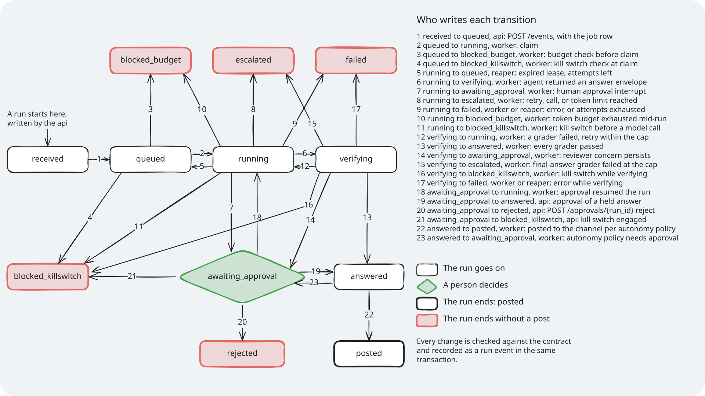
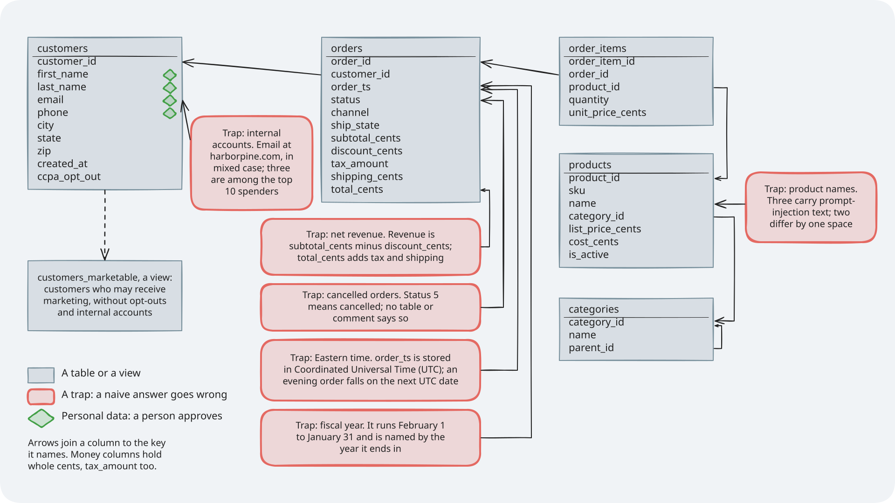

# Module: Loop Engineering - Diagrams

This folder holds the diagrams that more than one page uses: the diagram style, the whole system,
the four loops as one system (with one variant per section), the text-to-Structured Query Language
(SQL) reference architecture, the run lifecycle, and the warehouse data model. The four-loop map
and the reference architecture also come in a version that names each part by its job, with no
part of DataPilot, for the deck. Each section has
its own `diagrams/` folder for the diagram of its loop.

## How to read these files

Every diagram has three files with the same name:

| File | What it is for |
|---|---|
| `.excalidraw` | The source. Open it at excalidraw.com to edit it |
| `.svg` | A render with the font embedded, for pages on GitHub |
| `.png` | A render at 2x scale, for pages and anyone who needs a picture |

There are three panel sizes. A slide diagram is 1920 by 791, the shape of the slide's diagram
panel (12.13 by 5.0 inches), and its PNG is 3840 by 1582. A pattern diagram is 1920 by 540, the
shape of a pattern slide's panel (12.13 by 3.41 inches), with the same labels of 40 pixels or
more, and its PNG is 3840 by 1080; the sixteen pattern diagrams are in
[`patterns/`](patterns/README.md), with their own fill rule: a pattern belongs to no single loop,
so they use the neutral fills only. The three reference diagrams that are too dense for a slide
(the system, the run lifecycle, and the warehouse data model) are 1920 by 1080 page diagrams, and
their PNG is 3840 by 2160.

Some diagrams are built up one step at a time. They also have step frames, named `-step-1`,
`-step-2`, and so on. Each frame adds one part, and every frame is the same panel, so nothing
moves between frames. The file without a step number is the full diagram, the same as the last
step.

Every diagram sits on a light rounded panel (`#F0F3F6`), so it reads on GitHub in light or dark
mode. The deck uses its own export of each slide diagram, described below.

## Diagram style


*Notice that every colour comes with its loop's name in words, so you never need to tell the colours apart.*

Every diagram is drawn from `platform/tools/diagrams/scene.py` with these values; a test
(`platform/tests/unit/test_diagrams.py`) fails if a source leaves them.

| What | Value |
|---|---|
| Excalidraw | 0.18.1, the build pinned in `platform/tools/diagrams/export_page.html` |
| Sloppiness | Roughness 0, the "architect" setting: straight, clean lines |
| Label font | Nunito, Excalidraw's "Normal" font, font family 6 |
| Code font | Comic Shanns, Excalidraw's "Code" font, font family 8 |
| Code font is for | Tool names, endpoints, and columns |
| Text colour | `#212121` on every fill |
| Label size, slide diagram | 40 pixels or more on 1920 by 791: 18.2 points on the 12.13-inch panel |
| Label size, pattern diagram | 40 pixels or more on 1920 by 540: 18.2 points on the 12.13-inch panel |
| Label size, page diagram | 20 pixels or more on the 1920 by 1080 panel |
| Line height | 1.25 |
| Outline | 2 pixels on every shape |
| Thick outline | 4 pixels: a person who decides, a stop, the highlighted loop |
| Arrows | One style: 3 pixels, solid, straight segments, a filled triangle head |
| Arrow labels | Free text beside the arrow, never on the line |
| Panel | `#F0F3F6`, rounded, 1920 pixels wide |

The four loop colours are the deck's colours, one per section, used as fills with dark text:

| Loop | Fill | Contrast of `#212121` on it |
|---|---|---|
| Agent loop | Blue `#3896D2` | 4.95 to 1 |
| Verification loop | Teal `#0097A7` | 4.59 to 1 |
| Event loop | Orange `#FFAB40` | 8.55 to 1 |
| Hill-climbing loop | Lime `#EEFF41` | 14.58 to 1 |

The neutrals: white `#FFFFFF` for a person who decides, something outside DataPilot, and a run
state; light grey `#EEEEEE` for a stop; the blue-grey `#78909C` only as the outline of a muted
loop. A loop colour is never used for text.

### Colours and shapes

The shape says what a thing is; the fill says which loop it belongs to:

| Shape | Meaning | Fill |
|---|---|---|
| Ellipse | An agent: a model decides what happens next | Its loop's colour |
| Rounded rectangle | Code: the same input gives the same result | Its loop's colour |
| Rectangle with square corners | Stored state: a database, a table, a record | Its loop's colour, or white |
| Diamond, thick outline | A person decides: human approval | White |
| Rounded rectangle, thick outline | A stop, a failure, or a trap; the label says which | Light grey |
| Rectangle, dashed outline | Outside DataPilot: a sender or a service | White |
| Rounded rectangle, dashed, named | A tool boundary, or a part with deliberately no agent | None |
| Rectangle with its name on top | The boundary of a loop or a process | None |
| Small rounded tag | A loop's name, in words | Its loop's colour |

In the run lifecycle, a white rounded rectangle is a state the run goes on from, and a thick
outline is a state that ends the run.

Colour is never the only signal. Each kind has its own shape, every loop is named in words on the
diagram that uses its colour, every stop starts with the word "Stop", "Stops", "Blocked",
"Failed", "Trap", "Kill switch", "Daily budget", "A refused write", or "No", and the alt text and
caption of each diagram say what it shows.

## The diagrams

Each diagram below has its embed snippet for a page in `docs/`; from another folder, change the
path (from the root `README.md`, `docs/diagrams/<name>.svg`; from a section page,
`../docs/diagrams/<name>.svg`).

### The system


*Notice that the application programming interface (API), the worker, and the runner never call each other: they meet in the ops schema, and the agents read the warehouse through a read-only role.*

```markdown


*Notice that the API, the worker, and the runner never call each other: they meet in the ops schema, and the agents read the warehouse through a read-only role.*
```

- **What it teaches**: the processes, the agents inside them, and the data they share.
- **Slide topic**: the system, on the architecture page; a page diagram, too dense for a slide.
- **Files**: `system-architecture`.
- **Source in the code**: `compose.yaml` (the services and the one-shot migrate),
  `platform/src/datapilot/db.py`, the 19 routes in `platform/src/datapilot/loop3_events/api/`,
  `loop3_events/scheduler.py`, `loop3_events/worker.py`, `loop3_events/trace_refusals.py`,
  `loop3_events/improvement.py` (one runner per database), `loop4_hill_climbing/runner.py` (two
  candidates, promotions with clearance re-runs, gold checks of live runs), and the tables in
  `platform/ops/sql/ops/`.

### The four loops as one system


*Notice where the agents are and where there are none: the router, the graders, and the gate are code, and a person approves.*

```markdown


*Notice where the agents are and where there are none: the router, the graders, and the gate are code, and a person approves.*
```

One variant per section shows the same map with that section's loop in its colour and the other
three muted (white, with a blue-grey outline), every label still readable:



*Notice that the agent loop sits at the centre: every other loop wraps it or feeds it.*

- **What it teaches**: how the four loops wrap one another, where each agent sits, and where the
  course chose code instead of an agent.
- **Slide topic**: the four-loop map, in the opening; its highlighted variant at the start of each
  section.
- **Files**: `four-loops`, with step frames `four-loops-step-1` to `four-loops-step-4` (one loop
  per step, Section 1: Agent loop first) and the variants `four-loops-agent-loop`,
  `four-loops-verification-loop`, `four-loops-event-loop`, and `four-loops-hill-climbing-loop`.
- **Source in the code**: `platform/src/datapilot/loop1_agent/analyst.py` and `scout.py`;
  `loop2_verification/checker.py`, `loop.py`, and `reviewer.py`; `loop3_events/router.py`,
  `worker.py`, `autonomy.py`, `killswitch.py`, and `approvals.py`;
  `loop4_hill_climbing/analyzer.py`, `gate.py`, and `runner.py`; the 25 development questions (the
  analyzer team may learn from them) and the 15 holdout questions (it never sees them) in
  `platform/packs/datapilot_us/benchmark/`.

### The four loops by role

![The four loops nested, each part named by its job: in the agent loop, a model answers with tools and code stops it; in the verification loop, layered checks, then a person decides a doubtful answer; in the event loop, events arrive, each is keyed once and queued with leases, a kill switch points at the queue and stops every run, and human approval comes before a post; beside them the hill-climbing loop, where failures on a benchmark lead agents to propose rules, the rules are judged on unseen questions, and a person promotes them, an arrow that runs under the event loop and up into the model](./four-loops-generic.svg)

*Notice that this is the same map as the four loops as one system, with every part named by the job it does, so it fits any agent you build.*

```markdown
![The four loops nested, each part named by its job: in the agent loop, a model answers with tools and code stops it; in the verification loop, layered checks, then a person decides a doubtful answer; in the event loop, events arrive, each is keyed once and queued with leases, a kill switch points at the queue and stops every run, and human approval comes before a post; beside them the hill-climbing loop, where failures on a benchmark lead agents to propose rules, the rules are judged on unseen questions, and a person promotes them, an arrow that runs under the event loop and up into the model](diagrams/four-loops-generic.svg)

*Notice that this is the same map as the four loops as one system, with every part named by the job it does, so it fits any agent you build.*
```

- **What it teaches**: the four loops as a pattern for any agent system, before the course shows
  how DataPilot builds each part.
- **Slide topic**: the four-loop map on the deck, where a slide teaches the pattern rather than
  DataPilot's parts; the pages keep the four loops as one system.
- **Files**: `four-loops-generic`.
- **Source in the code**: the same files as the four loops as one system; no label names a part
  of DataPilot or one of its counts.

### The text-to-SQL reference architecture

![The text-to-SQL reference architecture in nine stages, each with DataPilot's implementation and its loop: question routing by a fixed router; schema retrieval and linking by the schema scout agent; business knowledge in the knowledge version, a light semantic layer; value lookup, Assignment 1: Agent loop; SQL generation by the analyst agent; validation by the syntax-tree guard, the cost estimate, and the personal-data rules; capped execution through the read-only executor; an answer read by the reviewer agent, with its assumptions stated, or a clarifying question, which Assignment 2: Verification loop adds; and evaluation by execution match against gold queries on two databases, whose failures go back to the business knowledge, where the analyzer team proposes rules](./text-to-sql-architecture.svg)

*Notice that models work in three stages, schema linking, SQL generation, and the reviewed answer: routing, validation, execution, and evaluation are code.*

```markdown
![The text-to-SQL reference architecture in nine stages, each with DataPilot's implementation and its loop: question routing by a fixed router; schema retrieval and linking by the schema scout agent; business knowledge in the knowledge version, a light semantic layer; value lookup, Assignment 1: Agent loop; SQL generation by the analyst agent; validation by the syntax-tree guard, the cost estimate, and the personal-data rules; capped execution through the read-only executor; an answer read by the reviewer agent, with its assumptions stated, or a clarifying question, which Assignment 2: Verification loop adds; and evaluation by execution match against gold queries on two databases, whose failures go back to the business knowledge, where the analyzer team proposes rules](diagrams/text-to-sql-architecture.svg)

*Notice that models work in three stages, schema linking, SQL generation, and the reviewed answer: routing, validation, execution, and evaluation are code.*
```

- **What it teaches**: the stages any text-to-SQL system needs, and how DataPilot does each one,
  so you can map them onto your own warehouse.
- **Slide topic**: the reference architecture, in the design segment after the four-loop map.
- **Files**: `text-to-sql-architecture`.
- **Source in the code**: `platform/src/datapilot/loop3_events/router.py` (a fixed table, never a
  model); `loop1_agent/scout.py` (the schema brief: tables, joins, caveats);
  `loop1_agent/knowledge.py` (the active knowledge version, added to every prompt);
  `loop1_agent/extension.py` (Assignment 1, the value lookup tool `find_exact_values`);
  `loop1_agent/analyst.py` and `tools.py` (`run_query`, at most 50 rows back);
  `loop2_verification/graders/` (`parse.py` and `statement_policy.py` on the syntax tree,
  `cost.py`, `personal_data.py`) and `executor.py` (the read-only role);
  `loop2_verification/reviewer.py` (the reviewer agent);
  `platform/src/datapilot/contracts/answer.py` (assumptions and the clarifying question) and
  Assignment 2 in `section-2-verification-loop/assignment/`; `loop4_hill_climbing/evaluator.py`
  (execution match on `warehouse` and `warehouse_alt`).

### The text-to-SQL reference architecture by job

![The text-to-SQL reference architecture in nine stages, each named by its job and its loop: question routing, where fixed code sends each question to its path; schema linking, which finds the tables and columns that matter; business knowledge as rules, versioned and tested; value lookup, which matches words to stored values; query generation, where a model writes the query; validation by syntax tree, cost, and personal-data checks; capped execution with a read-only role and a row cap; an answer that is reviewed, with its assumptions stated, or a question back; and evaluation, which compares results with gold answers on two databases and sends failures back to the business knowledge](./text-to-sql-architecture-generic.svg)

*Notice that each stage is named by its job and its loop, so you can check your own system one stage at a time.*

```markdown
![The text-to-SQL reference architecture in nine stages, each named by its job and its loop: question routing, where fixed code sends each question to its path; schema linking, which finds the tables and columns that matter; business knowledge as rules, versioned and tested; value lookup, which matches words to stored values; query generation, where a model writes the query; validation by syntax tree, cost, and personal-data checks; capped execution with a read-only role and a row cap; an answer that is reviewed, with its assumptions stated, or a question back; and evaluation, which compares results with gold answers on two databases and sends failures back to the business knowledge](diagrams/text-to-sql-architecture-generic.svg)

*Notice that each stage is named by its job and its loop, so you can check your own system one stage at a time.*
```

- **What it teaches**: the stages any text-to-SQL system needs, in general terms, so you can map
  them onto your own warehouse.
- **Slide topic**: the reference architecture on the deck; the pages keep the version with
  DataPilot's parts.
- **Files**: `text-to-sql-architecture-generic`.
- **Source in the code**: `docs/text-to-sql-design.md`, and the same stages and arrows as the
  text-to-SQL reference architecture; no label names a part of DataPilot.

### The run lifecycle



*Notice that every arrow has one named writer, the API, the worker, or the reaper, and that six states end a run, only one of them with a posted answer.*

```markdown


*Notice that every arrow has one named writer, the API, the worker, or the reaper, and that six states end a run, only one of them with a posted answer.*
```

- **What it teaches**: the states a run passes through and which component may move it.
- **Slide topic**: the run lifecycle, on the architecture page and in Section 3: Event loop; a page
  diagram, too dense for a slide.
- **Files**: `run-lifecycle`.
- **Source in the code**: `RunStatus`, `TERMINAL`, and `TRANSITIONS` in
  `platform/src/datapilot/contracts/lifecycle.py`. The key on the diagram is built from
  `TRANSITIONS`, and `platform/tests/unit/test_diagrams.py` fails if they drift apart.

### The warehouse data model



*Notice that no column name or comment states a business rule: each trap is invisible in the schema, so only a knowledge version can teach it.*

```markdown


*Notice that no column name or comment states a business rule: each trap is invisible in the schema, so only a knowledge version can teach it.*
```

- **What it teaches**: Harbor & Pine Outfitters' warehouse, and where a naive answer goes wrong:
  fiscal year, net revenue, cancelled orders, Eastern time, and internal accounts.
- **Slide topic**: meet the warehouse, in the opening and in Section 1: Agent loop; a page diagram,
  too dense for a slide.
- **Files**: `warehouse-data-model`.
- **Source in the code**: `platform/ops/sql/warehouse_schema.sql` and `warehouse_indexes.sql`;
  the data conditions in `platform/planted/registry.yaml`; business rules 1 to 6 in
  `platform/packs/datapilot_us/benchmark/business_rules.md`; the personal-data columns in
  `platform/packs/datapilot_us/pack.yaml`.

## How the renders are made

The renders are made at authoring time only. Learners never run the export, the renders are
committed, and nothing in the app or the learner's setup uses Node.

1. Each diagram is written as a function in `platform/tools/diagrams/definitions.py`, built from
   the fixed kinds and the style in `platform/tools/diagrams/scene.py`, so every label can be
   traced to the file it comes from. `--build` writes the `.excalidraw` sources (with the step
   frames and the highlighted variants) from them. After that the `.excalidraw` file is the
   source: edit it at excalidraw.com, or change the function and build again, which overwrites
   hand edits.
2. `platform/tools/diagrams/export_diagrams.py` opens headless Chromium through Playwright for
   Python on `platform/tools/diagrams/export_page.html`, a local page that loads one pinned
   Excalidraw build from jsDelivr
   (`https://cdn.jsdelivr.net/npm/@excalidraw/excalidraw@0.18.1/+esm`), with its fonts from the
   same package. The page loads Nunito and the code font, measures each label with the real font
   (so a label is centred as Excalidraw would centre it), then calls `exportToSvg` (fonts
   embedded) and `exportToBlob` at scale 2 for each source. The script refuses a PNG whose size is
   not the panel times the scale.
3. The script writes `<name>.svg` and `<name>.png` beside the source, and records the SHA-256 of
   the source and of both renders in the folder's `renders.json`. Renders are deterministic: the
   same source gives the same bytes.
4. It also exports each slide diagram and each pattern diagram for the deck, without step frames:
   a PNG at scale 3 (5760 by 2373 for a slide diagram, 5760 by 1620 for a pattern diagram) with a
   transparent background, the panel's fill left out so the slide's own
   light panel shows through. These exports belong to the deck, which is private and not part of
   this module.
5. `platform/tests/unit/test_diagrams.py` runs in `make test` with no browser and no network. It
   fails when a source changed without a new render or a render was changed by hand, and it checks
   the panels, the label sizes, the style values above, the scale of every PNG, the embedded
   font, the step frames, the four highlighted variants, the naming rule on every label, and the
   run lifecycle key against the contract.

Run it from the repository root (the `dev` dependency group, once per machine
`uv run playwright install chromium`):

```bash
uv run python platform/tools/diagrams/export_diagrams.py          # render what is stale
uv run python platform/tools/diagrams/export_diagrams.py --build  # write sources, then render
uv run python platform/tools/diagrams/export_diagrams.py --check  # report stale renders
```

| Pinned | Version | Note |
|---|---|---|
| `@excalidraw/excalidraw` on npm | 0.18.1 | Released 2026-04-20; loaded as jsDelivr's `+esm` build |
| React, through that build | 19.2.5 | jsDelivr fixes it inside the `+esm` build |
| Playwright for Python | 1.63.0 | Already in the `dev` dependency group |
| Chromium | 153.0.8010.12 | The build Playwright 1.63.0 installs |
