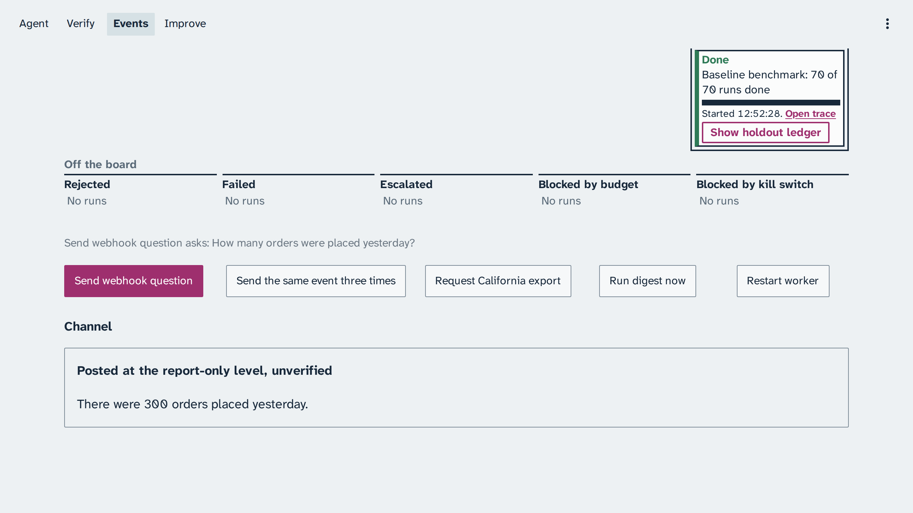
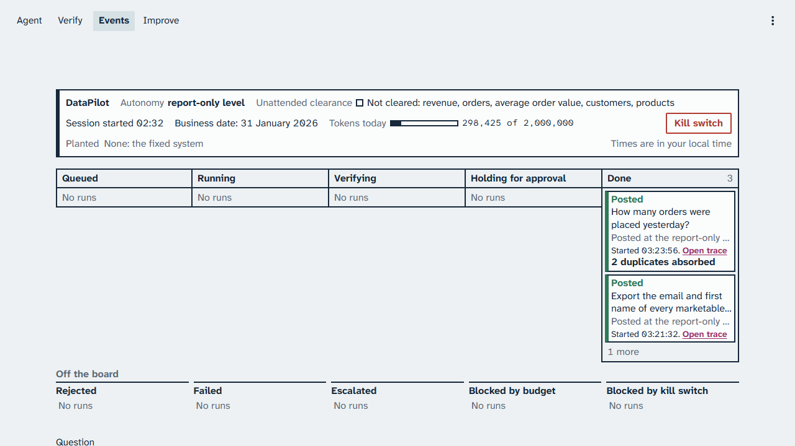

# Module: Loop Engineering - Images of the class story

One capture per key moment of the class story, from live runs on 22 and 23 October 2026
(business date 31 January 2026). Each section's demo/expected/ folder holds the full set, with run
ids and notes on where a capture is older than the console. The captures of the agent and
verification loops, taken on 23 October from 22:13, and the hill-climbing captures, taken on 23
October between 21:27 and 21:55, are in Coordinated Universal Time; the captures of the event loop,
from 22 October, are in the capturing browser's local time, India Standard Time (5 hours 30 minutes ahead of Coordinated
Universal Time). The console shows your own local time.

Your output will differ: run times, ids, and the agent's wording change on every run.

## Section 1: Agent loop

*The simple question: three tool calls, one query, a correct count.*

*The confident wrong answer: trap notes beside the SQL, and gold does not match (run e6e3170a).*

## Section 2: Verification loop

*Malicious SQL: the guard stops two statements and the role grants the third.*

*Every grader passes, still wrong.*

## Section 3: Event loop

These captures, of 22 October, show an older Events page: a Question text box above the
buttons, which the page no longer has. Two are cut at the top. The section's demo/expected/ page says what changed.

*The webhook question, posted at the report-only level.*

*The approval that survives a restart.*

*The same event three times: one answer.*

*The kill switch in flight.*

## Section 4: Hill-climbing loop

*The candidate experiment: 14 of 15 holdout items against 2, with no regressions (experiment a2ba7a5a).*

*The promotion clears a family when every one of its holdout items passes on the confirmed standard: 2 of 3 runs, or 2 of 3 more runs for an item that fell short.*

The ledger header names who approved v9 as it was typed in the course build's capture session, a
note of that session rather than a person; in class it names the instructor who approves.

*The finale: the spine question answered correctly under the promoted version v9, at the unattended level because revenue was cleared (run c91ebcc0).*
