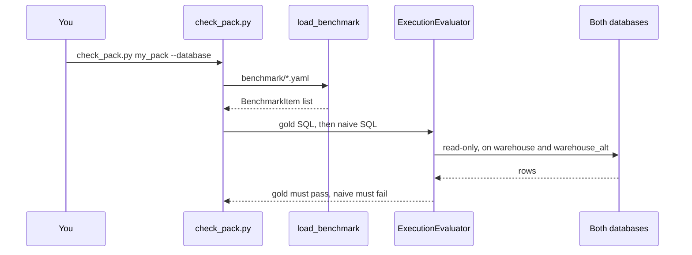

# Final project walkthrough

> **Terms on this page**
>
> - **Domain pack**: The folder that holds one warehouse's settings, rules, benchmark, and knowledge.

## What this code does

Three short pieces carry the final project. The platform reads one pack, named in its
configuration. It loads the pack's benchmark through the `BenchmarkItem` contract. The pack check
then runs every gold Structured Query Language (SQL) query, and every naive query, through the
same read-only executor and evaluator the hill-climbing loop uses.



## The code, explained

### platform/src/datapilot/config.py, lines 24-30

```python
# platform/src/datapilot/config.py (lines 24-30)
def active_pack() -> str:
    """The folder name under platform/packs/ of the selected pack."""
    return get_settings().datapilot_pack


def pack_config(pack: str | None = None, root: Path = PACKS) -> dict[str, Any]:
    return _load(pack or active_pack(), root)
```

Every process reads the pack named by the `DATAPILOT_PACK` setting, `datapilot_us` when it is not
set. One line in `.env` switches the analyst, the graders, the evaluator, the knowledge versions,
and the preflight checks to your pack.

### platform/src/datapilot/loop4_hill_climbing/pack_files.py, lines 48-54

```python
# platform/src/datapilot/loop4_hill_climbing/pack_files.py (lines 48-54)
def load_benchmark(pack: str | None = None) -> list[BenchmarkItem]:
    """Every item in benchmark/*.yaml, in file order then item order."""
    items: list[BenchmarkItem] = []
    for path in sorted((pack_root(pack) / "benchmark").glob("*.yaml")):
        for raw in yaml.safe_load(path.read_text(encoding="utf-8")) or []:
            items.append(BenchmarkItem.model_validate(raw))
    return items
```

Each item is validated against the contract, so a missing field fails at load, before any model
call. Any `.yaml` file in `benchmark/` is part of the benchmark.

### use-in-your-repo/check_pack.py, lines 148-159

```python
# use-in-your-repo/check_pack.py (lines 148-159)
    config = VerificationConfig.from_pack(pack_config(pack, PACKS))
    evaluator = ExecutionEvaluator(runner=ReadOnlyRunner(WarehouseRunner(executors(config))))
    for item in items:
        if not item.gold_sql:
            continue
        gold = AnswerEnvelope(status=AnswerStatus.ANSWERED, final_sql=item.gold_sql)
        result = evaluator.evaluate(item, gold)
        report.check(result.passed, f"{item.id}: the gold query runs on both databases")
        if item.naive_sql:
            naive = AnswerEnvelope(status=AnswerStatus.ANSWERED, final_sql=item.naive_sql)
            result = evaluator.evaluate(item, naive)
            report.check(not result.passed, f"{item.id}: the naive query differs from gold")
```

The check scores your naive query as if the agent had written it. It must fail: a trap that a
naive query survives cannot catch a model. The executor uses your pack's allowed schema and
statement timeout.

## If you copy this into your repository

- Keep the order: load through the contract, then check gold, then check naive. A benchmark whose
  gold queries fail measures nothing.
- Run the check on two differently seeded databases, never one, so a coincidence cannot pass.
- Run it after every change to your data or your benchmark, before any live run.
