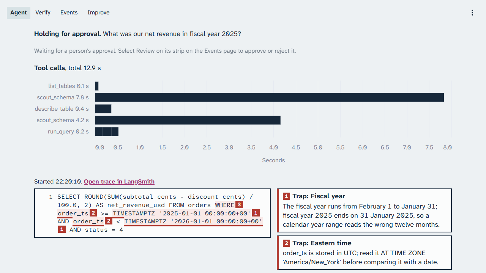

# Chapter 1: Section 1: Agent loop

The analyst answers a plain question correctly, then answers the spine question, "What was our net
revenue in fiscal year 2025?", with a confident number that is wrong. Nothing in the agent loop
checks it yet. You run each demo from the demo terminal and watch it on the console's Agent page.
Every screenshot and number in this chapter comes from the live runs of 22 October 2026
(business date 31 January 2026), and every time range from the calibration demo pass of 22 and 23
October 2026.

> Your output will differ: run times, ids, and the agent's wording change on every run.

### Step 1: Ask the simple question

**Where:** The demo terminal, in the repository folder, and the console's Agent page at
http://localhost:8501.

**Type:** this, or press **Ask** on the Agent page.

```bash
make demo NAME=agent-simple-question
```

**You should see:** the run's summary in the terminal, then the run on the Agent page. The terminal
excerpt of the captured run:

```text
question: How many orders have been placed in total?
run id: 3246b3e9-5797-4365-8376-59d05054d28b
status: posted
tool calls: list_tables, describe_table, run_query
final SQL: SELECT COUNT(*) AS total_orders FROM orders;
answer: There have been 405738 orders placed in total.
tokens: 3083 in, 58 out; cost $0.0003
model: gpt-6-luna; knowledge version: v1
```


*The analyst lists the tables, describes one, runs one query, and answers; describe_table takes most of the 0.8 seconds of tool time.*

**Look at:** the tool timeline, then the line "Started ... Open trace in LangSmith" above the query.

**What it means:** with no trap in the question, the agent loop alone is enough: three tool calls,
one query, a correct count. The live stamp shows this result comes from a run started just now.

> [!CHECKPOINT]
> The page says **Posted**, the answer is a count, and the live stamp shows this run's start time.

> [!IFDIFFERENT]
> `No live session is open: run make preflight first.` → run `make preflight PURPOSE=class` once (Part 0).
> The run stays in one place → `make reset NAME=agent-loop`, then the same `make demo` again.
> More or fewer tool calls → expected; the number of tool calls can vary.

> [!INSTRUCTOR]
> Point at the timeline first, then the query, then the tokens and cost line (5,126 tokens and
> 0.0003 dollars in the captured run). Say: "This is the loop you already know. The next question
> looks just as simple."

### Step 2: Ask the spine question

**Where:** The demo terminal, and the Agent page.

**Type:** this, or press **Ask the spine question** on the Agent page.

```bash
make demo NAME=agent-confident-wrong-answer
```

**You should see:** the run with its status line and its tool timeline. In the captured run the
analyst also called the schema scout.



*The spine question under the starting knowledge v1: the run holds for approval, and the analyst still answers with a number.*

**Look at:** the status, **Holding for approval**, and the `scout_schema` bar in the timeline.

**What it means:** the reviewer raised a concern, so the run waits for a person. The analyst
answered anyway, with a number, and nothing in this loop tells you whether it is right.

> [!CHECKPOINT]
> The run has a status and a timeline; the answer text appears below the query once it finishes.

> [!IFDIFFERENT]
> The status reads **Posted** instead of holding → the reviewer's verdict varies; go on, the gold check still decides.
> The page still says "Running the agent" after about a minute → scroll down; then reset and run it again if nothing changes.

> [!INSTRUCTOR]
> Ask the class to guess the number before it appears. Do not explain the hold yet: Section 2:
> Verification loop covers the reviewer.

### Step 3: Read the annotated query

**Where:** The Agent page; scroll down to the query and its trap notes.

**Type:** nothing; scroll.

**You should see:** the query, with numbered marks on its wrong fragments and one note per trap.


*Each wrong fragment of the query carries the number of its trap note.*

1. Trap: Fiscal year. The query reads calendar year 2025; fiscal year 2025 ends on 31 January 2025.
2. Trap: Eastern time. `order_ts` is stored in Coordinated Universal Time (UTC) and is compared
   without converting it to New York time.
3. Trap: Internal accounts. The query keeps the staff and test accounts on the company email domain.

**Look at:** the answer line under the notes: the analyst itself says it read the calendar year.

**What it means:** the query is valid, safe, and plausible. Each mistake is a business rule the
schema does not show.

> [!CHECKPOINT]
> You can name at least one trap from its note.

> [!IFDIFFERENT]
> Different trap numbers or fewer notes → expected; which traps the query hits varies from run to run.
> No notes at all → the run has not finished; wait, then scroll again.

> [!INSTRUCTOR]
> Read one trap note aloud. Say: "None of these rules is in the schema. A stronger model guesses
> the same way."

### Step 4: Compare the answer against gold

**Where:** The Agent page; scroll to **Answer against gold**.

**Type:** nothing; scroll.

**You should see:** the agent's answer, the gold answer, and the result on both databases.


*The gold check fails on both warehouse and warehouse_alt.*

**Look at:** the **Mismatch** line.

**What it means:** the answer, 72,394,572.08 dollars, is not the gold 64,015,091.21 dollars. The
agent loop gave no sign that it was wrong.

> [!CHECKPOINT]
> The page shows **Mismatch** for both databases.

> [!IFDIFFERENT]
> A different wrong value → expected; the calibration run got 76,981,355.95 dollars against the same gold.
> No **Answer against gold** block after about a minute → the gold check has not arrived; reset with `make reset NAME=agent-loop` and run it again.

> [!INSTRUCTOR]
> This is the section's result: a confident, wrong number. Say what did not go the course's way if
> it happens: the reviewer may approve it, and the gold check still fails.

### Step 5: Run the large query, with and without the row cap

**Where:** The demo terminal, `.env` in an editor, and the Agent page.

**Type:** set `BUG_UNBOUNDED_ROWS=1` in `.env`, then run the planted half; set it back to `0` and
run the fixed half. Each change to `.env` needs `make up`.

```bash
make up
make demo NAME=agent-unbounded-rows
```

**You should see:** with the unbounded rows bug on, the token counter jumps. With it off, the
query returns at most the row cap, the total count, and a truncation notice. The fixed half used
17,298 and 19,661 tokens in its two calibration runs; the planted half used 183,639 to 186,689
tokens in three runs, about ten times as many. In the latest run the fixed half was held for
approval after two reviewer concerns.

<!-- capture: unbounded rows with the unbounded rows bug on: the Agent page with the token counter, and its terminal summary -->

<!-- capture: unbounded rows with the fix: the Agent page with the truncation notice and the total count -->

**Look at:** the tokens line of each run, side by side.

**What it means:** a tool that returns everything spends the run's budget on rows the model cannot
use. The row cap (`limits.row_cap` in `platform/packs/datapilot_us/pack.yaml`) keeps the loop
inside its budget.

> [!CHECKPOINT]
> The fixed half shows the truncation notice and the total count.

> [!IFDIFFERENT]
> The token counter does not move with the bug on → the services still hold the old `.env`; run `make up`.
> The run is held by a reviewer concern → expected in one of the two calibration runs; read its tokens anyway.

> [!INSTRUCTOR]
> Set the flag back to `0` and run `make up` before the next section. Point at the tokens, not the
> answer: this demo is about what reaches the model.

## Result summary

| Item | This run |
|---|---|
| Spine question against gold, both databases | Mismatch (headline) |
| The simple question | Posted, correct count |
| The spine question's status | Holding for approval, reviewer concern |
| Traps marked on the spine query | Fiscal year, Eastern time, internal accounts |
| Tokens, secondary | 5,126 for the simple question; 27,245 for the spine question (the captured runs) |

## Time and cost

Times are wall time from the trigger to the checked result, from the calibration demo pass of 22
and 23 October 2026 and the live sessions of 23 October, afternoon and evening
(`docs/calibration-report.md`), each demo run alone with a reset between.

| Demo | Time | Cost of the captured run | Cap |
|---|---|---|---|
| The simple question | 14 to 39 s | 0.0003 dollars | 60,000 tokens per run |
| The confident wrong answer | 37 to 76 s | 0.0025 dollars | 60,000 tokens per run |
| Unbounded rows | Planted half 18 to 19 s; fixed half 26 s | Fixed half: 17,298 to 27,040 tokens | 60,000 tokens per run |

## What to say in class

- "The loop works: three tool calls and a correct count for a plain question."
- "The spine answer is confident, valid, and wrong. Each mistake is a rule the schema hides."
- "Nothing in this loop compares the answer with the truth. The gold check is a measurement, not
  part of the agent."
- "The row cap is a tool decision: what reaches the model shapes every later step."
- If the reviewer approved the wrong answer this time: "The reviewer can miss it. That is
  Section 2."
