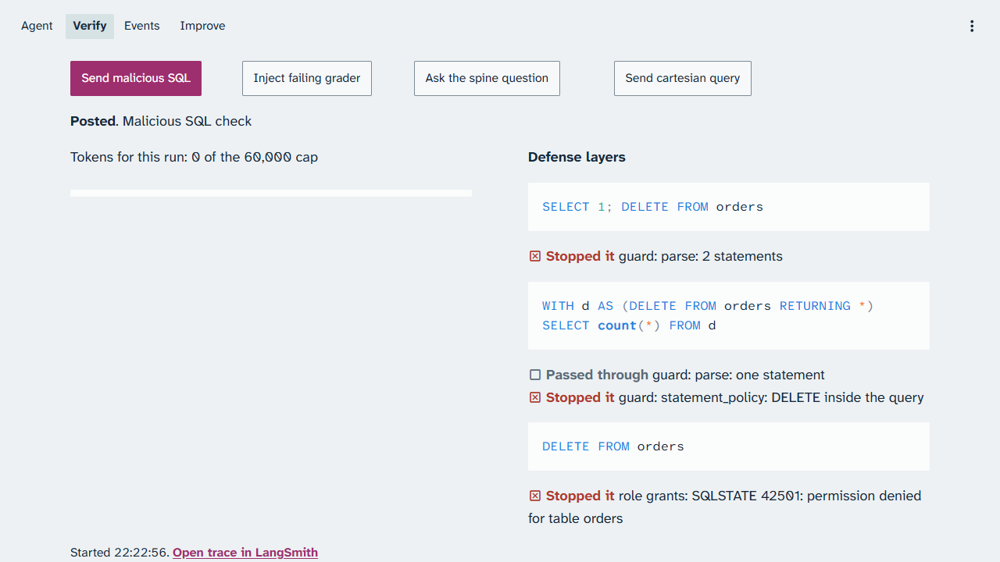
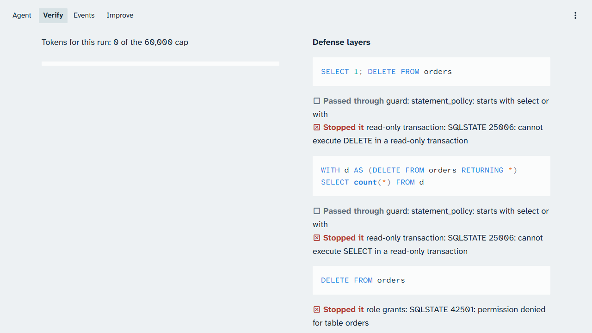
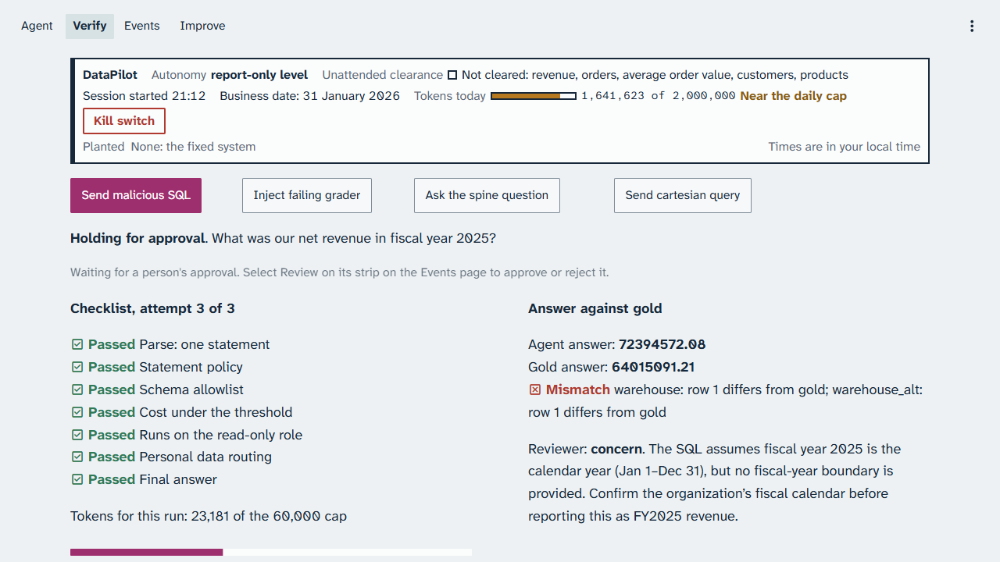
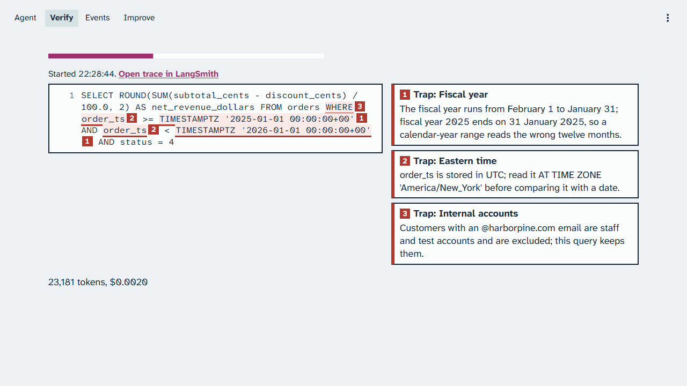

# Chapter 2: Section 2: Verification loop

The verification loop stops unsafe Structured Query Language (SQL) and bounds the agent's retries.
Then it passes every grader on the spine answer, and the answer is still wrong. You run each demo
from the demo terminal and watch it on the console's Verify page. Every screenshot and number in
this chapter comes from the live runs of 22 October 2026 (business date 31 January 2026), and
every time range from the calibration demo pass of 22 and 23 October 2026.

> Your output will differ: run times, ids, and the agent's wording change on every run.

### Step 1: Send the malicious statements to the fixed system

**Where:** The demo terminal, in the repository folder, and the console's Verify page.

**Type:** this, or press **Send malicious SQL** on the Verify page.

```bash
make demo NAME=verify-malicious-sql
```

**You should see:** the **Defense layers** panel, one block per statement, each with the layer
that stopped it.



*With the syntax-tree guard, the guard stops two statements before execution and the role grants stop the third.*

**Look at:** the red **Stopped it** line under each statement, and which layer it names.

**What it means:** the guard parses each statement before it runs. The raw DELETE is sent with the
read-only default switched off on purpose, so it reaches the database, and the role's grants refuse
it (SQLSTATE 42501). No model call is made: the run shows 0 tokens.

> [!CHECKPOINT]
> Every statement shows **Stopped it**, and no statement changed a row.

> [!IFDIFFERENT]
> A layer you did not expect → check that `BUG_NAIVE_GUARD` is `0` in `.env`, then `make up`.
> The panel is empty → scroll up to the run's status; reset with `make reset NAME=verification-loop` and run it again.

> [!INSTRUCTOR]
> Only timings vary in this demo. Say: "The prompt never sees these statements. Code and grants
> stop them."

### Step 2: Send them again with the naive guard planted

**Where:** `.env` in an editor, the demo terminal, and the Verify page.

**Type:** set `BUG_NAIVE_GUARD=1` in `.env`, then:

```bash
make up
make demo NAME=verify-malicious-sql
```

**You should see:** both statements pass the naive guard, and a deeper layer stops each one. The
terminal of the captured run:

```text
statement: SELECT 1; DELETE FROM orders
  guard: statement_policy: passed through: starts with select or with
  read-only transaction: stopped it: SQLSTATE 25006: cannot execute DELETE in a read-only transaction
  stopped by: read-only transaction
statement: WITH d AS (DELETE FROM orders RETURNING *) SELECT count(*) FROM d
  guard: statement_policy: passed through: starts with select or with
  read-only transaction: stopped it: SQLSTATE 25006: cannot execute SELECT in a read-only transaction
  stopped by: read-only transaction
statement: DELETE FROM orders
  role grants: stopped it: SQLSTATE 42501: permission denied for table orders
  stopped by: role grants
orders before 405738, after 405738: unchanged True
```



*With the naive guard, the read-only transaction stops the first two statements; the grants still stop the third.*

**Look at:** the last terminal line: the order count before and after.

**What it means:** a guard that checks how a statement starts is not a boundary. The read-only
transaction and the role's grants are, and no order row changes.

> [!CHECKPOINT]
> The terminal ends with `unchanged True`.

> [!IFDIFFERENT]
> The guard still stops the statements → the services did not read `.env`; run `make up` again.
> A row count changed → stop the demo and tell the class; this is a security failure, not a varied result.

> [!INSTRUCTOR]
> Set `BUG_NAIVE_GUARD` back to `0` and run `make up` before the next demo. Say: "Defense in
> depth: the layer you forgot is caught by the next one."

### Step 3: Inject a grader that always fails

**Where:** The demo terminal, and the Verify page.

**Type:** this, or press **Inject failing grader** on the Verify page.

```bash
make demo NAME=verify-retry-cap
```

**You should see:** the run goes back to the agent after each failed check, and stops after 3
attempts (`limits.max_retries` in `platform/packs/datapilot_us/pack.yaml`). It ends escalated, with
every reason.

<!-- capture: the retry cap with the fix: the Verify page with the attempts, the cost counter, and the escalated status -->

**Look at:** the attempt count and the run's final status, **Escalated**.

**What it means:** a loop that cannot stop on its own costs money on every turn. The cap ends it,
and a person sees why.

> [!CHECKPOINT]
> The run ends escalated after 3 attempts.

> [!IFDIFFERENT]
> The run keeps going → check that `BUG_NO_RETRY_CAP` is `0` in `.env`, then `make up`.
> The run ends in fewer attempts → read its reasons; a model or token cap may have ended it first.

> [!INSTRUCTOR]
> In calibration this demo escalated after 3 attempts in both runs. If time allows, show the planted
> half with `BUG_NO_RETRY_CAP=1`: the cost counter keeps climbing until the 60,000-token cap per run.

<!-- capture: the retry cap with the missing retry cap planted: the cost counter climbing on the Verify page -->

### Step 4: Ask the spine question through every grader

**Where:** The demo terminal, and the Verify page.

**Type:** this, or press **Ask the spine question** on the Verify page.

```bash
make demo NAME=verify-graders-pass-still-wrong
```

**You should see:** the checklist turns green, the gold check fails, and the reviewer gives its
verdict.



*Every grader passes; the gold check fails on both databases; the reviewer raises a concern.*

**Look at:** the green checklist on the left, then **Mismatch** on the right.

**What it means:** the graders check that the query is safe and well formed. None of them knows
what "fiscal year 2025" means at Harbor & Pine. The reviewer's concern holds the answer for human
approval.

> [!CHECKPOINT]
> Every checklist line reads **Passed**, and the gold check reads **Mismatch**.

> [!IFDIFFERENT]
> The reviewer approves → expected sometimes; in calibration it raised a concern in 6 of 7 runs and approved in 1.
> No **Answer against gold** block after about a minute → reset with `make reset NAME=verification-loop` and run it again.

> [!INSTRUCTOR]
> Ask: "If every grader passes, is the answer right?" Let the screen answer. Then say which way the
> reviewer went in this run.

### Step 5: Read the trap notes

**Where:** The Verify page; scroll down below the checklist.

**Type:** nothing; scroll.

**You should see:** the query with numbered marks and one note per trap.



*The query that passed every grader, with the three traps it hits.*

1. Trap: Fiscal year. The query reads calendar year 2025.
2. Trap: Eastern time. `order_ts` is compared in Coordinated Universal Time (UTC).
3. Trap: Internal accounts. The query keeps the staff and test accounts.

**Look at:** the tokens line at the bottom: 23,181 tokens and 0.0020 dollars in the captured run.

**What it means:** a grader can only check what someone wrote down. The missing business rules
are the case for Section 4: Hill-climbing loop.

> [!CHECKPOINT]
> You can match each mark in the query to its note.

> [!IFDIFFERENT]
> Fewer traps marked → expected; which traps the query hits varies.

> [!INSTRUCTOR]
> Say: "Verification makes the loop safe and bounded. It does not make it right."

## Result summary

| Item | This run |
|---|---|
| Spine question against gold, both databases | Mismatch, with every grader passed (headline) |
| Malicious statements, fixed system | Guard, guard, then role grants (42501) |
| Malicious statements, naive guard | Read-only transaction twice (25006), then role grants (42501) |
| Order rows changed | None: 405,738 before and after |
| Reviewer on the spine answer, secondary | Concern, held for human approval |

## Time and cost

Times are wall time from the trigger to the checked result, from the calibration demo pass of 22
and 23 October 2026 and the live sessions of 23 October, afternoon and evening
(`docs/calibration-report.md`), each demo run alone with a reset between.

| Demo | Time | Cost of the captured run | Cap |
|---|---|---|---|
| Malicious SQL | 2 to 6 s | 0 tokens | No model call |
| The retry cap | 14 to 79 s | Not captured | 3 attempts; 60,000 tokens per run |
| Every grader passes, still wrong | 52 to 58 s; shown in 4 of 5 later runs | 0.0020 dollars | 60,000 tokens per run |

"Later runs" are those after the change that keeps one run's gold check from blocking another. In
the one not shown, on the evening of 23 October, every grader passed but the run posted with no
gold check within 214 seconds; the cause is not yet confirmed, and the retry showed the moment. If
it happens in class, reset and run it again.

## What to say in class

- "Code and grants stop unsafe statements; a prompt rule would not."
- "The naive guard let two statements through, and the next layer still stopped them."
- "The retry cap turns an endless loop into an escalation a person can read."
- "Every grader passed and the answer is wrong. The graders check safety, not meaning."
- If the reviewer approved: "The reviewer is a model too. It catches some guesses, not all."
