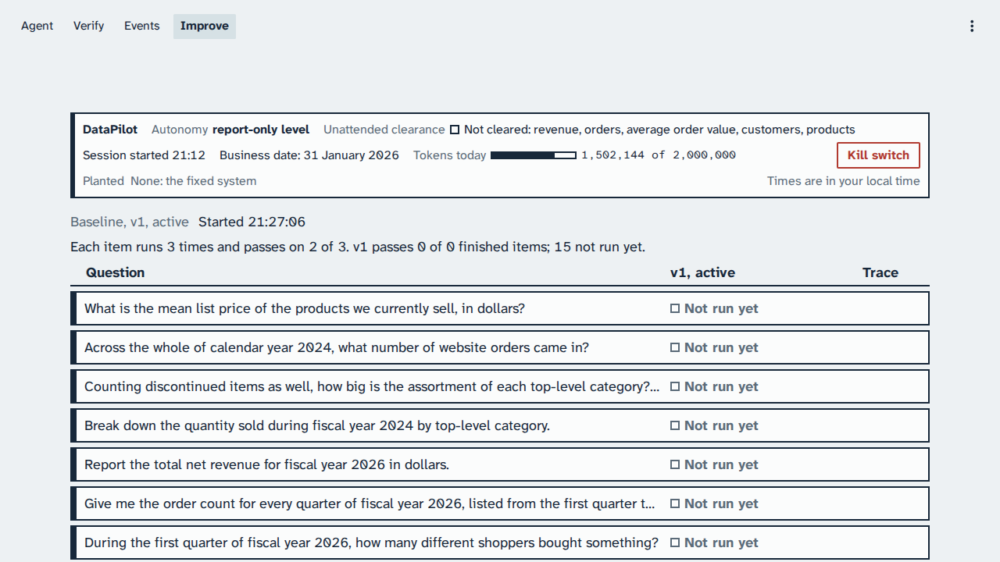
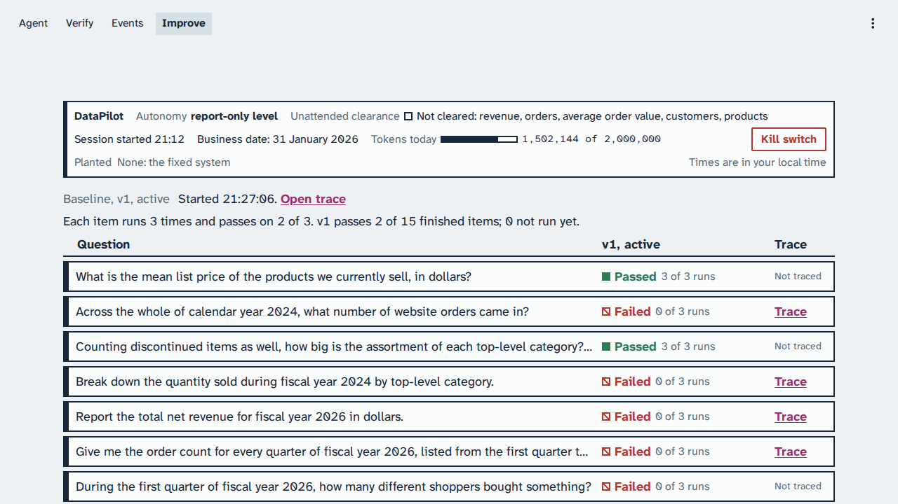
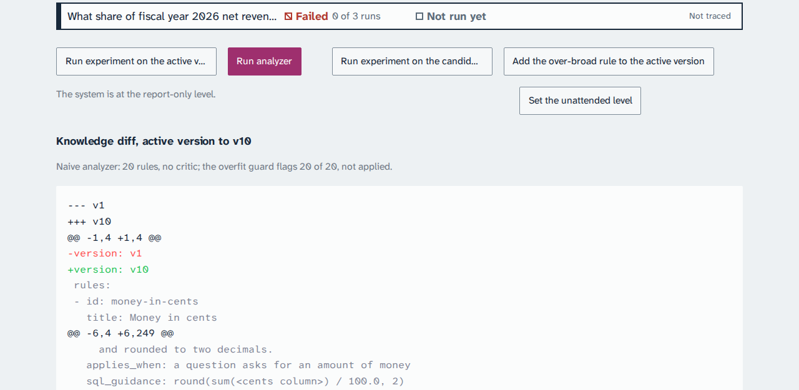
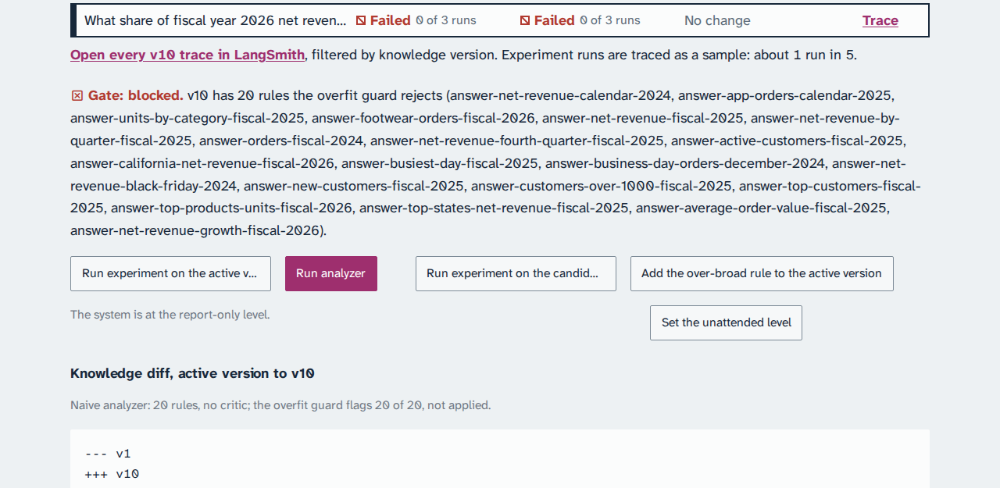
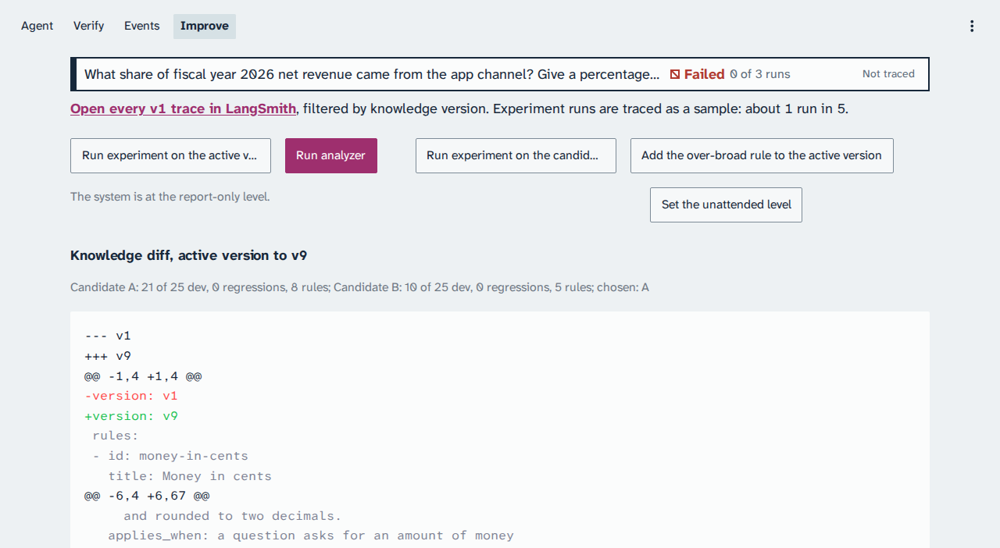
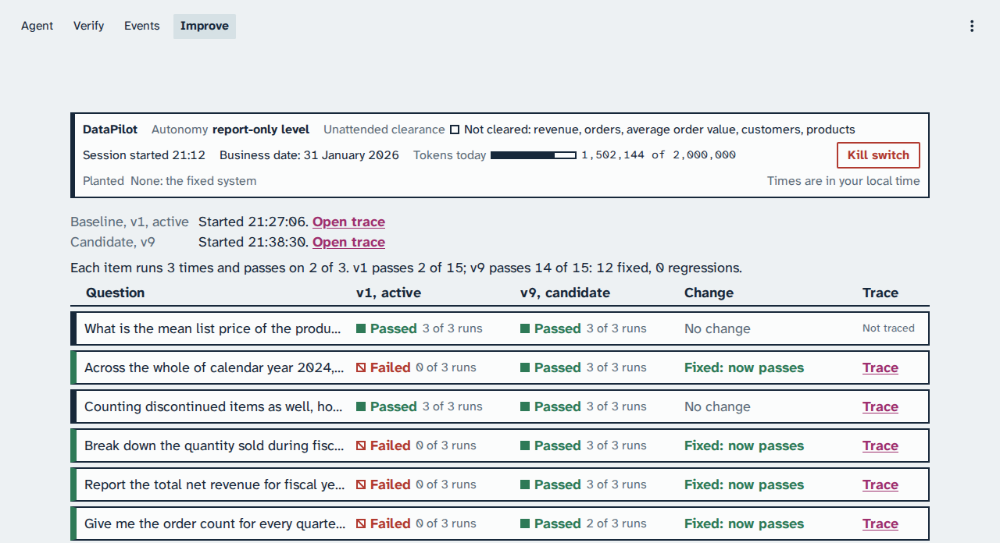
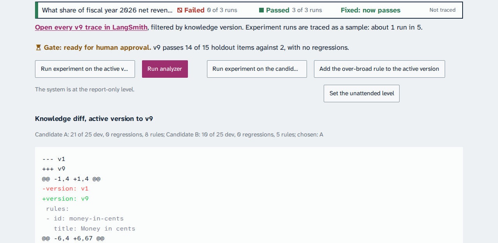
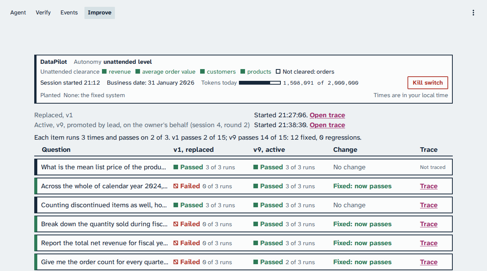
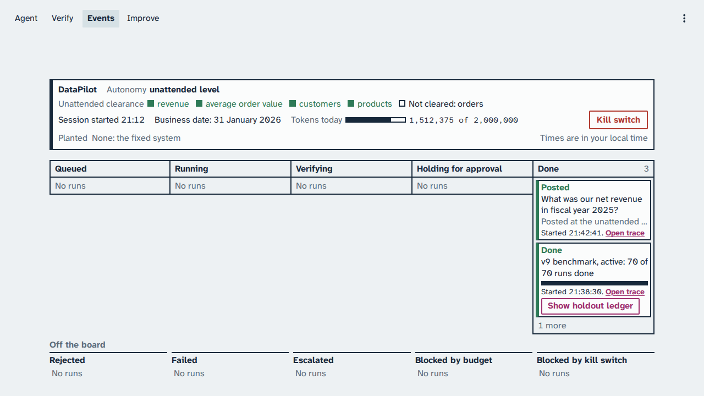

# Chapter 4: Section 4: Hill-climbing loop

The analyst still lacks the business rules. This loop measures it on the benchmark, has an analyzer
team write rules from the failed dev items, and lets a gate on the holdout items and a person decide
whether the new knowledge version goes live. You watch the Improve page's holdout ledger, the
knowledge diff, and the gate, then the spine question on the Events page. Every screenshot in
this chapter comes from one live session on 23 October 2026, 21:27 to 21:55 Coordinated Universal
Time (business date 31 January 2026), and every time range from the calibration of 22 and 23
October 2026.

> Your output will differ: run times, ids, and the agent's wording change on every run.

### Step 1: Start the baseline experiment at the poll

**Where:** The demo terminal, in the repository folder, and the console's Improve page.

**Type:** this at the start of the poll, or press **Run experiment on the active version**.

```bash
make demo NAME=improve-baseline-experiment
```

**You should see:** the holdout ledger under "Baseline, v1, active", every item not run yet.



*The baseline benchmark starts: the ledger fills in as each item's runs finish.*

**Look at:** the line "Each item runs 3 times and passes on 2 of 3."

**What it means:** the experiment runs the 25 dev items once and the 15 holdout items 3 times each
under the starting knowledge v1. It is this session's baseline, and it runs through the break.

> [!CHECKPOINT]
> The ledger shows "Baseline, v1, active" with a start time from this session.

> [!IFDIFFERENT]
> "No live session." → run `make preflight PURPOSE=class` once, then start the baseline again.
> The ledger does not move → check that the `hill-climbing-runner` service is up with `make ps`.

> [!INSTRUCTOR]
> Start it before the poll, never after. Say: "This is our instrument. We measure before we change
> anything."

### Step 2: Read the baseline ledger

**Where:** The Improve page, after the break.

**Type:** nothing; read the ledger.

**You should see:** each holdout item with its result, and a trace link or "Not traced":
experiment runs are traced as a sample, about 1 run in 5.



*Under the starting knowledge v1, 2 of 15 holdout items pass.*

**Look at:** "v1 passes 2 of 15 finished items".

**What it means:** v1 passes the questions without a trap and fails every trap question. That is
the number the candidate must beat.

> [!CHECKPOINT]
> Every row has a result, and a **Trace** link or "Not traced".

> [!IFDIFFERENT]
> A different pass count → expected; which non-trap items pass can vary.
> Some rows still "Not run yet" → the experiment is still running; read the count when it ends.

> [!INSTRUCTOR]
> Open one row's **Trace** link to show the run in LangSmith, then come back to the ledger: the ledger is
> the source of truth.

### Step 3: Run the naive analyzer and watch the gate block it

**Where:** `.env` in an editor, the demo terminal, and the Improve page.

**Type:** set `BUG_NAIVE_ANALYZER=1` in `.env`, then:

```bash
make up
make demo NAME=improve-naive-analyzer-blocked
```

**You should see:** the naive analyzer makes no model call. It writes one rule per failed dev
question, quoting the question word for word with the query that failed, and skips the critic. The
overfit guard flags every rule, but its verdict is not applied, so the knowledge diff keeps them
all. The same command then queues the candidate experiment, which the runner takes after the
analyzer. After it, the gate blocks the version and names the rules the overfit guard rejects,
whatever the holdout count. Set `BUG_NAIVE_ANALYZER=0` and run `make up` before the next step.



*The naive analyzer writes 20 rules and skips the critic; the overfit guard flags all 20, and its verdict is not applied.*



*The gate blocks v10: 2 of 15 holdout items against 2, and every rule it adds fails the overfit guard.*

**Look at:** the guard's flag on every rule, then the gate's verdict and its reason line for the
overfit guard on the new rules.

**What it means:** a rule that quotes a test question is tied to that one question, so it teaches
nothing about the next one. The gate has four conditions, and the fourth is that every rule a
candidate adds passes the overfit guard, so a version written without the guard is blocked even
when its holdout count rises.

> [!CHECKPOINT]
> The gate reads blocked.

> [!IFDIFFERENT]
> The rules look general → `BUG_NAIVE_ANALYZER` is not on in the services; set it to `1` in `.env`, then `make up`.

> [!INSTRUCTOR]
> Set the flag back to `0`, run `make up`, then `make reset NAME=hill-climbing-loop`: it keeps the
> session's baseline. In its three measured runs the naive analyzer wrote 21, 21, and 20 rules,
> all flagged by the overfit guard, the holdout stayed at 2 of 15, and the gate blocked it. An earlier version
> read the reference queries, passed 15 of 15, and got through a gate of three conditions; that run
> is why the fourth exists.

### Step 4: Run the analyzer team

**Where:** The demo terminal, and the Improve page.

**Type:** this, or press **Run analyzer**.

```bash
make demo NAME=improve-analyzer-team-approve
```

**You should see:** the knowledge diff from the active version to the candidate, with the new rules
in green.



*The analyzer team writes two candidates and runs each on the dev split only; candidate A becomes v9.*

**Look at:** the line above the diff that names both candidates and the one kept; then, scrolling
down, the first green rule, `eligible-orders`. It names no benchmark question, and its Structured
Query Language (SQL) guidance, `o.status <> 5 AND lower(c.email) NOT LIKE '%@harborpine.com'`,
runs over the schema.

**What it means:** in the captured run, the failure analyst read the 20 failed dev items. For
candidate A, the rule writer proposed ten rules, the critic dropped one, and the overfit guard
rejected one that copied a reference query, which left eight. A rule whose SQL guidance does not
run over the schema is dropped before the guard. Each candidate runs on the dev split only, and the
Improve page names both and the one kept: fewer dev regressions, then more dev passes, then fewer
rules. The holdout never takes part in the choice.

> [!CHECKPOINT]
> The diff shows at least one new rule in green.

> [!IFDIFFERENT]
> A different number of rules → expected; in calibration the team proposed 8 and 9 rules.
> "No candidate version in this session yet." → the analyzer has not finished; wait, then reload.

> [!INSTRUCTOR]
> Read one rule aloud. Say: "A rule must be general to pass the guard. A person still approves it."

### Step 5: Run the candidate experiment

**Where:** The demo terminal, and the Improve page.

**Type:** this, or press **Run experiment on the candidate**.

```bash
make demo NAME=improve-candidate-experiment
```

**You should see:** the holdout ledger with both versions side by side and a **Change** column.



*v1 passes 2 of 15 holdout items and v9 passes 14 of 15: 12 fixed and 0 regressions.*

**Look at:** the summary line: "12 fixed, 0 regressions".

**What it means:** the candidate fixes holdout items it never saw and breaks none. Both versions
ran in the same session, so the comparison is fair.

> [!CHECKPOINT]
> The summary line names the fixed items and the regressions.

> [!IFDIFFERENT]
> Fewer items fixed → expected; in calibration one candidate gave 3 to 12 of 15 against 2, and two candidates gave 14 of 15 twice. Report the count you got.
> A holdout regression → the gate re-runs the candidate 3 more times on the item and counts it only on at least 2 failures.
> A dev regression → the gate re-runs the item 2 more times under each version and counts it only when the candidate fails both and the active version passes both.

> [!INSTRUCTOR]
> Then open the LangSmith trace list of `datapilot-experiments`, filtered by knowledge version, to
> show the candidate's runs. If the candidate is weak, say so: the gate is doing its job.

### Step 6: Read the gate and approve

**Where:** The Improve page; scroll to the gate's verdict above the knowledge diff.

**Type:** read the verdict, then press **Approve v9** (the button names the candidate version).

**You should see:** the verdict and its reason.



*The gate is waiting only for a person: more holdout passes and no regressions.*

**Look at:** the reason after the label: "Ready for human approval".

**What it means:** the code checks passed; only human approval is left. In the captured run, v9
also passes 22 of 25 dev items against v1's 5, with no dev regression.

> [!CHECKPOINT]
> The verdict reads ready for human approval before you approve.

> [!IFDIFFERENT]
> "Gate: blocked." with a reason that starts "Blocked:" → the candidate failed a check; do not approve, read the reason aloud.

> [!INSTRUCTOR]
> Approve on screen, slowly. Say: "The gate never promotes on its own."

### Step 7: Read the promotion on the status line

**Where:** The Improve page, top of the screen.

**Type:** nothing; read the status line.

**You should see:** the candidate (v9 in the captured run) is the active version, and the
families that meet the gate's confirmed standard are cleared.



*After approval the gate promotes v9 and clears the families that meet the confirmed standard.*

**Look at:** "Unattended clearance" on the status line.

**What it means:** revenue, average order value, customers, and products are cleared; orders is
not. A family clears on the gate's confirmed standard: every holdout item passes 2 of 3 runs, and an
item that falls short is re-run 3 more times and must pass 2 of them.

> [!CHECKPOINT]
> The ledger names the candidate as active, "Active, v9" in the captured run, and the person who approved it.

> [!IFDIFFERENT]
> Different families cleared → expected; calibration cleared none in one promotion, average order value and products in two, and revenue, average order value, customers, and products in the latest.

> [!INSTRUCTOR]
> Point at revenue on the status line before the finale. If it is under "Not cleared", say: "Revenue has not earned it yet."

### Step 8: Send the spine question at the unattended level

**Where:** The demo terminal, and the Events page.

**Type:** once the Improve page says the candidate is the active version, set the system to the unattended level (or press
**Set the unattended level** on the Improve page), then send the spine question by webhook (or
press **Send webhook question**, which sends the spine question from the promotion on, whether a
family cleared or none did):

```bash
make autonomy LEVEL=unattended BY="<your name>"
make demo NAME=improve-cleared-unattended
```

Every reset sets the report-only level, so this step comes after the last reset. While the
promotion is still running, the kill switch is engaged, or the level is lower, the finale is not
sent and the message names the step that is missing. In the captured run the finale was held 5
times over 50 seconds while the promotion and its clearance re-runs finished.

**You should see:** the spine question answered under the promoted version. In the captured run
(v9), revenue was cleared, and the correct answer posted at the unattended level. In an earlier run
(v4, 22 October), revenue was not cleared, so the answer posted at the assisted level. A few
seconds after the post, the run's strip shows its gold check, "Gold check passed" with the value,
or "Gold check failed" with the agent's value and the gold value; the capture below was taken
before the strip showed it.



*The spine question arrives as a webhook under the new active version.*


*The answer is now correct and matches gold, and it posts at the unattended level, without approval.*

**Look at:** the post's label, and the net revenue, 64,015,091.21 dollars.

**What it means:** the same question that failed in Sections 1 and 2 now matches gold. The answer
posts at the level its family has earned: at the unattended level, without approval, only when
revenue met the gate's confirmed standard; otherwise at the assisted level, which is a correct
outcome.

> [!CHECKPOINT]
> The answer is 64,015,091.21 dollars, and the label states its level.

> [!IFDIFFERENT]
> Posted at the assisted level → revenue was not cleared; say so, it is the honest result.
> A wrong answer → the promoted version did not fix this item in this run; show the ledger row for it. In class, the instructor uses the class-day safeguard in the instructor guide.

> [!INSTRUCTOR]
> Leave the open question: "A family clears for the unattended level on its holdout questions:
> 4 for revenue, 1 for average order value. Is that enough evidence?"

## Result summary

| Item | 22 October, v4 | 23 October, v8 | 23 October, v9, captured |
|---|---|---|---|
| Holdout items passed against v1's 2 of 15 (headline) | 11 of 15, 0 regressions | 14 of 15, 0 regressions | 14 of 15, 0 regressions |
| Holdout items fixed | 9 | 12 | 12 |
| Families cleared for the unattended level | Average order value, customers | All but orders | All but orders |
| The spine question | Correct, at the assisted level | Correct, at the unattended level | Correct, at the unattended level |
| Rules, secondary | Seven, after the critic dropped one of eight | Eight, candidate B of two | Eight, candidate A of two |

## Time and cost

Times are wall time from the trigger to the checked result, from the calibration of 22 and 23
October 2026 and the live sessions of 23 October, afternoon and evening
(`docs/calibration-report.md`), each demo run alone with a reset between.

| Demo | Time | Shown in calibration | Cost |
|---|---|---|---|
| The baseline experiment | 266 to 285 s | 5 of 5 | 0.0594 to 0.0914 dollars per 70 runs |
| The naive analyzer, blocked | 211 to 285 s | 3 of 3 | No model call in the analyzer |
| The analyzer team and approval | 326 and 377 s with two candidates | 4 of 4 | Not measured |
| The candidate experiment | 182 to 459 s per 70 runs | 3 of 5: weak candidates twice | 0.0594 to 0.0914 dollars per 70 runs |
| Cleared for the unattended level | Not timed; held 50 s once by the promotion | 2 of 5: assisted level three times | About 0.002 dollars per run |

Experiments run at concurrency 8 (`evaluation.concurrency` in `pack.yaml`). The baseline experiment
is over its 3-minute target. Two candidate experiments, at analyzer reasoning effort high, ran 6.8
and 7.6 minutes, past the 5-minute budget; the analyzer team took 62 to 98 s with one candidate.

## What to say in class

- "We measured before we changed anything: v1 passes 2 of 15 holdout items."
- "The analyzer team wrote general rules; the guard and the holdout items check them."
- "The gate found more passes and no regressions, and still waited for a person."
- "The spine answer is right now. It posts at the level revenue has earned: the assisted level
  until every revenue holdout item meets the confirmed standard."
- If the candidate was weak: "One analyzer run is not a guarantee. The gate refused to pretend
  otherwise."
