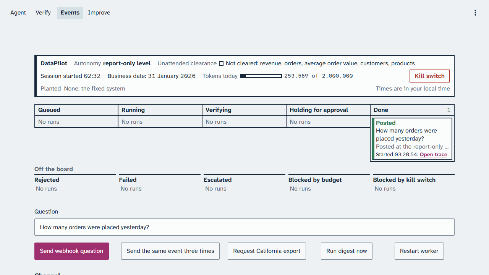

# Part 0: Before you start

Part 0 gets the class machine ready: the services up, the warehouse checked, every section reset,
a class session started with its drift canary, and the console on screen. Run it thirty minutes
before class, in order. The first time on a machine, finish the [setup pages](../setup/README.md)
first; they include the install and the first live demo.

## What you need

- A set-up copy of the repository, with your two keys in `.env`: the OpenAI key from the operations
  team and your own LangSmith key. Never paste a key into a terminal, a document, or a chat.
- The display the class sees. Present the console in full screen (F11): the run board is laid out
  for a page of 1280 by 720 pixels (`platform/console/DESIGN.md`).
- Two terminals in the repository folder: the stack terminal, for the services, and the demo
  terminal, for every `make demo` and `make reset`. The chapters name them.

> Your output will differ: run times, ids, and the agent's wording change on every run.

### Step 1: Start the services

**Where:** The stack terminal, in the repository folder.

**Type:**

```bash
make up
make ps
```

**You should see:** the image build, then the containers starting. `make ps` on the course machine:

```text
NAME                    IMAGE                    COMMAND                  SERVICE     CREATED          STATUS                    PORTS
datapilot-api-1         datapilot:local          "uvicorn datapilot.l…"   api         32 minutes ago   Up 31 minutes (healthy)   0.0.0.0:8000->8000/tcp, [::]:8000->8000/tcp
datapilot-console-1     datapilot:local          "streamlit run app.p…"   console     32 minutes ago   Up 31 minutes             0.0.0.0:8501->8501/tcp, [::]:8501->8501/tcp
datapilot-postgres-1    postgres:18.6-bookworm   "docker-entrypoint.s…"   postgres    40 minutes ago   Up 40 minutes (healthy)   0.0.0.0:5432->5432/tcp, [::]:5432->5432/tcp
datapilot-scheduler-1   datapilot:local          "datapilot scheduler"    scheduler   32 minutes ago   Up 31 minutes
datapilot-worker-1      datapilot:local          "datapilot worker"       worker      32 minutes ago   Up 31 minutes
```

<!-- capture: make ps on the class machine with the hill-climbing-runner service listed -->

**Look at:** the STATUS column.

**What it means:** every service is up, and `api` and `postgres` passed their health checks.

> [!CHECKPOINT]
> Every service shows `Up`, and `api` and `postgres` show `(healthy)`.

> [!IFDIFFERENT]
> `Cannot connect to the Docker daemon` → start Docker (`sudo systemctl start docker` in Ubuntu), then `make up`.
> A service keeps restarting → `make logs NAME=<service>` shows why.

> [!INSTRUCTOR]
> Do this before learners join. If a service is down later in class, `make up` again: the queue and
> pending approvals survive in Postgres.

### Step 2: Check the warehouse

**Where:** The stack terminal.

**Type:**

```bash
make check-data
```

**You should see:** one line per warehouse with its row counts and content hash. The last line on
the course machine:

```text
check-data: both warehouses match expected.yaml
```

**Look at:** that last line.

**What it means:** both warehouses hold exactly the seeded data the benchmark's gold queries expect.

> [!CHECKPOINT]
> The last line matches, with no `x` line before it.

> [!IFDIFFERENT]
> An `x` line names a table → run `make seed`, then `make check-data` again.

> [!INSTRUCTOR]
> No model call yet: nothing so far costs anything.

### Step 3: Reset every section

**Where:** The demo terminal.

**Type:**

```bash
make reset NAME=agent-loop
make reset NAME=verification-loop
make reset NAME=event-loop
make reset NAME=hill-climbing-loop
```

**You should see:** one confirmation per section. The hill-climbing reset says what it kept.

<!-- capture: the terminal output of the four resets on the class machine -->

**Look at:** the last line of each reset.

**What it means:** each section's live run state is cleared and the kill switch is released.
Planted bugs are flags in `.env`; the reset does not change them.

> [!CHECKPOINT]
> Every reset ends without an error line.

> [!IFDIFFERENT]
> A reset cannot reach the database → Step 1 again.

> [!INSTRUCTOR]
> The hill-climbing reset keeps a session's baseline experiment. Never use
> `make reset-discarding-baseline` to recover in class.

### Step 4: Start the class session

**Where:** The demo terminal.

**Type:**

```bash
make preflight PURPOSE=class
```

**You should see:** one line per check starting with `ok`, one `canary` line per question ending in
`as expected` with its trace link, and a last line that starts with `Live session started at`.

<!-- capture: the terminal output of make preflight PURPOSE=class on the class machine -->

**Look at:** the last line: the session's start time and the model id, `gpt-6-luna`.

**What it means:** the services, the warehouse, your key, and the model all work, and the drift
canary still behaves as calibration measured: three easy questions pass and two trap questions
still fail. Everything from now until the next preflight belongs to this class session.

> [!CHECKPOINT]
> The last line starts with `Live session started at` and names `gpt-6-luna`.

> [!IFDIFFERENT]
> `Your OpenAI key was not accepted. Check it with the operations team.` → the key in `.env` is missing or rejected; ask the operations team.
> `The drift canary failed: ...` → the model changed; do not teach the measured results as they are, and re-run calibration.

> [!INSTRUCTOR]
> Run preflight once. Never run it again during class: a new session orphans the class baseline.
> The canary makes five live model calls.

### Step 5: Put the console on screen

**Where:** The browser, at http://localhost:8501.

**Type:** open the Events page, then press F11 for full screen.

**You should see:** the status line above the run board.



*The status line in class: report-only level, business date 31 January 2026, and no planted bug; this capture already holds one posted run.*

**Look at:** "Planted None: the fixed system" and "Business date: 31 January 2026".

**What it means:** every demo starts from the fixed system, at the report-only level, on the
course's business date. Times on the console are in your local time.

> [!CHECKPOINT]
> The status line, all five lanes, and the off-the-board row fit on the screen without scrolling.

> [!IFDIFFERENT]
> The console is blank → `make ps`; if the console service is up, try http://127.0.0.1:8501.
> "No live session." → Step 4.

> [!INSTRUCTOR]
> Keep the terminals and the editor in separate windows, and share only the console window.
