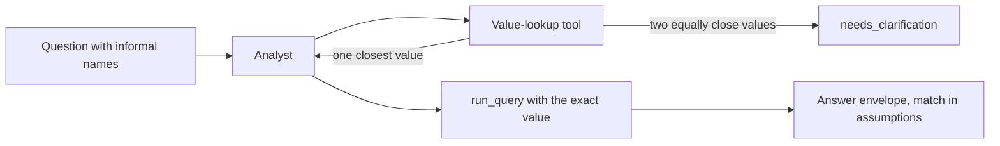

# Module: Loop Engineering - Assignment 1: Agent loop

Try it yourself first. The full solution is published at the start of the Thursday review.

> **Deadline:** the date your instructor announces in the class chat.

## The problem

**Illustrative scenario.** A merchandiser at Harbor & Pine Outfitters asks DataPilot for the list
price of a trail runner, and she misspells the product line. The analyst filters on the words she
typed, finds no rows, and answers with a confident "no such product". She drops the product from
the next promotion.

**In class.** Section 1: Agent loop showed the analyst giving correct answers only when a question
used the exact values stored in the warehouse. The simple question and the confident wrong answer
both relied on names read straight from the schema and the sample rows. This assignment closes
that gap for product and category names.

> **Terms on this page**
>
> - **Agent loop**: The model calls tools, reads the results, and repeats until it answers.
> - **Answer envelope**: The structured result of a run: status, the query, rows, and answer text.
> - **Extension point**: A marked place in the class system where this assignment's code goes.
> - **Live check**: The command that runs the done-when scenario against the real stack and the
>   real model, and reports PASS or FAIL per requirement.
>
> All terms: [glossary](../../docs/glossary.md).

## What you'll build

You add a value-lookup tool that maps informal or misspelled product and category wording to the
exact values stored in the warehouse. The analyst calls it before it filters on a name, as part of
its working method. Every match it used goes into the answer envelope's `assumptions`, so a reader
sees which exact value stood in for the question's words. When two stored values are equally
close, such as the two near-identical backpack names in the catalog, the analyst asks instead of
guessing.

The starter is the complete class system. Your code goes in one file,
`platform/src/datapilot/loop1_agent/extension.py`, at four marked extension points; the class
system already calls each one, and each does nothing until you fill it in.

**Done when** `make check-assignment NAME=agent-loop` prints PASS on every line: the lookup itself
against the real warehouse, then three questions with informal or misspelled names that answer
correctly with the lookup before the query, and one question with two equally close names that
ends with a clarifying question. The last four run live through the event loop on the real model.

Estimated effort: about 1.5 hours.

**Cost of one full check:** at most 12 analyst runs: 2 runs of each of the 4 live questions, and a
third run only for a question whose first two runs disagree. The check prints its own estimate
before the first model call and the actual tokens and cost at the end. Measured on gpt-6-luna
in the course's clean verification runs, one full check of a working solution typically cost
about 0.4 cents; the measured checks are in the costs table linked below. On the check that
ships, with requirement 6 running the lookup while the other roles' database addresses point at a
closed port, on 25 October 2026 from 22:35 Coordinated Universal Time (UTC), the starter failed
all 11 requirements, as it must, and the reference and both alternatives each passed all 11 in two
checks in a row (6 checks of 6), at 0.39 to 0.47 cents a check ([evidence](../../docs/evidence/general.md#captures)). At the caps,
with every run using its whole token budget at the output price, one check can cost at most 36
cents, below the check's own spend cap of 1.00 dollar, at which any check stops cleanly
([costs](../../docs/costs.md#assignments)).

## Step by step

1. With your OpenAI key in `.env` ([setup](../../setup/README.md)), run the live check on the
   unchanged starter: `make check-assignment NAME=agent-loop`. The check builds, starts, and seeds a
   stack of its own, the Compose project `datapilot-assignments`, so it needs no `make up` or
   `make seed` (those are for the class stack and its demos). Check: requirements 1 to 7 read FAIL, each saying which
   extension point to fill, and the live requirements say they did not run.
2. Read [starter/README.md](starter/README.md) and open `extension.py`. Check: you can name the
   hook the tool list calls, the prompt step, and the hook that edits the answer envelope.
3. Write `lookup_values` at `agent-loop-1`. Read the stored names through `warehouse.url`, the
   read-only agent role; score each against the wording; return at most `MAX_CANDIDATES`; and mark
   a tie when the top two are equally close. Check: requirements 1 to 6 read PASS.
4. Return the tool from `lookup_tools` at `agent-loop-2`, named `find_exact_values`, with the
   arguments `kind` and `wording`, appending every lookup to the run's log. Check: requirement 7
   reads PASS once step 5 is done too.
5. Write the working-method step at `agent-loop-3`: look a name up before filtering on it, filter
   on the exact value, and ask when the tool reports a tie. Check: requirement 7 reads PASS.
6. Record each match at `agent-loop-4`, in `with_matches`, and decide what happens to an answer
   that rests on a tie. Check: run the whole check again; requirements 8 to 11 run live and read
   PASS, each with its trace link and live stamp.

## Grading criteria (100 points)

This rubric is for assessing your own work. Nobody grades it.

| Criterion | What earns the points | Points | How you check it |
|---|---|---|---|
| Exact product match | Misspelled and informal product wording resolve to the stored name | 20 | Check lines 1 and 2 |
| Category match | Informal category wording resolves the same way | 10 | Check line 3 |
| Ask, do not guess | Two equally close names come back as a tie | 10 | Check line 4 |
| Bounded, read-only | A short list of stored values, read through the agent role | 10 | Check lines 5 and 6 |
| Working method | The tool is registered and the prompt says when to call it | 10 | Check line 7 |
| Live answers | Three live questions answer correctly with the lookup first | 30 | Check lines 8 to 10 |
| Live clarification | The tie question ends in needs_clarification naming both | 10 | Check line 11 |
| Total | | 100 | |

Every requirement and its pass rule is in [SPEC.md](SPEC.md).

## Solution walkthrough

The reference solution, two alternatives, and their `SOLUTION.md` are published at the start of
the Thursday review. The block for this assignment is in
[the review session](../../docs/review-session.md): the live check of the reference solution, three
or four code excerpts, and the two alternatives with their trade-offs.
