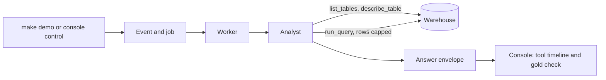

# Module: Loop Engineering - Demos for Section 1: Agent loop

## The problem

**Illustrative scenario.** The finance manager's question from the
[section page](../README.md#the-problem) comes back with a confident wrong number. Later someone
asks for a long list, and the analyst pulls every row into its context before it answers.

These demos put both failures in front of a live run. The fiscal year 2025 revenue question runs
under version 1 of the knowledge (the starting version), which states only the money rule, so the
traps in the seeded data decide the answer.
The unbounded rows demo sends a Structured Query Language (SQL) query that returns far more rows
than the model needs.

> **Terms on this page**
>
> - **Agent loop**: The model calls tools, reads the results, and repeats until it answers.
> - **Trap**: A business rule the schema does not reveal, so a plausible query gets it wrong.
> - **Gold SQL**: The query an analyst wrote by hand that gives the right answer.
> - **Answer envelope**: The structured result of a run: status, SQL, rows, and answer text.
> - **Knowledge version**: A numbered set of business rules given to the agent in its prompt.
> - **Planted bug**: A defect switched on by a flag so a demo shows its failure every time.
>
> All terms: [glossary](../../docs/glossary.md).

## What you'll see

Each demo is one real run of the analyst against the warehouse, with real model calls traced to
LangSmith. The analyst writes SQL, runs it through `run_query`, and
returns an answer envelope that the console shows with its SQL, tokens, cost, and trace link.

Times and cost, measured live on 22 and 23 October 2026: the simple question 14 to 39 seconds, the
confident wrong answer 37 to 76 seconds, and about 0.001 dollars per analyst run. On the code
of 24 October 2026, measured live once that day: the simple question 16 seconds, the confident
wrong answer 50 seconds, and the unbounded rows demo 33 seconds fixed and 12 seconds planted. The
runs are on the [evidence page](../../docs/evidence/section-1-agent-loop.md#results), and `run.sh`
states the most a run can cost at the caps in `platform/packs/datapilot_us/pack.yaml`.



## Run it

Finish the [setup pages](../../setup/README.md) first, including the
[pre-class checks](../../setup/pre-class.md). Then start the services, confirm the data, and open
a live session in a terminal at the repository root:

```bash
make up
make check-data
make preflight PURPOSE=development
```

Every run belongs to a live session, which `make preflight` opens; with none open, a demo fails
with "No live session is open". Preflight first asks five questions that show the model still
behaves as the course measured it, one agent run each. In class the instructor runs
`make preflight PURPOSE=class` instead.

Open the console at http://localhost:8501 on the Agent page. Run every core demo of this section
from the same terminal, one at a time, with:

```bash
bash section-1-agent-loop/demo/run.sh
```

Add `--optional` to run Texas last quarter after the core demos, or name one demo to run it alone.
Each `make demo` prints the run ids it started; the run itself shows up in the console.

The unbounded rows demo runs twice: once with the planted bug on and once with it off.
`make demo NAME=agent-unbounded-rows PLANTED=1` switches `BUG_UNBOUNDED_ROWS` on for that run
alone; then `make demo NAME=agent-unbounded-rows` runs the fixed half. `.env` never changes.

<!-- generated:demo-table -->
| Demo | Tier | Run it | Target minutes |
|---|---|---|---|
| The simple question | core | `make demo NAME=agent-simple-question` | 3 |
| Texas last quarter | optional | `make demo NAME=agent-texas-last-quarter` | 4 |
| The confident wrong answer | core | `make demo NAME=agent-confident-wrong-answer` | 5 |
| Unbounded rows | core | `make demo NAME=agent-unbounded-rows` | 4 |

Each demo also runs from the console (Agent > Ask; Agent > Ask; Agent > Ask the spine question; Agent > Run large query).
Recovery for every demo in Section 1: Agent loop: `make reset NAME=agent-loop`, then the same
trigger again. The target minutes are the class plan's, from `platform/demos/registry.yaml`, not
measured times.
<!-- /generated:demo-table -->

### Files and links

- [run.sh](run.sh): the launcher; its header states what it runs, the caps, and the target minutes
- [walkthrough.md](walkthrough.md): the code behind these demos, explained
- [Version 1 of the knowledge](../../platform/packs/datapilot_us/knowledge/v1.yaml): the near-empty rules
- [The analyst's prompt](../../platform/src/datapilot/loop1_agent/prompts.py)
- [The row cap and call limits](../../platform/packs/datapilot_us/pack.yaml): `limits` and `budgets`
- [expected/](expected/): real output from a real run, for comparison after class, never in class
- [Evidence page](../../docs/evidence/section-1-agent-loop.md): the measured runs

## What to watch

| Step | Screen | What appears |
|---|---|---|
| The simple question | Agent page | The tool timeline: each call with its duration |
| The confident wrong answer | Agent page | The answer-versus-gold ledger and the annotated SQL |
| Unbounded rows | Agent page | The token counter, with the bug on and then off |

Each demo's entry below comes from the demo registry: how to start it, what guarantees its moment,
and what may differ from run to run.

<!-- generated:demo-runbook -->
### The simple question

- **Tier**: core
- **Start it**: Agent > Ask in the console, or `make demo NAME=agent-simple-question`
- **What appears**: The analyst lists tables, describes one, runs one query, and returns an answer envelope with the SQL and the result; the tool timeline shows each call with its duration.
- **Expected live outcome**: A correct count with its SQL, tokens, cost, and a LangSmith link.
- **What can vary**: the analyst's wording; number of tool calls; latency; tokens
- **Recovery**: `make reset NAME=agent-loop`, then the same trigger again

### Texas last quarter

- **Tier**: optional, cut first when the section runs late
- **Start it**: Agent > Ask in the console, or `make demo NAME=agent-texas-last-quarter`
- **What appears**: A multi-join question across orders, order items, products, and categories for customers in Texas over the last completed fiscal quarter (August to October 2025, against the business date of 31 January 2026), with the join path visible in the SQL.
- **Expected live outcome**: An answer whose SQL joins four tables. No benchmark question asks this question, so the run gets no gold check; the date range in the SQL shows whether the fiscal-quarter trap is hit.
- **What can vary**: join order; whether the fiscal-quarter trap is hit; latency
- **Recovery**: `make reset NAME=agent-loop`, then the same trigger again

### The confident wrong answer

- **Tier**: core
- **Start it**: Agent > Ask the spine question in the console, or `make demo NAME=agent-confident-wrong-answer`
- **Guaranteed by**: the near-empty version 1 of the knowledge (the starting version); the tempting total_cents column; the undocumented order status codes; the five traps in the seeded data
- **What appears**: Under version 1 of the knowledge (the starting version), the fiscal year 2025 revenue question, "What was our net revenue in fiscal year 2025?", gets a confident, wrong answer; the answer-versus-gold ledger shows the mismatch and the annotated SQL names each trap behind the wrong fragments.
- **Expected live outcome**: A mismatch against gold with at least one trap annotation on the SQL.
- **What can vary**: which traps the SQL hits; the wrong value; wording; held for approval by a reviewer concern (leave it held: the gold check still shows); no number, so no gold check: reset Section 1 and ask again
- **Recovery**: `make reset NAME=agent-loop`, then the same trigger again

### Unbounded rows

- **Tier**: core
- **Start it**: Agent > Run large query in the console, or `make demo NAME=agent-unbounded-rows`
- **Guaranteed by**: the unbounded rows bug (`BUG_UNBOUNDED_ROWS`)
- **What appears**: With the unbounded rows bug on, a 10,000-row SELECT goes through run_query and a list question follows; the token counter spikes. With it off, the same steps return at most the row cap, the total count, and a truncation notice.
- **Expected live outcome**: Tokens per run jump with the bug on and drop back with it off.
- **What can vary**: exact token counts; the list question's wording; whether the run with the bug off ends held for approval by a reviewer concern; the token counter is the moment either way
- **Recovery**: `make reset NAME=agent-loop`, then the same trigger again
<!-- /generated:demo-runbook -->

## What the result means

A correct count on the simple question shows the loop itself works: tool choice, SQL, and the
answer envelope. A mismatch on the fiscal year 2025 revenue question is the expected result under
version 1. It shows that better tools do not supply business rules. That is why
[Section 2: Verification loop](../../section-2-verification-loop/README.md) adds checks, and why
only the rules learned in Section 4: Hill-climbing loop fix the number.

If the fiscal year 2025 revenue question comes back correct, the model solved the traps unaided on
this run. Report it as it is; the gold check, not the answer's wording, is the verdict. One run
shows what one model did once; the evidence page counts several.

With the unbounded rows bug on, the token counter jumps because every row reaches the model. With it
off, the model sees at most the row cap (`limits.row_cap` in `pack.yaml`), the total count, and a
truncation notice.

## If it fails

| What you see | Why | What to do |
|---|---|---|
| `run.sh` says the services do not answer | The services are not running | `make up`, then `make ps` until every service is healthy |
| The run stays in Queued | The worker is not running or is restarting | `make ps`; `make logs NAME=worker` for the reason |
| The run ends escalated with a token limit | The run reached `budgets.tokens_per_run` | Reset and run it again; the cap is the designed stop |
| The token counter does not move with the bug on | The run was sent without `PLANTED=1` | `make demo NAME=agent-unbounded-rows PLANTED=1` |
| The run with the bug off ends in Holding for approval | A reviewer concern, as twice in calibration | Nothing: point at its token counter, the moment |
| Anything else | A stale run or an engaged kill switch | `make reset NAME=agent-loop`, then the same trigger again |
