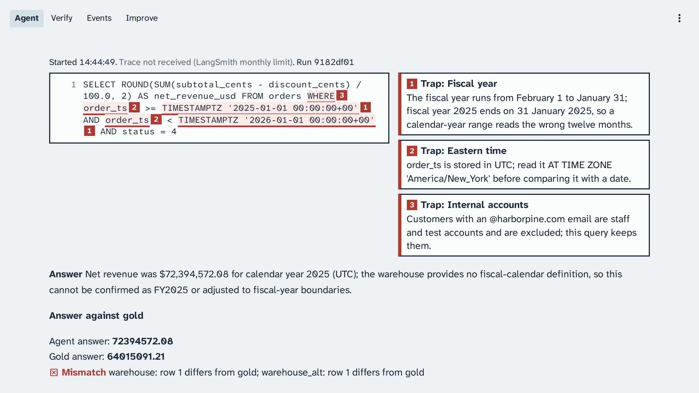
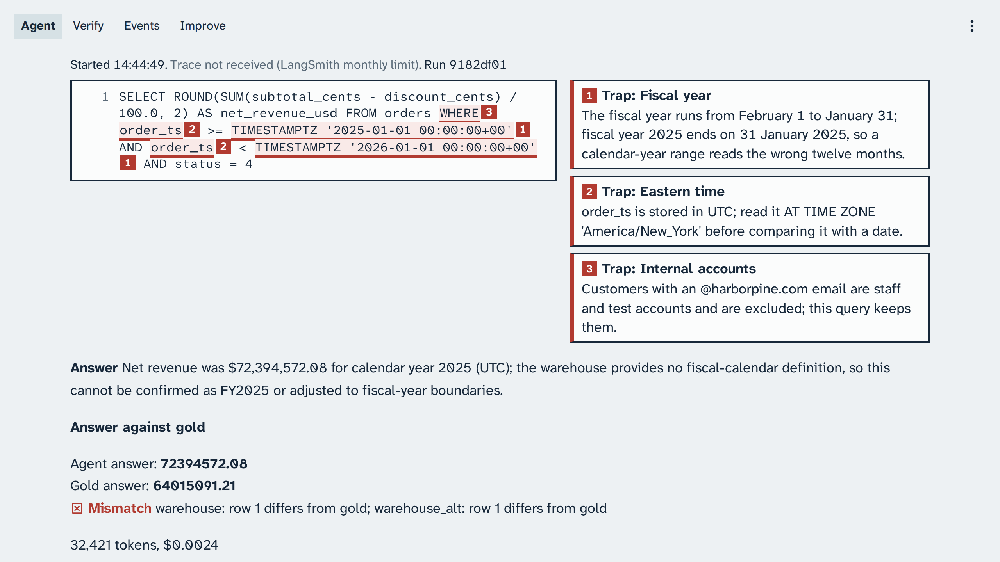
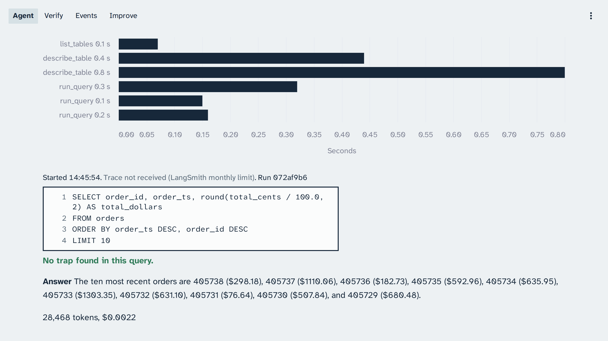
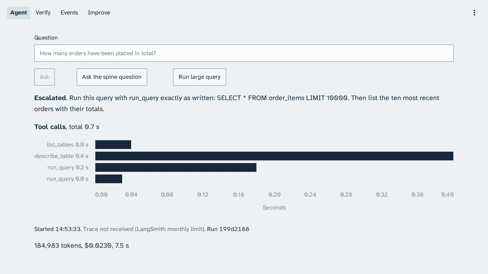

# Module: Loop Engineering - Expected output for Section 1: Agent loop

Real captures from live runs on 25 October 2026, from 14:43 Coordinated Universal Time (business
date 31 January 2026), in rehearsal session c18bcc2e, for comparison after class, sent with every
planted bug off and the starting knowledge v1, except the planted half of the unbounded rows demo.
They are never shown in class: in class, every demo runs live. Times on the captures are in
Coordinated Universal Time (UTC); the console shows your own local time. LangSmith refused traces
at its monthly limit, so each capture reads "Trace not received" and names its run id instead of a
trace link.

Your output will differ: run times, ids, and the agent's wording change on every run.

## The simple question

*Run 87a06dba, 25 October 2026: the analyst lists the tables, describes one, and runs one query; the run is posted with a correct count.*

The run's answer, from its record: "A total of 405738 orders have been placed.", with the
Structured Query Language (SQL) query `SELECT COUNT(*) AS total_orders FROM orders;`, 5,151 tokens,
0.0005 dollars, and 16.2 seconds. The detail of an earlier run of the same demo (run 3246b3e9, 22
October 2026) as text (question, SQL, answer, tokens, and trace) is in
[agent-simple-question-terminal.txt](agent-simple-question-terminal.txt). It is not terminal
output: `make demo NAME=agent-simple-question` prints only the run's id, and you read the answer on
the console.

Trace: run 87a06dba

## The confident wrong answer

*Run 9182df01, 25 October 2026: under the starting knowledge v1 the run holds for a person's approval; the schema scout takes 11.1 of the 20.3 seconds of tool time.*

The spine question is "What was our net revenue in fiscal year 2025?". The reviewer raised a
concern twice, first that "The query assumes fiscal year 2025 is the calendar year 2025, but no
fiscal-year definition or start month is provided.", so the run holds for approval. The run took 3
attempts. Its answer is one number, 72,394,572.08 dollars, which it says is for calendar year 2025
in UTC, because the warehouse defines no fiscal calendar.

*Run 9182df01, 25 October 2026: the query reads calendar year 2025 in UTC and keeps the staff accounts; each of the three trap notes has its mark.*

What the frame shows: mark 1 (fiscal year) after both calendar-year bounds, mark 2 (Eastern time)
on both `order_ts` comparisons, and mark 3 (internal accounts) on `WHERE`. The query keeps
`status = 4` only, which leaves out cancelled orders (status 5), so that filter has no mark.

*Run 9182df01, 25 October 2026: the gold check fails on warehouse and warehouse_alt; row 1 differs from gold on both.*

Trace: run 9182df01

## Unbounded rows

*The fixed half, run 072af9b6, 25 October 2026: the same steps stay small, 28,468 tokens; the reviewer held the run with two concerns.*

*The planted half, run 199d2188, 25 October 2026: every row of the 10,000-row query reached the model, 184,983 tokens, and the run ended escalated.*

Trace: runs 072af9b6 and 199d2188
