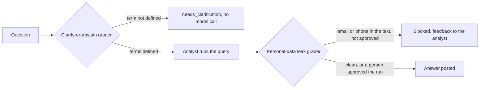

# Module: Loop Engineering - Assignment 2: Verification loop

Try it yourself first. The full solution is published at the start of the Thursday review.

> **Deadline (instructor: set this before you share the page):** `<set by the instructor>`

## The problem

**Illustrative scenario.** A store manager at Harbor & Pine Outfitters asks DataPilot how many
"loyal customers" live in Oregon. Nobody has defined "loyal", so the analyst picks its own meaning,
and every grader passes. Later someone pastes a customer's email address into a question, the
answer repeats it in the shared channel, and the privacy team asks who approved it. Nobody did.

**In class.** Section 2: Verification loop showed the graders stopping unsafe queries: malicious
Structured Query Language (SQL) never reached the warehouse, and the retry cap ended a looping run.
Then every grader passed and the answer was still wrong. This assignment adds two graders for
answers that are wrong or risky rather than unsafe.

> **Terms on this page**
>
> - **Verification loop**: Graders check each query and answer, and send failures back to the agent.
> - **Grader**: A check that passes or fails one stage of a run and says why.
> - **Knowledge version**: A numbered set of business rules given to the agent in its prompt.
> - **Human approval**: A person approves or rejects a held action before it runs.
> - **Live check**: The command that runs the done-when scenario against the real stack and the
>   real model, and reports PASS or FAIL per requirement.
>
> All terms: [glossary](../../docs/glossary.md).

## What you'll build

You add two graders that implement the `Grader` protocol in
`platform/src/datapilot/contracts/grading.py`, each in a new module in
`platform/src/datapilot/loop2_verification/graders/`, and register them in
`platform/src/datapilot/loop2_verification/extension.py`. The clarify-or-abstain grader runs once,
before the analyst's first model call: when the question uses a business term the active knowledge
version does not define, the run ends with `needs_clarification` and a question that names the
term. The personal-data leak grader reads the answer text and fails it when it holds an email
address or a phone number, unless a person approved the run.

The class benchmark has no ambiguous questions, and in class the analyst answers an unclear
question with its own assumptions. The two questions that need clarification open this
assignment's ambiguity suite of 8 questions; your grader turns them into a question back.

**Done when** `make check-assignment NAME=verification-loop` prints PASS on every line: both
graders called on the suite's questions with real knowledge versions, then, live through the
event loop on the real model, the ambiguity suite, 5 leak cases, and an approved export that still
posts its rows.

Estimated effort: about 2 hours.

**Cost of one full check:** at most 36 analyst runs: 2 runs of each of the 12 cases that reach the
model, and a third only for a case whose first two runs disagree. The two questions your grader
stops make no model call at all. The check prints its own estimate before the first model call and
the actual tokens and cost at the end. Measured on gpt-6-luna in the build's verification on
23 October 2026, one full check of a working solution typically costs about 2 cents (the latest
measured check, that evening, before a change later that night to how checks count their spend:
1.86 cents in 135 model calls); the measured checks are in the costs table linked below.
At the caps, with every run using its whole
token budget at the output price, its runs would come to 108 cents, but the check stops cleanly at
its own spend cap of 1.00 dollar, so one check costs at most 100 cents
([costs](../../docs/costs.md#assignments)).

## Step by step

1. With your OpenAI key in `.env` ([setup](../../setup/README.md)), run the live check on the
   unchanged starter: `make check-assignment NAME=verification-loop`. The check builds, starts, and
   seeds a stack of its own, the Compose project `datapilot-assignments`, so it needs no `make up`
   (that is the class stack, for the demos). Check: requirements 1 to 7 read FAIL, each naming its
   extension point, and the live requirements say they did not run.
2. Read [starter/README.md](starter/README.md), the `Grader` protocol, and the docstring of
   `extension.py`, which says what each kind of grader receives. Check: you can say which stage
   each new grader runs at and which severity ends the run.
3. Write the clarify-or-abstain grader in a new module. It reads only the question and
   `context.extra["knowledge"]`, never the model. Check: requirements 1 to 4 read PASS once it is
   registered (step 5).
4. Write the personal-data leak grader in a second module. It passes when
   `context.extra["approved"]` is true. Check: requirement 7 reads PASS once it is registered
   (step 5), and requirement 5 still reads PASS.
5. Return both from `question_graders()` and `answer_graders()`. Check: requirement 6 reads PASS,
   and the live requirements 8 to 10 run and read PASS, each with its trace link and live stamp.

## Grading criteria (100 points)

This rubric is for assessing your own work. Nobody grades it.

| Criterion | What earns the points | Points | How you check it |
|---|---|---|---|
| Undefined terms | "loyal" and "VIP" under v1 end in a question that names the term | 15 | Check lines 1 and 2 |
| Defined terms pass | A defined term, and words that are not business terms, pass | 10 | Check line 3 |
| Feedback | Each failure has a reason, feedback for the agent, and a severity | 10 | Check line 4 |
| Deterministic | Neither grader calls a model; both are registered in stage order | 10 | Check lines 5 and 6 |
| Leak grader | Personal data in an answer fails unless a person approved it | 10 | Check line 7 |
| Live ambiguity suite | All 8 questions end as expected | 15 | Check line 8 |
| Live leak cases | No personal data posted without approval; approved runs post the approved data | 20 | Check line 9 |
| Approved export | The approved export posts its rows | 10 | Check line 10 |
| Total | | 100 | |

Every requirement and its pass rule is in [SPEC.md](SPEC.md).

## Solution walkthrough

The reference solution, two alternatives, and their `SOLUTION.md` are published at the start of
the Thursday review. The block for this assignment is in
[the review session](../../docs/review-session.md): the live check of the reference solution, three
or four code excerpts, and the two alternatives with their trade-offs.
