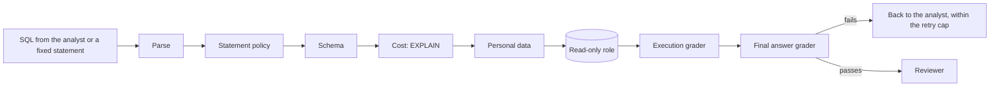

# Module: Loop Engineering - Demos for Section 2: Verification loop

## The problem

**Illustrative scenario.** The three failures from the
[section page](../README.md#the-problem): a second Structured Query Language (SQL) statement
stacked after the SELECT that a guard checking only the first word lets through, a check that fails
on every retry while the bill climbs, and a revenue answer that passes every check and is still
wrong.

These demos put all three in front of a live run. Fixed malicious statements go through each
defense layer in turn. An injected grader that always fails tests the retry cap. The fiscal year
2025 revenue question runs under version 1 of the knowledge (the starting version), where every
deterministic grader passes a wrong answer.

> **Terms on this page**
>
> - **Verification loop**: Graders check each query and answer, and send failures back to the agent.
> - **Grader**: A check that passes or fails one stage of a run and says why.
> - **Reviewer**: An independent agent that reads the question, SQL, and result after the graders pass.
> - **Gold SQL**: The query an analyst wrote by hand that gives the right answer.
> - **Knowledge version**: A numbered set of business rules given to the agent in its prompt.
> - **Planted bug**: A defect switched on by a flag so a demo shows its failure every time.
>
> All terms: [glossary](../../docs/glossary.md).

## What you'll see

Malicious SQL and the cost guard send fixed SQL statements through the graders and the read-only
role, with no model call. The retry cap and the fiscal year 2025 revenue question are real runs of
the analyst with real model calls, traced to LangSmith. The console shows every grader result, which
layer stopped each statement, and the reviewer's verdict.

Times, measured live on 22 and 23 October 2026: malicious SQL 2 to 6 seconds with no model call,
the retry cap 14 to 79 seconds, and every grader passes, still wrong 52 to 58 seconds. On the
code of 24 October 2026, measured live once that day: malicious SQL 2 seconds, the retry cap 20
seconds, and every grader passes, still wrong 50 seconds. The last demo was shown in 5 of 6 live
attempts after the change that keeps one run's gold check from blocking another, the last two in a
row; in the other, the run posted with no gold check. The runs are on the
[evidence page](../../docs/evidence/section-2-verification-loop.md#results), and `run.sh` states the most a
run can cost at the caps in `platform/packs/datapilot_us/pack.yaml`.



## Run it

Finish the [setup pages](../../setup/README.md) first, including the
[pre-class checks](../../setup/pre-class.md). Then start the services, confirm the data, and open
a live session in a terminal at the repository root:

```bash
make up
make check-data
make preflight PURPOSE=development
```

Every run belongs to a live session, which `make preflight` opens; with none open, a demo fails
with "No live session is open". Preflight first asks five questions that show the model still
behaves as the course measured it, one agent run each. In class the instructor runs
`make preflight PURPOSE=class` instead.

Open the console at http://localhost:8501 on the Verify page. Run every core demo of this section
from the same terminal, one at a time, with:

```bash
bash section-2-verification-loop/demo/run.sh
```

Add `--optional` to run the cost guard after the core demos, or name one demo to run it alone.
Each `make demo` prints the run ids it started; the run itself shows up in the console.

Three demos run twice, once with their planted bug on and once with it off: malicious SQL
(`BUG_NAIVE_GUARD`), the cost guard (`BUG_NO_COST_GUARD`), and the retry cap
(`BUG_NO_RETRY_CAP`). `make demo NAME=<demo> PLANTED=1` switches the bug on for that demo's run
alone; then `make demo NAME=<demo>` runs the fixed half. `.env` never changes.

<!-- generated:demo-table -->
| Demo | Tier | Run it | Target minutes |
|---|---|---|---|
| Malicious SQL | core | `make demo NAME=verify-malicious-sql` | 4 |
| The cost guard | optional | `make demo NAME=verify-cost-guard` | 3 |
| The retry cap | core | `make demo NAME=verify-retry-cap` | 4 |
| Every grader passes, still wrong | core | `make demo NAME=verify-graders-pass-still-wrong` | 4 |

Each demo also runs from the console (Verify > Send malicious SQL; Verify > Send cartesian query; Verify > Inject failing grader; Verify > Ask the spine question).
Recovery for every demo in Section 2: Verification loop: `make reset NAME=verification-loop`, then the same
trigger again. The target minutes are the class plan's, from `platform/demos/registry.yaml`, not
measured times.
<!-- /generated:demo-table -->

### Files and links

- [run.sh](run.sh): the launcher; its header states what it runs, the caps, and the target minutes
- [walkthrough.md](walkthrough.md): the code behind these demos, explained
- [The graders](../../platform/src/datapilot/loop2_verification/graders/): one file per grader
- [The retry cap and cost limits](../../platform/packs/datapilot_us/pack.yaml): `limits` and `cost_guard`
- [Version 1 of the knowledge](../../platform/packs/datapilot_us/knowledge/v1.yaml): the near-empty rules
- [expected/](expected/): real output from a real run, for comparison after class, never in class
- [Evidence page](../../docs/evidence/section-2-verification-loop.md): the measured runs

## What to watch

| Step | Screen | What appears |
|---|---|---|
| Malicious SQL | Verify page | The defense-layer panel: which layer stopped each statement |
| The retry cap | Verify page | The cost counter and the attempts, then the escalated status |
| Every grader passes, still wrong | Verify page | The green checklist beside the failed gold check |

Each demo's entry below comes from the demo registry: how to start it, what guarantees its moment,
and what may differ from run to run.

<!-- generated:demo-runbook -->
### Malicious SQL

- **Tier**: core
- **Start it**: Verify > Send malicious SQL in the console, or `make demo NAME=verify-malicious-sql`
- **Guaranteed by**: the naive guard (`BUG_NAIVE_GUARD`)
- **What appears**: With the naive guard, "SELECT 1; DELETE FROM orders" and a data-modifying common table expression pass the guard and the read-only role refuses them (error code 25006); with the syntax-tree guard, its parse step stops the stacked statements and its statement policy the data-modifying common table expression, before execution. A raw DELETE as the agent role is refused by the role.
- **Expected live outcome**: The defense-layer panel shows which layer stopped each statement; no warehouse row changes.
- **What can vary**: nothing in the outcome; timings only
- **Recovery**: `make reset NAME=verification-loop`, then the same trigger again

### The cost guard

- **Tier**: optional, cut first when the section runs late
- **Start it**: Verify > Send cartesian query in the console, or `make demo NAME=verify-cost-guard`
- **Guaranteed by**: the missing cost guard (`BUG_NO_COST_GUARD`)
- **What appears**: With the missing cost guard, a cartesian join runs until the statement timeout; with the cost grader, the plan estimate (EXPLAIN) rejects it at once with feedback for the agent.
- **Expected live outcome**: A timeout with the bug on; an instant rejection with its reason with it off.
- **What can vary**: the EXPLAIN cost figure; timings
- **Recovery**: `make reset NAME=verification-loop`, then the same trigger again

### The retry cap

- **Tier**: core
- **Start it**: Verify > Inject failing grader in the console, or `make demo NAME=verify-retry-cap`
- **Guaranteed by**: the missing retry cap (`BUG_NO_RETRY_CAP`); the injected failing grader
- **What appears**: An injected grader that always fails sends the run back to the agent; with the missing retry cap the run keeps looping and the cost counter climbs; with the cap it stops after 3 attempts and ends escalated with the reasons.
- **Expected live outcome**: The cost counter stops at the cap and the run shows escalated.
- **What can vary**: cost per attempt; the agent's retries' SQL
- **Recovery**: `make reset NAME=verification-loop`, then the same trigger again

### Every grader passes, still wrong

- **Tier**: core
- **Start it**: Verify > Ask the spine question in the console, or `make demo NAME=verify-graders-pass-still-wrong`
- **Guaranteed by**: the near-empty version 1 of the knowledge (the starting version); the five traps in the seeded data
- **What appears**: Under version 1 of the knowledge (the starting version), the fiscal year 2025 revenue question passes every deterministic grader and the checklist turns all green, while the gold check on both databases fails (6 of 7 recorded live attempts; in the other, no gold check arrived in time, cause not confirmed). The reviewer's verdict is shown beside it, whichever way it goes.
- **Expected live outcome**: An all-green checklist beside a failed gold check.
- **What can vary**: the reviewer's verdict; the wrong value
- **Recovery**: `make reset NAME=verification-loop`, then the same trigger again
<!-- /generated:demo-runbook -->

## What the result means

Malicious SQL has one right outcome: no warehouse row changes. The naive guard lets the statements
reach the read-only role, which refuses them; the syntax-tree guard stops them before execution.
Two layers that each stop the attack are the point, so one wrong guess never reaches the data.

The retry cap ends a failing run after `limits.max_retries` attempts in `pack.yaml`, escalated with
its reasons. Without the cap, only the token budget stops the run, and the cost counter shows what
that costs.

An all-green checklist beside a failed gold check is the expected result under version 1. Graders
check that a query is safe and well formed, not that it encodes the business rules. The reviewer may
catch it or not; one run shows one verdict. That gap is the case for
[Section 4: Hill-climbing loop](../../section-4-hill-climbing-loop/README.md).

## If it fails

| What you see | Why | What to do |
|---|---|---|
| `run.sh` says the services do not answer | The services are not running | `make up`, then `make ps` until every service is healthy |
| The same layer stops the statements with the bug on and off | The planted half was sent without `PLANTED=1` | `make demo NAME=verify-malicious-sql PLANTED=1` |
| The retry-cap run never escalates with the bug off | `.env` sets `BUG_NO_RETRY_CAP=1` | Set it to `0`, run `make up`, and run it again |
| The run stays in Queued | The worker is not running or is restarting | `make ps`; `make logs NAME=worker` for the reason |
| Anything else | A stale run or an engaged kill switch | `make reset NAME=verification-loop`, then the same trigger again |
