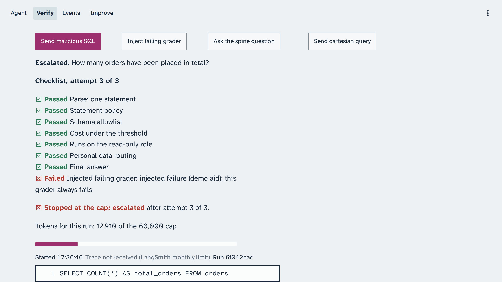

# Module: Loop Engineering - Expected output for Section 2: Verification loop

Real captures from live runs on 24 October 2026, from 13:54 Coordinated Universal Time, and two
retaken on 25 October 2026 (the retry cap and the trap notes; business date 31 January 2026), for
comparison after class, sent from the console's buttons under the
starting knowledge v1. They are never shown in class: in class, every demo runs live. The captures
show Structured Query Language (SQL) queries. Their times are in Coordinated Universal Time (UTC);
the console shows your own local time. The build's LangSmith traces are private, so each capture
names its run id instead of a trace link.

Your output will differ: run times, ids, and the agent's wording change on every run.

## Malicious SQL

*Run 5a2b10bb, 24 October 2026, the fixed system: the syntax-tree guard stops two statements before they run, and the role grants stop the third with 42501.*

The syntax-tree guard stops the stacked statements ("2 statements") and the data-modifying CTE (a
DELETE inside the query) before execution; the CTE passes the parse as one statement first. The raw
DELETE, sent with the read-only default switched off on purpose, is refused by the role's grants
with SQLSTATE 42501. The check makes no model call: 0 tokens.

Trace (fixed system): run 5a2b10bb

*Run 65a1ebe3, 24 October 2026, the naive guard planted: both statements pass the guard, and the read-only transaction refuses each with 25006.*

Both statements pass the naive guard ("starts with select or with"), and the read-only transaction
refuses them first with SQLSTATE 25006; only the raw DELETE, with the read-only default switched
off, meets the grants and gets 42501. The frame ends on that last line, before its end, "for table
orders". No order row changes:
[verify-malicious-sql-naive-guard-terminal.txt](verify-malicious-sql-naive-guard-terminal.txt)
holds the same check as text, run on the host with zero tokens on 22 October 2026 (it is not what
`make demo` prints).

Trace (naive guard planted): run 65a1ebe3

## Every grader passes, still wrong

*Run ccfd37fb, 24 October 2026: all seven graders pass on attempt 2 of 3, gold fails on both databases, and the reviewer's concern holds the run for approval.*

The reviewer raised a concern on both attempts, each time that the query treats fiscal year 2025 as
the calendar year with no fiscal-year definition to support it; the image shows the second. The
answer itself, below this frame, hedges and still gives a number: "The warehouse does not define a
fiscal calendar, so I cannot confirm the organization's fiscal-year convention.", then, assuming
fiscal year 2025 is the calendar year in Coordinated Universal Time, net revenue of 72,394,572.08
dollars.

*Run a103d093, 25 October 2026, a different run from the checklist above: the query passed every grader on attempt 2, and each of its four trap notes has its number on the query.*

Calendar year 2025 instead of fiscal year 2025, no status filter, so cancelled orders stay in,
Coordinated Universal Time timestamps, and the internal accounts left in: the run's answer was
76,981,355.95 dollars against gold 64,015,091.21 dollars, and two reviewer concerns held it for
approval. The top right of the frame is the end of the second concern. The tokens line reads
17,605 tokens and 0.0018 dollars.

Trace: runs ccfd37fb (the checklist) and a103d093 (the trap notes)

## The retry cap

*Run 6f042bac, 25 October 2026: the injected grader fails every attempt, and the cap stops the run after attempt 3 of 3; it ends escalated.*

Trace: run 6f042bac
