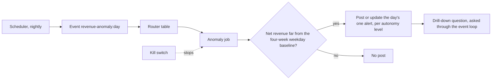

# Module: Loop Engineering - Assignment 3: Event loop

Try it yourself first. The full solution is published at the start of the Thursday review.

> **Deadline (instructor: set this before you share the page):** `<set by the instructor>`

## The problem

**Illustrative scenario.** On a Tuesday, the Harbor & Pine Outfitters checkout breaks for most of
the evening. Nobody notices until the weekly review, because the morning digest only reports
totals. When someone adds a quick alert script, every retry posts the same alert again, and a
late batch of orders makes the alert wrong by noon.

**In class.** Section 3: Event loop showed questions and the morning digest running as events:
the webhook question became a job, duplicate events were absorbed, and the kill switch stopped
a run in flight. This assignment adds a scheduled job of your own that follows the same rules.

> **Terms on this page**
>
> - **Event loop**: Events become jobs that workers run, with approvals, budgets, and a kill switch.
> - **Autonomy level**: How much DataPilot may do unattended: report-only, assisted, or unattended.
> - **Kill switch**: The guarded control that stops every worker and forces the report-only level.
> - **Live check**: The command that runs the done-when scenario against the real stack and the
>   real model, and reports PASS or FAIL per requirement.
>
> All terms: [glossary](../../docs/glossary.md).

## What you'll build

You add a nightly revenue anomaly alert. It compares the previous day's net revenue, on the
Eastern time calendar day, with the same weekday in each of the previous four weeks. A
deterministic key, `revenue-anomaly:YYYY-MM-DD`, allows at most one alert per day: a repeated
delivery is absorbed, and a re-run after late orders updates that alert instead of posting a
second one. Posting follows the autonomy level, and the job checks the kill switch itself before
it posts. The job has no agent in it: the comparison is arithmetic. The alert carries one
drill-down question with its own deterministic key, which the analyst answers through the event
loop when someone asks it.

**Seasonality, and the 2 January dip.** The job checks Friday 30 January 2026, the day before the
business date. Its comparison days are the Fridays 23, 16, 9, and 2 January. The 2 January Friday
sits in the post-holiday dip, so it pulls the baseline down and makes a normal Friday look high. In
the seeded warehouse, 30 January has $145,387.81 of net revenue against $120,592.50, $122,144.90,
$119,217.89, and $111,567.55 on those Fridays: 22.8 percent above their mean, or 20.5 percent
above the mean of the three Fridays left once 2 January is set aside. Decide what your alert does
about a comparison day in a holiday week, and say why. The check does not depend on your answer: it
adds its own orders to make one day unmistakably anomalous, and it uses Thursday 29 January as the
normal day.

**Done when** `make check-assignment NAME=event-loop` prints PASS on every line: the router table,
the schedule, the deterministic key, the baseline, a normal day, an anomalous day, a second
delivery, a late order, the autonomy level, and the kill switch, all against the real Postgres and
the running workers with no model call; then the alert's drill-down question, asked twice through
the event loop, runs once, live on the real model, and posts an answer that names the right
category. When the run holds for approval, the check approves it, as an instructor would, and
judges the answer it then posts.

Estimated effort: about 2 to 2.5 hours.

**Cost of one full check:** one analyst run, the drill-down question. The check prints its own
estimate before the model call and the actual tokens and cost at the end. Measured on
gpt-6-luna in the build's verification on 23 October 2026, from 08:11 Coordinated Universal Time
(UTC): one full check of a working solution cost 0.23 to 0.40 cents (six checks, 7 to 12 model
calls each), about 0.3 cents typically. At the caps, with the run using its whole token budget at
the output price, one check can cost at most 3 cents, below the check's own spend cap of 1.00
dollar, at which any check stops cleanly ([costs](../../docs/costs.md#assignments)).

## Step by step

1. With the stack up and seeded and your OpenAI key in `.env` ([setup](../../setup/README.md)),
   run the live check on the unchanged starter: `make check-assignment NAME=event-loop`. Check:
   requirements 1 to 6 read FAIL, each naming its extension point, and the rest did not run.
2. Read [starter/README.md](starter/README.md), and the digest's schedule and event id in
   `platform/src/datapilot/loop3_events/scheduler.py`. Check: you can say how the digest gets its
   deterministic id, and how an occasion makes a repeated request a new event.
3. Write `measure` at `event-loop-2`: net revenue as the business rules define it, on the day and
   the same weekday of each of the four weeks before, on Eastern time calendar days, read through
   the read-only agent role. Check: requirement 4 reads PASS.
4. Write `is_anomaly` and `alert_text`, and decide about the 2 January dip. Check: requirement 5
   reads PASS once the job runs (step 6).
5. Write `publish`: one alert per day, found by its key and updated in place with a revision
   number; the label the autonomy level gives the revenue family; nothing posted while the kill
   switch is engaged; and the drill-down question in the alert. Check: requirements 6 to 9 read
   PASS once the job runs.
6. Write `anomaly_event_id`, `request_anomaly_check`, and `run_job`, add the router table entry at
   `event-loop-3` and the nightly schedule at `event-loop-1`. Check: every line reads PASS, and the
   live drill-down shows its trace link and live stamp.

## Grading criteria (100 points)

This rubric is for assessing your own work. Nobody grades it.

| Criterion | What earns the points | Points | How you check it |
|---|---|---|---|
| Wiring | The router table and the nightly schedule in Eastern time | 10 | Check lines 1 and 2 |
| Deterministic key | The same key for a day, a new one per occasion | 10 | Check line 3 |
| Correct baseline | Eastern time days, net revenue, the same weekday over four weeks | 20 | Check line 4 |
| Anomaly decision | A normal day posts nothing; an anomalous day posts one full alert | 15 | Check lines 5 and 6 |
| One alert per day | A second delivery posts nothing new | 10 | Check line 7 |
| Late orders | A re-run updates the alert in place | 15 | Check line 8 |
| Autonomy and kill switch | The label follows the level; the job checks the switch before posting | 10 | Check line 9 |
| Live drill-down | Asked twice, it runs once and posts an answer naming the gold category | 10 | Check line 10 |
| Total | | 100 | |

Every requirement and its pass rule is in [SPEC.md](SPEC.md).

## Solution walkthrough

The reference solution, two alternatives, and their `SOLUTION.md` are published at the start of
the Thursday review. The block for this assignment is in
[the review session](../../docs/review-session.md): the live check of the reference solution, three
or four code excerpts, and the two alternatives with their trade-offs.
