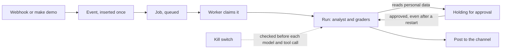

# Module: Loop Engineering - Demos for Section 3: Event loop

## The problem

**Illustrative scenario.** At Harbor & Pine Outfitters the morning digest posts twice after a
worker retries. A California marketing export with customer emails waits for approval, the worker
restarts, and the pending approval is gone. Someone presses stop, and the run already in flight keeps
going and posts its answer.

These demos put each of those in front of a live run. A question arrives as a webhook and crosses
the run board. The same event arrives three times. An export that reads personal data holds for
human approval across a worker restart. The kill switch is engaged while a run is in flight.

> **Terms on this page**
>
> - **Event loop**: Events become jobs that workers run, with approvals, budgets, and a kill switch.
> - **Human approval**: A person approves or rejects a held action before it runs.
> - **Kill switch**: The guarded control that stops every worker and forces the report-only level.
> - **Autonomy level**: How much DataPilot may do unattended: report-only, assisted, or unattended.
> - **Planted bug**: A defect switched on by a flag so a demo shows its failure every time.
>
> All terms: [glossary](../../docs/glossary.md).

## What you'll see

Each demo sends real events to the DataPilot services, and a worker runs each job as a real run of
the analyst with real model calls, traced to LangSmith. The run board shows each run moving across
its lanes; the channel shows what was posted and at which autonomy level.

Times and cost, measured live on 22 and 23 October 2026, each demo twice with a reset between
and once more on the current code: the webhook question 16 to 46 s, the approval across a restart
53 to 84 s, duplicates 35 to 78 s, the kill switch 5 to 33 s. An analyst run costs about 0.001
dollars. The runs are on the [evidence page](../../docs/evidence/section-3-event-loop.md), and
`run.sh` states the most a run can cost at the caps in `platform/packs/datapilot_us/pack.yaml`.



## Run it

Finish the [setup pages](../../setup/README.md) first, including the
[pre-class checks](../../setup/pre-class.md). Then start the services and confirm the data in a
terminal at the repository root:

```bash
make up
make check-data
```

Open the console at http://localhost:8501 on the Events page. Run every core demo of this section
from the same terminal, one at a time, with:

```bash
bash section-3-event-loop/demo/run.sh
```

Add `--optional` to run the digest now after the core demos, or name one demo to run it alone.
Each `make demo` prints the run ids it started; the runs themselves show up on the run board.

Three demos run twice, once with their planted bugs on and once with them off: the approval that
survives a restart (`BUG_MEMORY_CHECKPOINTER`), duplicate events (`BUG_NO_IDEMPOTENCY` and
`BUG_RANDOM_DIGEST_ID`), and the kill switch in flight (`BUG_KILLSWITCH_AT_CLAIM_ONLY`). Set the
flag to `1` in `.env`, run `make up` so the services read it, and run the demo; then set it back to
`0`, run `make up`, and run the demo again. The kill switch demo also needs `DEMO_PACING=1`, so a run
is still in flight when the switch is engaged, and a release between its halves: its first half
leaves the switch engaged, which blocks every new run at claim (and `make demo` cannot arm an
engaged switch). After the first half, press Release kill switch on the status line (or run
`make reset NAME=event-loop`), then set the flag to `0`, run `make up`, run the second half, and
end with `make reset NAME=event-loop`.

The approval demo needs two clicks from you. After the run holds, press Restart worker in the
console, wait for the worker to come back, then approve the held export.

<!-- generated:demo-table -->
| Demo | Tier | Run it | Target minutes |
|---|---|---|---|
| The webhook question | core | `make demo NAME=events-webhook-question` | 3 |
| The digest now | optional | `make demo NAME=events-digest-now` | 3 |
| The approval that survives a restart | core | `make demo NAME=events-approval-survives-restart` | 5 |
| Duplicate events | core | `make demo NAME=events-duplicate-events` | 3 |
| The kill switch in flight | core | `make demo NAME=events-kill-switch-in-flight` | 4 |

Each demo also runs from the console (Events > Send webhook question; Events > Run digest now; Events > Request California export; Events > Send the same event three times; Status line > Kill switch (arm, then stop)).
Recovery for every demo in Section 3: Event loop: `make reset NAME=event-loop`, then the same
trigger again. The target minutes are the class plan's, from `platform/demos/registry.yaml`, not
measured times.
<!-- /generated:demo-table -->

### Files and links

- [run.sh](run.sh): the launcher; its header states what it runs, the caps, and the target minutes
- [walkthrough.md](walkthrough.md): the code behind these demos, explained
- [The personal data columns and the budgets](../../platform/packs/datapilot_us/pack.yaml): `personal_data` and `budgets`
- [Planted items](../../docs/planted-items.md): what each flag changes
- [expected/](expected/): real output from a real run, for comparison after class, never in class
- [Evidence page](../../docs/evidence/section-3-event-loop.md): the measured runs

## What to watch

| Step | Screen | What appears |
|---|---|---|
| The webhook question | Events page | One strip moving from Queued to Done; one post labelled unverified |
| The approval that survives a restart | Events page | The approval dialog with the exact query and row count |
| Duplicate events | Events page | One post and the count of duplicates ignored |
| The kill switch in flight | Status line and Events page | The strip in Blocked by kill switch; the report-only level |

Each demo's entry below comes from the demo registry: how to start it, what guarantees its moment,
and what may differ from run to run. The approval dialog states the Structured Query Language
(SQL) the export would run.

<!-- generated:demo-runbook -->
### The webhook question

- **Tier**: core
- **Start it**: Events > Send webhook question in the console, or `make demo NAME=events-webhook-question`
- **What appears**: A question arrives as a webhook, becomes an event and a job, moves across the run board lanes, and is posted to the channel labelled unverified at the report-only level.
- **Expected live outcome**: One strip moves Queued to Done; one post labelled unverified.
- **What can vary**: time in each lane; the answer's wording
- **Recovery**: `make reset NAME=event-loop`, then the same trigger again

### The digest now

- **Tier**: optional, cut first when the section runs late
- **Start it**: Events > Run digest now in the console, or `make demo NAME=events-digest-now`
- **What appears**: The 8 a.m. Eastern time digest of key performance indicators runs on demand with its deterministic id and posts one digest to the channel.
- **Expected live outcome**: One digest post with the previous business day's key figures.
- **What can vary**: the digest wording
- **Recovery**: `make reset NAME=event-loop`, then the same trigger again

### The approval that survives a restart

- **Tier**: core
- **Start it**: Events > Request California export in the console, or `make demo NAME=events-approval-survives-restart`
- **Guaranteed by**: the in-memory checkpointer (`BUG_MEMORY_CHECKPOINTER`)
- **What appears**: A California marketing export touches personal data, so the run holds for human approval and the dialog states the exact SQL and row count. The worker is restarted; with the Postgres checkpointer the pending approval survives and approving resumes the run. With the in-memory checkpointer the pending approval is lost.
- **Expected live outcome**: The strip stays in Holding for approval across the restart, then moves to Done.
- **What can vary**: row count wording; restart time
- **Recovery**: `make reset NAME=event-loop`, then the same trigger again

### Duplicate events

- **Tier**: core
- **Start it**: Events > Send the same event three times in the console, or `make demo NAME=events-duplicate-events`
- **Guaranteed by**: the missing idempotency (`BUG_NO_IDEMPOTENCY`); the random digest id (`BUG_RANDOM_DIGEST_ID`)
- **What appears**: The same event is sent three times. With the missing idempotency, three answers are posted; with idempotency, one answer and "2 duplicates ignored". Firing the digest twice shows the same with the random digest id.
- **Expected live outcome**: One post and two absorbed duplicates on the board.
- **What can vary**: timing of the duplicates
- **Recovery**: `make reset NAME=event-loop`, then the same trigger again

### The kill switch in flight

- **Tier**: core
- **Start it**: Status line > Kill switch (arm, then stop) in the console, or `make demo NAME=events-kill-switch-in-flight`
- **Guaranteed by**: the kill switch at claim only (`BUG_KILLSWITCH_AT_CLAIM_ONLY`); demo pacing (`DEMO_PACING`)
- **What appears**: With demo pacing on, the webhook question is in flight (Events > Send webhook question) when the kill switch is engaged. With the kill switch at claim only, the run keeps going; with the check before every model and tool call, it stops at its next step as blocked by kill switch and the system drops to the report-only level. Each half ends with the switch engaged, so release it between the halves (Status line > Release kill switch, or `make reset NAME=event-loop`) before the flag goes to 0 and `make up`: an engaged switch blocks the next run at claim. The switch stays engaged until a release: `make reset NAME=event-loop` right after the second half, so nothing later is blocked.
- **Expected live outcome**: The in-flight strip moves to Blocked by kill switch; the status line shows the report-only level.
- **What can vary**: which step the run stops at
- **Recovery**: `make reset NAME=event-loop`, then the same trigger again
<!-- /generated:demo-runbook -->

## What the result means

The webhook question shows the path every later run takes: event, job, claim, run, post. At the
report-only level every answer is posted labelled unverified, and no export is released.

The webhook question asks how many orders were placed on the previous day. The business date is
31 January 2026, so that day is 30 January 2026. You will see one of two counts, and both are
expected:

| Count | How the analyst counted the day | Right? |
|---|---|---|
| 300 orders | Midnight to midnight in Eastern time (New York), the company's business day | Yes |
| 291 orders | Midnight to midnight in Coordinated Universal Time, the stored clock | No |

In January, Eastern time is five hours behind Coordinated Universal Time, so the second count
shifts the day five hours early. That is the Eastern time trap, one of the five traps in the
benchmark. The reviewer approves either count: it works from the same starting knowledge as the
analyst, which has no time-zone rule yet, and both counts read as a fair answer for the previous day.
This is why an unproven metric family stays at the report-only level, where the answer is posted
labelled unverified for a person to check. Section 4: Hill-climbing loop is where the time-zone
rule is earned, on benchmark evidence and with a person's approval.

The approval demo has one right outcome with the Postgres checkpointer: the strip stays in Holding
for approval across the restart, and approving resumes the run. With the in-memory checkpointer the
pending approval is lost, and the run cannot resume.

Duplicate events show that delivery is at least once and the effect is at most once: one answer,
and the extra deliveries counted, not run. The kill switch stops the in-flight run at its next model
or tool call, then holds the system at the report-only level until a person raises it.

## If it fails

| What you see | Why | What to do |
|---|---|---|
| `run.sh` says the services do not answer | The services are not running | `make up`, then `make ps` until every service is healthy |
| Restart worker does nothing | Demo controls are off | Set `DATAPILOT_ALLOW_DEMO_CONTROLS=1` in `.env`, then `make up` |
| The kill switch run finishes before the switch | Demo pacing is off | Set `DEMO_PACING=1` in `.env`, then `make up` |
| Runs end as blocked by kill switch after the kill switch demo | The switch stays engaged until a reset releases it | `make reset NAME=event-loop` at the end of the kill switch demo |
| Runs end as blocked by the budget | The daily token budget is used up | Check `budgets.tokens_per_day` in `pack.yaml` and the run's tokens |
| Anything else | A stale run or an engaged kill switch | `make reset NAME=event-loop`, then the same trigger again |
