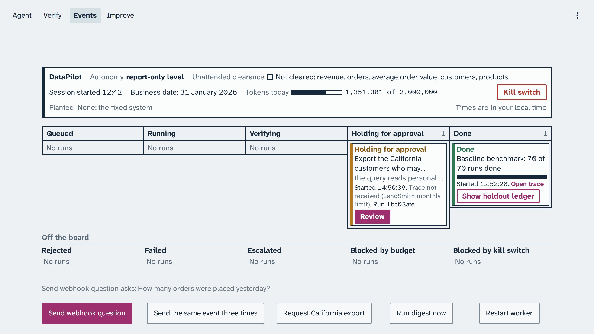
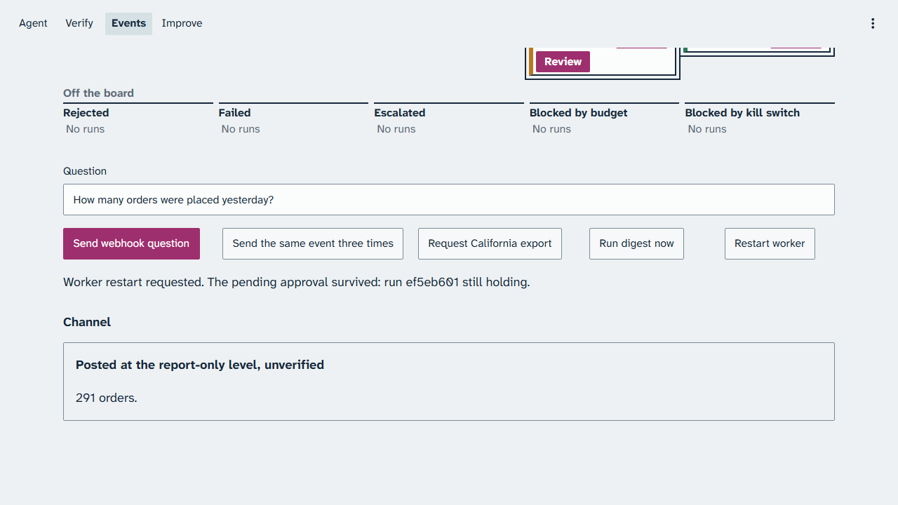
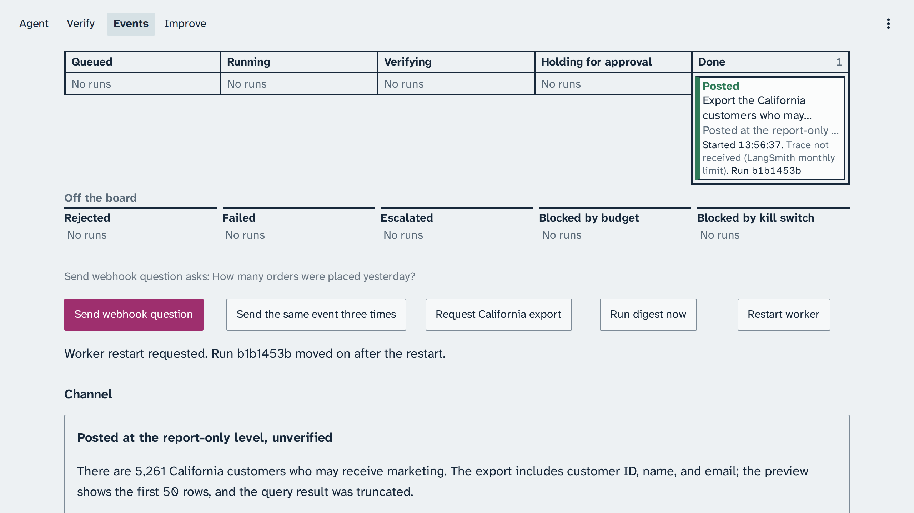
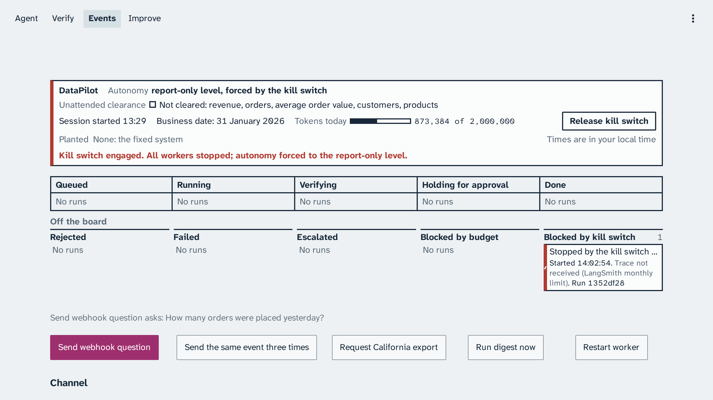
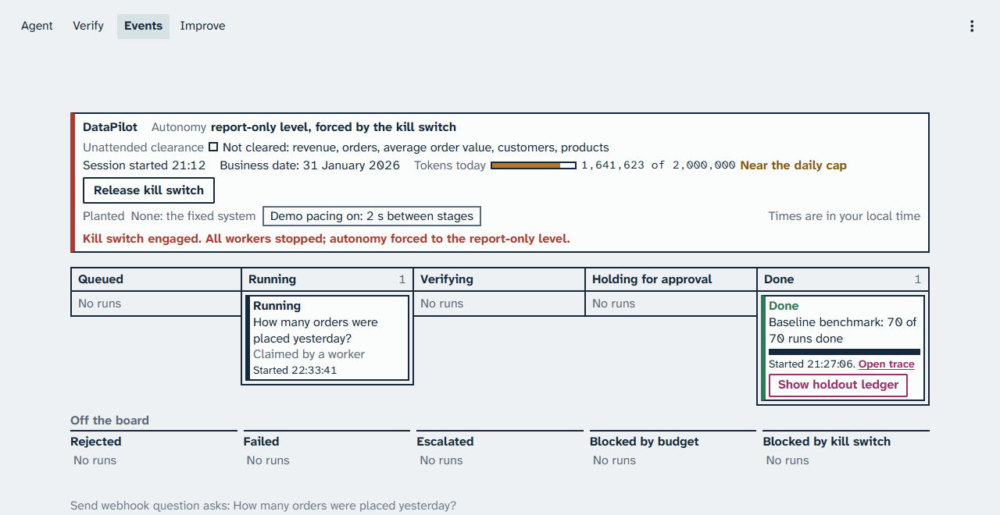
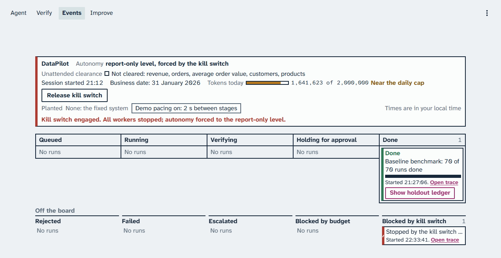

# Module: Loop Engineering - Expected output for Section 3: Event loop

Real captures from live runs on 22 October 2026, and the two paced kill switch captures from 23
October 2026 (business date 31 January 2026), for comparison after class. They are never shown in
class: in class, every demo runs live. Times on the captures of 22 October are in the capturing
browser's local time, India Standard Time (5 hours 30 minutes ahead of Coordinated Universal
Time); the paced kill switch captures of 23 October are in Coordinated Universal Time. The console
shows your own local time. The build's LangSmith traces are private, so each capture names its run
id instead of a trace link.

Your output will differ: run times, ids, and the agent's wording change on every run.

The captures of 22 October show an older Events page than yours. Above the buttons they have a
Question text box, which the page no longer has: it now reads "Send webhook question asks:"
and the question the button sends, the same one `make demo` sends. Their Kill switch button sits
at the right of the status line; it is now under it. The export they request is worded "Export
the email and first name of every marketable..."; it is now "Export the California customers
who may receive marketing, with their email addresses." The webhook question's channel capture
and the capture after the restart are cut at the top, through the Done and Review strips, and
the board captures of the webhook question and of duplicate events cut the Channel heading at
the bottom. The run, its lanes, and its outcome are the ones you will see.

## The webhook question

*The webhook question becomes an event and a job, and moves to Done.*

The question asks for the orders of the previous business day, 30 January 2026. Your count may be
300 or 291 orders, and both are expected: 300 counts the day in Eastern time (New York), the right
answer, and 291 counts the day in Coordinated Universal Time, the Eastern time trap. The
[demo page](../README.md#what-the-result-means) explains why the reviewer approves both.

*At the report-only level the answer is posted labelled unverified.*

Trace: run 7cf0509e

## The approval that survives a restart

*The California marketing export reads personal data, so the run holds before the query runs.*

*The worker restarts; the Postgres checkpointer keeps the pending approval.*

*Approving resumes the run, and the export is posted.*

In this run the reviewer asked for changes, so the analyst rewrote its query three times; each new
query was approved before it ran (an approved query is never asked about twice).

Trace: run ef5eb601

## Duplicate events

*The same event three times: one run, one post, and 2 duplicates absorbed.*

Trace: run 9a3a8296

## The kill switch in flight

*The kill switch stops a run in flight and drops the system to the report-only level.*

The run's event says it stopped "in flight". This capture ran without demo pacing.

Trace: run bb8b3e1f

The two paced captures below were taken on a clean board, after `make reset NAME=hill-climbing-loop`
and `make reset NAME=event-loop`: the status line lists no cleared family. The Done lane still
shows the session's baseline benchmark, which the hill-climbing reset keeps on purpose; in class,
Section 3 runs before any experiment, so your Done lane holds only this section's runs. The webhook
question was sent with Events > Send webhook question, and the kill switch was armed and stopped
from the status line while the strip was in the Running lane. Both images are cropped at the
bottom edge, above the row of buttons the window cut.

*With demo pacing on, the run is visibly in flight when the kill switch is engaged.*

*It stops at its next step and moves off the board to Blocked by kill switch.*

Trace: run 31984983

`make reset NAME=event-loop` released the kill switch afterwards.
