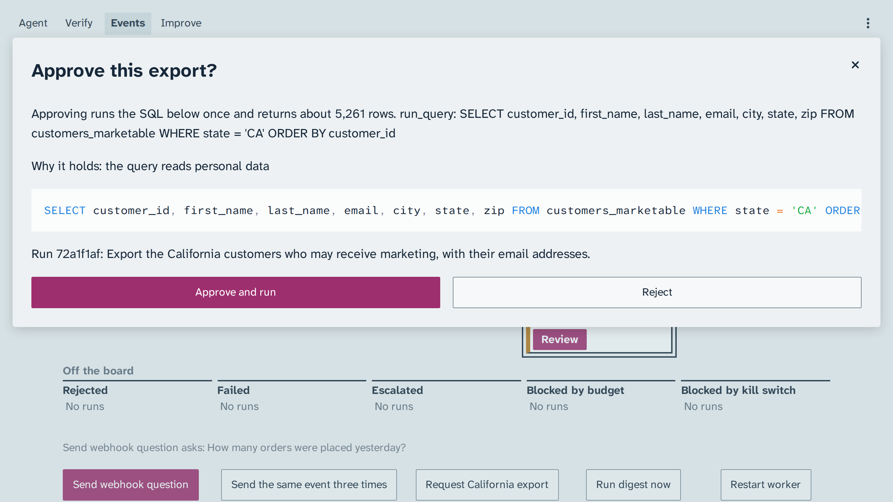
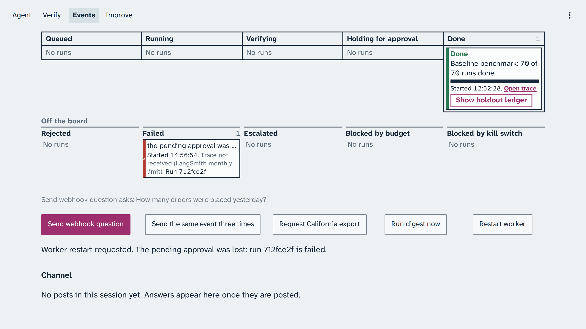
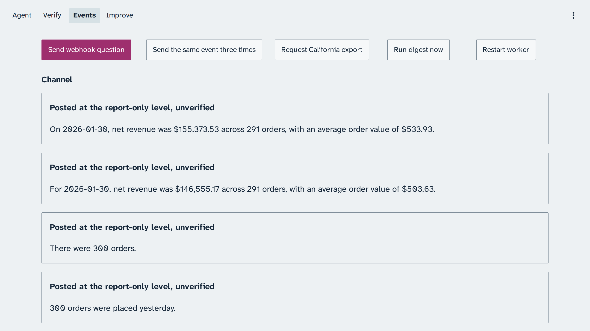
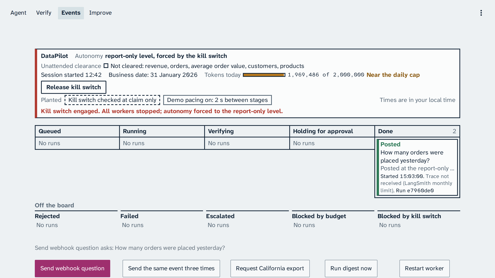

# Module: Loop Engineering - Expected output for Section 3: Event loop

Real captures from live runs on 24 October 2026, 13:56 to 14:09 Coordinated Universal Time, and
from 14:49 to 17:38 on 25 October 2026 for the frames that name that date (business date 31
January 2026), for comparison after class, sent from the console's buttons with
every planted bug off and under version 1 of the knowledge (the starting version), except the
planted halves below; the two paced kill switch captures of 24 October ran with demo pacing only.
They are never shown in class: in class, every demo runs live. Times on the captures are in
Coordinated Universal Time (UTC); the console shows your own local time. The build's
LangSmith traces are private, so each capture names its run id instead of a trace link; the strips
read "Trace not received (LangSmith monthly limit)" because the build's trace quota was spent.

Your output will differ: run times, ids, and the agent's wording change on every run.

## The webhook question

*Run ce15ac5d, 24 October 2026: the webhook question becomes an event and a job, and moves to Done, posted at the report-only level.*

The question asks for the orders of the previous business day, 30 January 2026. This run answered
300 orders, counting the day in Eastern time (New York), the right
answer. Your count may be 300 or 291 orders, and both are expected: 291 counts the day in
Coordinated Universal Time, the Eastern time trap. The
[demo page](../README.md#what-the-result-means) explains why the reviewer approves both.

*Run 0ebf3d5c, 25 October 2026, a later run of the same demo: the post is labelled "Posted at the report-only level, unverified", and its answer is 300 orders; the run's own strip is above the frame.*

Trace: runs ce15ac5d (the board) and 0ebf3d5c (the Channel)

## The approval that survives a restart

*Run 1bc03afe, 25 October 2026: the California marketing export reads personal data, so the run holds before its query runs.*

The next two frames are a different run of the same demo, b1b1453b of 24 October 2026; the
Review dialog after them is a third, 72a1f1af of 25 October 2026.

*Run b1b1453b, 24 October 2026: the worker restarts, and the Postgres checkpointer keeps the pending approval.*

*Run b1b1453b, 24 October 2026: approving resumes the same run, and the export is posted with 5,261 customers.*

The post reads: "There are 5,261 California customers who may receive marketing. The export
includes customer ID, name, and email; the preview shows the first 50 rows, and the query result
was truncated." The restart was pressed on the page, and the approval was given through the
dialog's own call.

*Run 72a1f1af, 25 October 2026: before anything runs, the dialog states the exact query, about how many rows it returns, and why it holds.*

Trace: runs 1bc03afe, b1b1453b, and 72a1f1af

## Duplicate events

*Run 0391e0c2, 25 October 2026: the question posted once, and its two repeats were absorbed as duplicates.*

The run's answer, from its record: 300 orders on the previous business day.

Trace: run 0391e0c2

## The kill switch in flight

*Run 1352df28, 24 October 2026: the kill switch stops a run in flight and drops the system to the report-only level.*

This capture ran without demo pacing: the run had used 754 tokens when the switch stopped it.

Trace: run 1352df28

The two paced captures below ran with `DEMO_PACING=1`. The webhook question was sent with Events >
Send webhook question, and the kill switch was armed and engaged while the strip was in the Running
lane.

*Run 1c76de06, 24 October 2026: with demo pacing on, the run is visibly in flight when the kill switch is engaged.*

*Run 1c76de06, 24 October 2026: it stops at its next step and moves off the board to Blocked by kill switch, with 0 tokens spent.*

Trace: run 1c76de06

`make reset NAME=event-loop` released the kill switch afterwards.

## The planted halves

Each ran with its planted bug on, on 25 October 2026.

*Run 712fce2f: with the in-memory checkpointer, the checkpoint died with the worker, so approving fails the run and the pending approval is lost.*

*Without the stored event id, each delivery ran again: two digests and repeated answers to one question, every post labelled unverified.*

*Run e7960de0: with the kill switch checked at claim only, the run in flight never sees it; the switch is engaged, and the run still posted.*

Trace: runs 712fce2f and e7960de0
