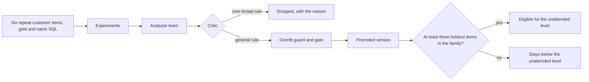

# Module: Loop Engineering - Assignment 4: Hill-climbing loop

Try it yourself first. The full solution is published at the start of the Thursday review.

> **Deadline (instructor: set this before you share the page):** `<set by the instructor>`

## The problem

**Illustrative scenario.** The retention team at Harbor & Pine Outfitters starts asking DataPilot
for the repeat-customer rate. The benchmark has no questions about it, so nothing measures whether
the answers are right. A rule writer suggests a broad rule that looks helpful, and one passing
holdout question is enough to clear a family for the unattended level.

**In class.** Section 4: Hill-climbing loop showed the analyzer team and the promotion gate
improving revenue questions: the naive analyzer was blocked, and the candidate experiment flipped
holdout items with zero regressions. This assignment extends the loop to a new metric family and
tightens two places where it is still too easy to pass.

> **Terms on this page**
>
> - **Hill-climbing loop**: Experiments find failures, an analyzer team proposes rules, and a gate decides.
> - **Holdout split**: The benchmark questions the analyzer team never sees; the gate decides on them.
> - **Promotion gate**: The check that a new knowledge version must pass before it becomes active.
> - **Regression**: An item that passed under the active version and fails under the candidate, confirmed by re-runs.
> - **Gold query**: The Structured Query Language (SQL) query an analyst wrote by hand
>   that gives the right answer.
> - **Live check**: The command that runs the done-when scenario against the real stack and the
>   real model, and reports PASS or FAIL per requirement.
>
> All terms: [glossary](../../docs/glossary.md).

## What you'll build

You add three things. First, a repeat-customer-rate metric family: 6 benchmark questions with gold
and naive Structured Query Language (SQL), at least three of them in the holdout split, each naive
query giving a different answer from gold on both warehouses. Second, a critic improvement that
drops a planted over-broad rule, "leave one-time buyers out of customer metrics"
([planted-rule.yaml](planted-rule.yaml)), with its reason. Third, a rule that a metric family needs
at least three holdout questions before it may reach the unattended level.

**Done when** `make check-assignment NAME=hill-climbing-loop` prints PASS on every line: the six
items, their gold and naive queries on both warehouses, the family in the pack, the
minimum-holdout rule, and an unchanged gate, checked with no model call; then, live on the real
model with the class measurement, the critic drops the planted rule and the gate promotes a version
covering the new family with zero confirmed regressions, after a human approval the check gives.

Estimated effort: about 2 to 2.5 hours.

**Cost and time of one full check:**

- **Typical:** about 13 to 24 cents for a later check in a live session, from seven later checks
  with two candidates each: five audited clean and two not confirmed clean
  ([costs](../../docs/costs.md#assignments), note 2). The five audited clean: alternative two at
  19.22 cents on 24 October 2026, and on 25 October the reference twice, at 14.53 and 12.91 cents,
  and each alternative once, at 12.62 and 17.09 cents. The two not confirmed clean: the reference
  at 13.58 and 23.95 cents on 23 October 2026, a day no audit of planted flags covers. The checks
  of 25 October ran before changes to the check's stack and the platform that cannot alter their
  verdicts ([evidence](../../docs/evidence/general.md#captures)). No clean first check, which
  also runs the baseline experiment, has been measured: the one of 24 October (23.59 cents) ran
  while a planted bug was on.
- **Ceiling:** the check prints its own estimate before the first model call, and it stops cleanly
  at its spend cap of 1.00 dollar, putting back the active knowledge version.
- **How long:** the two later checks of 23 October took 15 and 22 minutes; on 25 October the two
  later checks of the reference finished 15 minutes apart.

Why a first check costs more, every figure, and the ceilings are on the
[costs page](../../docs/costs.md#assignments). How often a correct solution passes requirement 10
is in [SPEC.md](SPEC.md).

## Step by step

1. With your OpenAI key in `.env` ([setup](../../setup/README.md)), run the live check on the
   unchanged starter: `make check-assignment NAME=hill-climbing-loop`. The check builds, starts, and
   seeds a stack of its own, the Compose project `datapilot-assignments`, so it needs no `make up`
   (that is the class stack, for the demos).
   Check: requirements 1 to 7 read FAIL, each naming its extension point or the item it needs, and
   the live requirements did not run, so the starter spends nothing.
2. Read [starter/README.md](starter/README.md) and one existing benchmark item with its gold and
   naive SQL in `platform/packs/datapilot_us/benchmark/dev.yaml`. Check: you can say which split
   each existing item belongs to, and which traps it touches.
3. Write the 6 repeat-customer items in a new file in `platform/packs/datapilot_us/benchmark/`, with
   gold SQL, naive SQL, traps, and a split for each, with `metric_family: repeat_customers`. Check:
   requirements 1 to 4 read PASS.
4. Add the family to `autonomy.metric_families` in `platform/packs/datapilot_us/pack.yaml`, and the
   benchmark's composition test in `platform/tests/unit/test_benchmark.py` to the new counts.
   Check: requirement 5 reads PASS, and `uv run pytest platform/tests/unit/test_benchmark.py`
   passes. Do not expect all of `make test` to pass from here on (see "Tests that pin the
   starter" below).
5. Improve the critic at `hill-climbing-loop-2`, in its guidance, its screen, or both. Check: it
   can still only keep, narrow, or drop.
6. Add the minimum-holdout rule at `hill-climbing-loop-3`, with the minimum in `pack.yaml`. Check:
   requirements 6 to 8 read PASS, and the live requirements 9 and 10 run and read PASS, with their
   trace links and live stamps.

**Tests that pin the starter.** The course repository ships the starter unchanged, and some of its
tests pin exactly that, so they fail once your work is in place. That is expected, not a sign your
work is wrong. With every step done, `make test` fails these, and only these, for that reason:

- `test_assignment_boundaries.py::test_the_hill_climbing_loop_extension_points_are_inert`: the
  extension points are no longer inert, and the family and its items now exist.
- `test_boundaries.py::test_no_assignment_capability_exists_in_class_code`, for the
  repeat-customer family and the minimum holdout rule: it finds them in the pack, where you put
  them.
- `test_assignment_check_judges.py::test_the_starter_fails_every_requirement_with_nothing_to_judge`:
  the family now has items to judge.
- Four tests of `test_family_clearance.py`, such as
  `test_the_class_rule_has_no_minimum_so_one_passing_item_clears_its_family`: they judge families
  with fewer than three holdout items under the class rule, which has no minimum.

Every other test still passes. If another one fails, such as
`test_no_class_pack_literals.py` (a name of Harbor & Pine's tables in platform code) or
`test_template_pack.py` (a setting in the class pack that the template pack lacks), the cause is
in your change: the reference solution passes both.

## Grading criteria (100 points)

This rubric is for assessing your own work. Nobody grades it.

| Criterion | What earns the points | Points | How you check it |
|---|---|---|---|
| Benchmark items | Six items with gold and naive SQL, at least three in holdout | 15 | Check lines 1 and 2 |
| Gold and traps | Gold runs on both warehouses; each naive query differs from gold | 15 | Check lines 3 and 4 |
| Family in the pack | The family is a metric family of the pack | 5 | Check line 5 |
| Minimum-holdout rule | Fewer than three holdout items keep a family below unattended | 15 | Check lines 6 and 7 |
| Gate unchanged | No change weakens the gate, the overfit guard, or the measurement | 10 | Check line 8 |
| Critic | The planted rule is dropped with a reason; no rule is added | 20 | Check line 9 |
| Promotion | Promotion with zero confirmed regressions, covering the family | 20 | Check line 10 |
| Total | | 100 | |

Every requirement and its pass rule is in [SPEC.md](SPEC.md).

## Solution walkthrough

The reference solution, two alternatives, and their `SOLUTION.md` are published at the start of
the Thursday review. The block for this assignment is in
[the review session](../../docs/review-session.md): the live check of the reference solution, three
or four code excerpts, and the two alternatives with their trade-offs.
