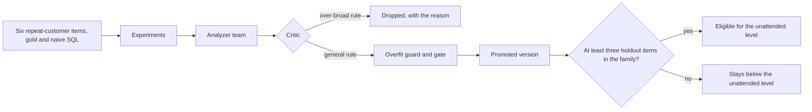

# Module: Loop Engineering - Assignment 4: Hill-climbing loop

Try it yourself first. The full solution is published at the start of the Thursday review.

> **Deadline (instructor: set this before you share the page):** `<set by the instructor>`

## The problem

**Illustrative scenario.** The retention team at Harbor & Pine Outfitters starts asking DataPilot
for the repeat-customer rate. The benchmark has no questions about it, so nothing measures whether
the answers are right. A rule writer suggests a broad rule that looks helpful, and one passing
holdout question is enough to clear a family for the unattended level.

**In class.** Section 4: Hill-climbing loop showed the analyzer team and the promotion gate
improving revenue questions: the naive analyzer was blocked, and the candidate experiment flipped
holdout items with zero regressions. This assignment extends the loop to a new metric family and
tightens two places where it is still too easy to pass.

> **Terms on this page**
>
> - **Hill-climbing loop**: Experiments find failures, an analyzer team proposes rules, and a gate decides.
> - **Holdout split**: The benchmark questions the analyzer team never sees; the gate decides on them.
> - **Promotion gate**: The check that a new knowledge version must pass before it becomes active.
> - **Regression**: An item that passed under the active version and fails under the candidate, confirmed by re-runs.
> - **Gold query**: The Structured Query Language (SQL) query an analyst wrote by hand
>   that gives the right answer.
> - **Live check**: The command that runs the done-when scenario against the real stack and the
>   real model, and reports PASS or FAIL per requirement.
>
> All terms: [glossary](../../docs/glossary.md).

## What you'll build

You add three things. First, a repeat-customer-rate metric family: 6 benchmark questions with gold
and naive Structured Query Language (SQL), at least three of them in the holdout split, each naive
query giving a different answer from gold on both warehouses. Second, a critic improvement that
drops a planted over-broad rule, "leave one-time buyers out of customer metrics"
([planted-rule.yaml](planted-rule.yaml)), with its reason. Third, a rule that a metric family needs
at least three holdout questions before it may reach the unattended level.

**Done when** `make check-assignment NAME=hill-climbing-loop` prints PASS on every line: the six
items, their gold and naive queries on both warehouses, the family in the pack, the
minimum-holdout rule, and an unchanged gate, checked with no model call; then, live on the real
model with the class measurement, the critic drops the planted rule and the gate promotes a version
covering the new family with zero confirmed regressions, after a human approval the check gives.

Estimated effort: about 2 to 2.5 hours.

**Cost of one full check:** the benchmark is the costly part, and the check prints its estimate
apart from the rest. One experiment is 82 analyst runs (28 dev items once, 18 holdout items 3 times
each), and every apparent regression is confirmed by re-runs. The first check in a live session
runs the baseline experiment and the candidate experiment, 164 runs; every later check in the same
session shares that session's baseline, as the class gate does, and runs only the candidate, 82
runs. As in class, the analyzer team writes two candidates, 3 calls each, and each candidate runs on
the 28 dev items once, 56 analyst runs, before one is kept. The check prints its own estimate before
the first model call and the actual tokens and cost at the end. Measured on gpt-6-luna in the
build's verification on 23 October 2026 with two candidates, each later check in a live session
cost about 14 to 24 cents (13.58 and 23.95 cents, two checks); a first check, with the baseline,
is about 38 cents (30.66 cents measured when the check wrote one candidate, plus about 7 cents for
the second candidate's dev runs). The measured checks are in the costs table linked below. At the
caps, with every run using its whole token budget at the output price, the runs of
a first check would come to 678 cents and those of a later one to 432 cents, with re-runs on top,
but the check stops cleanly
at its own spend cap of 1.00 dollar, so one check costs at most 100 cents. A check stopped at the
cap puts back the active knowledge version, as a normal end does
([costs](../../docs/costs.md#assignments)).

**How often a correct solution passes.** Requirement 10 depends on the rule set the model writes
in that check. In the build's verification and the checks of 23 October, with one candidate per
check, it passed in 6 of 10 checks of correct solutions. Three were blocked by one confirmed dev
regression: a rule the model wrote made one dev item fail under the candidate. The third of them,
measured with the current re-runs of both versions, passed that item in both re-runs under v1 and
failed it in both under the candidate, so it was a real regression of that rule set, not noise in
v1. The fourth candidate was no better than v1 on holdout. The check now writes two candidates and
keeps the one with fewer dev regressions, then more dev passes, as the class does, which targets
the first cause. Measured on 23 October 2026 with two candidates, the reference passed 2 of 2
checks (13.58 and 23.95 cents, 15 and 22 minutes); two checks are a small sample, so a correct
solution may still read FAIL on requirement 10 now and then: run the check again, and the FAIL line
says when the cause is the model's rule set rather than your files. A starter, and a solution that
leaves out a family item or lets `aov` reach the unattended level, still fail it every time.

## Step by step

1. With your OpenAI key in `.env` ([setup](../../setup/README.md)), run the live check on the
   unchanged starter: `make check-assignment NAME=hill-climbing-loop`. The check builds, starts, and
   seeds a stack of its own, the Compose project `datapilot-assignments`, so it needs no `make up`
   (that is the class stack, for the demos).
   Check: requirements 1 to 7 read FAIL, each naming its extension point or the item it needs, and
   the live requirements did not run, so the starter spends nothing.
2. Read [starter/README.md](starter/README.md) and one existing benchmark item with its gold and
   naive SQL in `platform/packs/datapilot_us/benchmark/dev.yaml`. Check: you can say which split
   each existing item belongs to, and which traps it touches.
3. Write the 6 repeat-customer items in a new file in `platform/packs/datapilot_us/benchmark/`, with
   gold SQL, naive SQL, traps, and a split for each, with `metric_family: repeat_customers`. Check:
   requirements 1 to 4 read PASS.
4. Add the family to `autonomy.metric_families` in `platform/packs/datapilot_us/pack.yaml`, and the
   benchmark's composition test in `platform/tests/unit/test_benchmark.py` to the new counts.
   Check: requirement 5 reads PASS, and `make test` passes.
5. Improve the critic at `hill-climbing-loop-2`, in its guidance, its screen, or both. Check: it
   can still only keep, narrow, or drop.
6. Add the minimum-holdout rule at `hill-climbing-loop-3`, with the minimum in `pack.yaml`. Check:
   requirements 6 to 8 read PASS, and the live requirements 9 and 10 run and read PASS, with their
   trace links and live stamps.

## Grading criteria (100 points)

This rubric is for assessing your own work. Nobody grades it.

| Criterion | What earns the points | Points | How you check it |
|---|---|---|---|
| Benchmark items | Six items with gold and naive SQL, at least three in holdout | 15 | Check lines 1 and 2 |
| Gold and traps | Gold runs on both warehouses; each naive query differs from gold | 15 | Check lines 3 and 4 |
| Family in the pack | The family is a metric family of the pack | 5 | Check line 5 |
| Minimum-holdout rule | Fewer than three holdout items keep a family below unattended | 15 | Check lines 6 and 7 |
| Gate unchanged | No change weakens the gate, the overfit guard, or the measurement | 10 | Check line 8 |
| Critic | The planted rule is dropped with a reason; no rule is added | 20 | Check line 9 |
| Promotion | Promotion with zero confirmed regressions, covering the family | 20 | Check line 10 |
| Total | | 100 | |

Every requirement and its pass rule is in [SPEC.md](SPEC.md).

## Solution walkthrough

The reference solution, two alternatives, and their `SOLUTION.md` are published at the start of
the Thursday review. The block for this assignment is in
[the review session](../../docs/review-session.md): the live check of the reference solution, three
or four code excerpts, and the two alternatives with their trade-offs.
