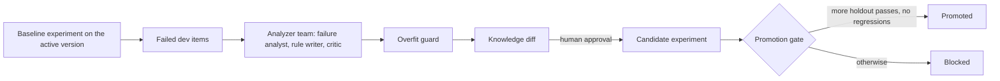

# Module: Loop Engineering - Demos for Section 4: Hill-climbing loop

## The problem

**Illustrative scenario.** An analyst at Harbor & Pine Outfitters pastes a fix for every failed
benchmark question into the agent's prompt. The score on those questions jumps, and the change
ships. Next month's questions are still wrong, and a question that used to be right now breaks.

These demos run that loop live and put a gate in its way. A baseline experiment measures knowledge
version v1 on the benchmark. A naive analyzer writes rules that quote the questions, and the gate
blocks them. The analyzer team writes two candidates of general rules, the one with the better dev
results is kept, a person approves it, and the candidate experiment decides on the holdout split.

> **Terms on this page**
>
> - **Hill-climbing loop**: Experiments find failures, an analyzer team proposes rules, and a gate decides.
> - **Knowledge version**: A numbered set of business rules given to the agent in its prompt.
> - **Dev split**: The benchmark questions the analyzer team may learn from.
> - **Holdout split**: The benchmark questions the analyzer team never sees; the gate decides on them.
> - **Promotion gate**: The check that a new knowledge version must pass before it becomes active.
> - **Regression**: An item that passed under the active version and fails under the candidate.
> - **Human approval**: A person approves or rejects a held action before it runs.
> - **Autonomy level**: How much DataPilot may do unattended: report-only, assisted, or unattended.
>
> All terms: [glossary](../../docs/glossary.md).

## What you'll see

Every experiment item is a fresh, real run of the analyst with real model calls. Results are scored
locally first: an answer passes only if its Structured Query Language (SQL) returns the gold result
on both warehouses. Experiment runs are traced in LangSmith as a sample, about 1 run in 5, to stay
inside the free plan's monthly traces: a row of the holdout ledger links to its trace when one of
its runs was traced and reads "Not traced" otherwise, and every row is scored all the same. The
analyzer team makes real model calls too, and the knowledge diff shows exactly what it proposes.

Times and cost: not measured yet. Calibration runs each demo three times and lists the runs on the
[evidence page](../../docs/evidence/section-4-hill-climbing-loop.md). Until then, `run.sh` states
the most an experiment can cost at the caps in `platform/packs/datapilot_us/pack.yaml`.



## Run it

Finish the [setup pages](../../setup/README.md) first, including the
[pre-class checks](../../setup/pre-class.md). Then start the services and confirm the data in a
terminal at the repository root:

```bash
make up
make check-data
```

Open the console at http://localhost:8501 on the Improve page. Run every core demo of this section
from the same terminal, one at a time, with:

```bash
bash section-4-hill-climbing-loop/demo/run.sh
```

Add `--optional` to run the over-broad rule after the core demos, or name one demo to run it alone.
Each `make demo` prints the request ids it queued; the experiments and the analyzer report show up
on the Improve page.

The order matters here. The baseline experiment is the comparison for every later gate verdict,
so it runs first and stays across a `make reset NAME=hill-climbing-loop`. The naive analyzer runs
with `BUG_NAIVE_ANALYZER=1` in `.env` (then `make up`); the analyzer team runs with it back at `0`.
Approve the candidate in the knowledge diff before the candidate experiment's verdict can pass.
The over-broad rule runs only after a candidate has been promoted.

<!-- provisional: the hill-climbing runner that claims these requests, and its measured times, arrive with calibration -->

<!-- generated:demo-table -->
| Demo | Tier | Run it | Target minutes |
|---|---|---|---|
| The baseline experiment | core | `make demo NAME=improve-baseline-experiment` | 3 |
| The naive analyzer, blocked | core | `make demo NAME=improve-naive-analyzer-blocked` | 4 |
| The over-broad rule, blocked | optional | `make demo NAME=improve-overbroad-rule-blocked` | 4 |
| The analyzer team and approval | core | `make demo NAME=improve-analyzer-team-approve` | 4 |
| The candidate experiment | core | `make demo NAME=improve-candidate-experiment` | 5 |
| Cleared for the unattended level | core | `make demo NAME=improve-cleared-unattended` | 3 |

Each demo also runs from the console (Improve > Run experiment on the active version; Improve > Run analyzer; Improve > Add the over-broad rule to the active version; Improve > Run analyzer; Improve > Run experiment on the candidate; Events > Send webhook question).
Recovery for every demo in Section 4: Hill-climbing loop: `make reset NAME=hill-climbing-loop`, then the same
trigger again. The target minutes are the class plan's, from `platform/demos/registry.yaml`, not
measured times.
<!-- /generated:demo-table -->

### Files and links

- [run.sh](run.sh): the launcher; its header states what it runs, the caps, and the target minutes
- [walkthrough.md](walkthrough.md): the code behind these demos, explained
- [Knowledge version v1](../../platform/packs/datapilot_us/knowledge/v1.yaml) and
  [the over-broad rule's version](../../platform/packs/datapilot_us/knowledge/v2-overbroad.yaml)
- [The benchmark](../../platform/packs/datapilot_us/benchmark/): the dev and holdout splits
- [The measurement scheme](../../platform/packs/datapilot_us/pack.yaml): `evaluation`
- [expected/](expected/): real output from a real run, for comparison after class, never in class
- [Evidence page](../../docs/evidence/section-4-hill-climbing-loop.md): the measured runs

## What to watch

| Step | Screen | What appears |
|---|---|---|
| The baseline experiment | Improve page | The holdout ledger filling in: start time, and trace or "Not traced" |
| The naive analyzer, blocked | Improve page | Rules quoting questions, all flagged by the overfit guard; the verdict blocked |
| The analyzer team and approval | Improve page | Two candidates' dev results, the one kept, and its knowledge diff |
| The candidate experiment | Improve page, then LangSmith | Holdout flips marked against the baseline; the gate verdict |
| Cleared for the unattended level | Events page and status line | The correct answer, posted at the level its family has earned |

Each demo's entry below comes from the demo registry: how to start it, what guarantees its moment,
and what may differ from run to run.

<!-- generated:demo-runbook -->
### The baseline experiment

- **Tier**: core
- **Start it**: Improve > Run experiment on the active version in the console, or `make demo NAME=improve-baseline-experiment`
- **Guaranteed by**: the near-empty knowledge version v1; the five traps in the seeded data
- **What appears**: Started at the poll, the experiment runs the 40 benchmark items under knowledge version v1; the trap items fail and the holdout ledger fills in locally, each row stamped with its run's start time and linked to its LangSmith trace when the trace sample took one of its runs (about 1 run in 5), otherwise marked "Not traced". This run is the session's baseline.
- **Expected live outcome**: A holdout pass count for v1 with the trap items failed.
- **What can vary**: which non-trap items pass; wall time
- **Recovery**: `make reset NAME=hill-climbing-loop`, then the same trigger again

### The naive analyzer, blocked

- **Tier**: core
- **Start it**: Improve > Run analyzer in the console, or `make demo NAME=improve-naive-analyzer-blocked`
- **Guaranteed by**: the naive analyzer (`BUG_NAIVE_ANALYZER`)
- **What appears**: The naive analyzer, with no model call, writes one rule per failed dev question, quoting it word for word with the analyst's query that failed, and never reads a reference query. It skips the critic and applies no overfit guard: the guard flags every rule and the Improve page says so, yet the knowledge diff keeps them all. Then the candidate experiment runs, and the gate blocks the version because the overfit guard rejects its rules, whatever its holdout count.
- **Expected live outcome**: The overfit guard flags every rule, not applied by the analyzer; the gate verdict reads blocked, naming the rules the overfit guard rejects.
- **What can vary**: how many dev items failed; the dev count; the holdout count
- **Recovery**: `make reset NAME=hill-climbing-loop`, then the same trigger again

### The over-broad rule, blocked

- **Tier**: optional, cut first when the section runs late
- **Start it**: Improve > Add the over-broad rule to the active version in the console, or `make demo NAME=improve-overbroad-rule-blocked`
- **Guaranteed by**: the over-broad rule
- **What appears**: Run only after a candidate has been promoted. The active version plus one pre-authored rule, "exclude discounted orders from revenue", breaks revenue items that pass under the active version; the ledger marks the regressions and the gate blocks it.
- **Expected live outcome**: Regressions marked on the ledger and a blocked verdict.
- **What can vary**: which items regress
- **Recovery**: `make reset NAME=hill-climbing-loop`, then the same trigger again

### The analyzer team and approval

- **Tier**: core
- **Start it**: Improve > Run analyzer in the console, or `make demo NAME=improve-analyzer-team-approve`
- **What appears**: The failure analyst diagnoses the failed dev items, the rule writer proposes general rules, the critic keeps, narrows, or drops each one, a rule whose SQL guidance does not run over the schema is dropped, and the overfit guard passes the rest. The team writes two candidates this way, each runs on the dev split only, and the Improve page names the one kept by its dev results; the knowledge diff shows it for human approval.
- **Expected live outcome**: A candidate version with general rules in the diff viewer, and the line naming both candidates and the one kept.
- **What can vary**: rule wording; number of rules; which candidate is kept
- **Recovery**: `make reset NAME=hill-climbing-loop`, then the same trigger again

### The candidate experiment

- **Tier**: core
- **Start it**: Improve > Run experiment on the candidate in the console, or `make demo NAME=improve-candidate-experiment`
- **What appears**: The candidate version flips a clear majority of holdout trap items with zero regressions on either split. The live holdout ledger in the console, scored locally against this session's baseline, marks the flips; then the LangSmith trace list of datapilot-experiments, filtered by knowledge version, shows the candidate's traced runs, a sample of about 1 run in 5. The gate passes once approved.
- **Expected live outcome**: Holdout flips marked against this session's baseline, no regressions, gate verdict passed.
- **What can vary**: which items flip; wall time
- **Recovery**: `make reset NAME=hill-climbing-loop`, then the same trigger again

### Cleared for the unattended level

- **Tier**: core
- **Start it**: Events > Send webhook question in the console, or `make demo NAME=improve-cleared-unattended`
- **What appears**: The correct answer, posted at the level its family has earned. The spine question arrives as a webhook and is answered correctly under the new active version; it posts at the unattended level when the promotion cleared its metric family on the gate's own confirmed standard (every holdout item at 2 of 3 runs, an item that fell short passing 2 of 3 more runs), and at the assisted level when the family fell short.
- **Expected live outcome**: A correct answer, posted at the unattended level if its family cleared on the confirmed standard, and at the assisted level if it did not.
- **What can vary**: wording; latency; the level: assisted or unattended; the answer is correct either way
- **Recovery**: `make reset NAME=hill-climbing-loop`, then the same trigger again
<!-- /generated:demo-runbook -->

## What the result means

The gate decides on the holdout split, which the analyzer team never reads. A candidate is
promoted only with more holdout passes than the active version, zero regressions on either split,
every new rule passing the overfit guard, and a person's approval. Each apparent regression is re-run before it counts
(`evaluation.holdout_regression_reruns` and `evaluation.dev_regression_reruns` in `pack.yaml`). An
apparent dev regression is re-run under both versions, 2 more runs each, and counts only when the
candidate fails both and the active version passes both: the ledger says "Apparent regression:
confirming with 2 more runs of each version".

A blocked naive analyzer is the expected result: rules that quote dev questions word for word
teach nothing about the holdout questions, and the gate blocks the version because the overfit
guard rejects every one of those rules, whatever the holdout count. A passed gate on the candidate means general rules fixed
traps on questions the analyzer team never saw. Report the counts as the ledger shows them: which
items flip can differ from run to run, and one session is one measurement.

A family cleared for the unattended level met the same standard as the gate: each of its holdout
items passed 2 of 3 runs, and an item that fell short passed 2 of 3 more runs before it counted. A
family that stays at the assisted level had an item that fell short twice; the correct answer is
still posted, at the assisted level, with approval where that level asks for it. Either way the
moment is the same: the correct answer, posted at the level its family has earned.

If the version promoted live in class gives a wrong finale answer, the finale runs again, live, on
the version promoted and verified in rehearsal: the class-day safeguard in the
[instructor guide](../../docs/instructor-guide.md#the-class-day-safeguard-for-the-finale).

## If it fails

| What you see | Why | What to do |
|---|---|---|
| `run.sh` says the services do not answer | The services are not running | `make up`, then `make ps` until every service is healthy |
| The gate refuses to compare the experiments | The baseline came from another live session | Run the baseline experiment again in this session |
| The naive analyzer's rules look general, or no rule quotes a question | `BUG_NAIVE_ANALYZER` is not on in the services | Set it to `1` in `.env`, then `make up` |
| The candidate verdict stays at ready for approval | Nobody approved the candidate | Approve it in the knowledge diff on the Improve page |
| Anything else | A stale request or an engaged kill switch | `make reset NAME=hill-climbing-loop`, then the same trigger again |
