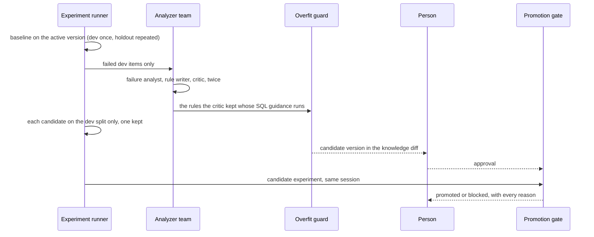

# Demo walkthrough for Section 4: Hill-climbing loop

The code behind the demos of this section: how an experiment repeats its runs, what the analyzer
team may read and keep, and how the promotion gate decides.

> **Terms on this page**
>
> - **Hill-climbing loop**: Experiments find failures, an analyzer team proposes rules, and a gate decides.
> - **Dev split**: The benchmark questions the analyzer team may learn from.
> - **Holdout split**: The benchmark questions the analyzer team never sees; the gate decides on them.
> - **Promotion gate**: The check that a new knowledge version must pass before it becomes active.
> - **Regression**: An item that passed under the active version and fails under the candidate.
> - **Planted bug**: A defect switched on by a flag so a demo shows its failure every time.
>
> All terms: [glossary](../../docs/glossary.md).

## What this code does

An experiment runs every benchmark item under one knowledge version, each repetition a fresh live
run, and scores each answer locally against the gold Structured Query Language (SQL) result. The
analyzer team reads only the failed dev items: the failure analyst diagnoses them, the rule writer
proposes rules, the critic keeps, narrows, or drops each one, a rule whose SQL guidance does not
run over the schema is dropped, and the overfit guard rejects any that quote a question or copy
gold SQL. The team writes two candidates this way; each runs on the dev split only, and one is
kept. The gate compares the kept candidate's experiment with the baseline from the same live
session.



## The code, explained

### platform/src/datapilot/loop4_hill_climbing/experiment.py, lines 192-194

```python
# platform/src/datapilot/loop4_hill_climbing/experiment.py (lines 192-194)
    def _run_item(self, item: BenchmarkItem, knowledge_version: str) -> list[RunRecord]:
        repeats = self.scheme.repeats(item.split)
        return [self.run_once(item, knowledge_version, n) for n in range(1, repeats + 1)]
```

This is the baseline experiment and the candidate experiment. Each item's runs go one after
another, so its run passes stay in repetition order. `scheme.repeats` gives a holdout item
`evaluation.holdout_repeats` runs and a dev item one, from `platform/packs/datapilot_us/pack.yaml`.
A holdout item passes on `evaluation.holdout_pass_threshold` of its runs, so one lucky run does not
flip it. The same scheme applies to both versions.

### platform/src/datapilot/loop4_hill_climbing/analyzer.py, lines 206-210

```python
# platform/src/datapilot/loop4_hill_climbing/analyzer.py (lines 206-210)
        holdout = [f.item.id for f in failed if f.item.split is not Split.DEV]
        if holdout:
            raise ValueError(f"the analyzer team reads dev items only, got {holdout}")
        if planted("BUG_NAIVE_ANALYZER"):
            return self._naive(failed, active, candidate_name)
```

The holdout split stays unseen in code, not by convention: a holdout item in the input stops the
analyzer team. With the naive analyzer (`BUG_NAIVE_ANALYZER`) on, the team is skipped: no critic,
and no overfit guard applied. That is the naive analyzer, blocked.

The naive analyzer, `naive_rules` in the same file, makes no model call. It writes one rule per
failed dev question, quoting the question word for word with the analyst's query that failed, and
never reads a reference query. Each rule is tied to one question, so it teaches nothing about the
next one. The overfit guard still checks every rule and flags each one for quoting a benchmark
question, but its verdict is not applied, so the knowledge diff keeps them all.

### platform/src/datapilot/loop4_hill_climbing/analyzer.py, lines 242-245

```python
# platform/src/datapilot/loop4_hill_climbing/analyzer.py (lines 242-245)
        guidance = [self.guidance.check(rule) for rule in kept] if self.guidance else []
        runs = [r for r in kept if r.id not in {g.rule_id for g in guidance if not g.passed}]
        guard = [self.guard.check(rule) for rule in runs]
        accepted = [rule for rule, g in zip(runs, guard, strict=True) if g.passed]
```

The critic can only keep, narrow, or drop a proposed rule; a review of an unknown rule is ignored.
A rule's SQL guidance goes into the analyst's prompt word for word, so it must run over the real
schema: `sql_guidance.py` parses it with sqlglot and looks up every table and column in the
catalog of the allowed schema. A placeholder such as `<documented non-internal-customer
predicate>`, a column that does not exist such as `customer_is_internal`, or prose fails. Such a
rule reaches the critic with its problems, to narrow from the reference SQL the diagnoses quote,
such as `lower(c.email) NOT LIKE '%@harborpine.com'`; a rule that still fails is dropped, with
the problems as its reason. The overfit guard is deterministic and runs last, with its thresholds
in `evaluation` in `pack.yaml`. Only rules that pass every check reach the candidate version.

One analyzer team run can write a strong candidate or a weak one from the same failed items, so
the team writes `analyzer.candidates` of them (two, in `pack.yaml`). Each runs on the dev split
only, every item once, and `choose` in `candidates.py` keeps one: fewer dev regressions against
the session's baseline, then more dev passes, then fewer rules. The holdout split never takes part
in the choice, so it still measures questions no decision was tuned on. The Improve page shows
both candidates and the one kept above the knowledge diff.

### platform/src/datapilot/loop4_hill_climbing/gate.py, lines 117-135

```python
# platform/src/datapilot/loop4_hill_climbing/gate.py (lines 117-135)
    a, c = active.passes(Split.HOLDOUT), candidate.passes(Split.HOLDOUT)
    total = candidate.total(Split.HOLDOUT)
    better = c > a
    clean = regressions.total == 0
    reasons = [
        f"{'pass' if better else 'fail'}: holdout passes {c} of {total} against {a} for "
        f"{active.knowledge_version}",
        f"{'pass' if not regressions.dev else 'fail'}: dev regressions {len(regressions.dev)}"
        + (f" ({', '.join(regressions.dev)})" if regressions.dev else ""),
        f"{'pass' if not regressions.holdout else 'fail'}: holdout regressions "
        f"{len(regressions.holdout)}"
        + (f" ({', '.join(regressions.holdout)})" if regressions.holdout else ""),
        f"{'pass' if approved_by else 'fail'}: human approval"
        + (f" by {approved_by}" if approved_by else " not given yet"),
        f"{'pass' if not overfit_flags else 'fail'}: overfit guard on the new rules"
        + (f" ({', '.join(overfit_flags)})" if overfit_flags else ""),
    ]
    ready = better and clean and not overfit_flags
    promoted = ready and bool(approved_by)
```

The gate has four conditions and records all of them: more holdout passes than the active
version, zero confirmed regressions on either split, a person's approval, and every rule the
candidate adds passing the overfit guard (`overfit_flags`, from `new_rule_flags` in
`overfit_guard.py`). Both experiments must come from the same live session, so the comparison is
always against this session's baseline. The over-broad rule is blocked by `clean`. The naive
analyzer's version is blocked by `overfit_flags` whatever its holdout count, because the guard
rejects every rule that quotes a question.

### platform/src/datapilot/loop4_hill_climbing/eligibility.py, lines 72-80

```python
# platform/src/datapilot/loop4_hill_climbing/eligibility.py (lines 72-80)
    def passes(item_id: str) -> bool:
        if candidate.passed(item_id):
            return True
        if item_id not in reruns:
            times = scheme.regression_reruns(Split.HOLDOUT)
            reruns[item_id] = rerun(by_id[item_id], times)
        return scheme.passes(Split.HOLDOUT, reruns[item_id])

    cleared = [f for f in enough if f in eligible_families(measured, passes, [f])]
```

A family is cleared for the unattended level on the gate's confirmed standard, not on one experiment:
every holdout item of the family passes 2 of 3 runs, and an item that fell short is re-run 3 more
times and must pass 2 of them. A family below the minimum number of holdout items is never judged,
and a family stops at its first item that falls short twice, so no model call is spent on a family
already lost. The re-runs are written beside their items in the candidate experiment.

## If you copy this into your repository

- Keep a holdout split that the code that writes rules cannot read, and decide promotion on it.
- Keep the measurement scheme fixed before any comparison: repeats, the pass threshold, and the
  re-runs that confirm a regression, the same for both versions.
- Keep a critic that can only remove or narrow, and a deterministic overfit check after it.
- Check every rule's SQL guidance against the real schema before the agent reads it.
- Choose between candidates on the dev split only, never on the split the gate decides on.
- Keep human approval as a gate condition, recorded with the other reasons.
- Change the benchmark to your own questions with hand-written gold queries, split before you
  look at any failure.
- Check it with a rule that quotes a benchmark question, which the overfit guard must reject, and
  a rule that breaks a passing item, which the gate must block.
