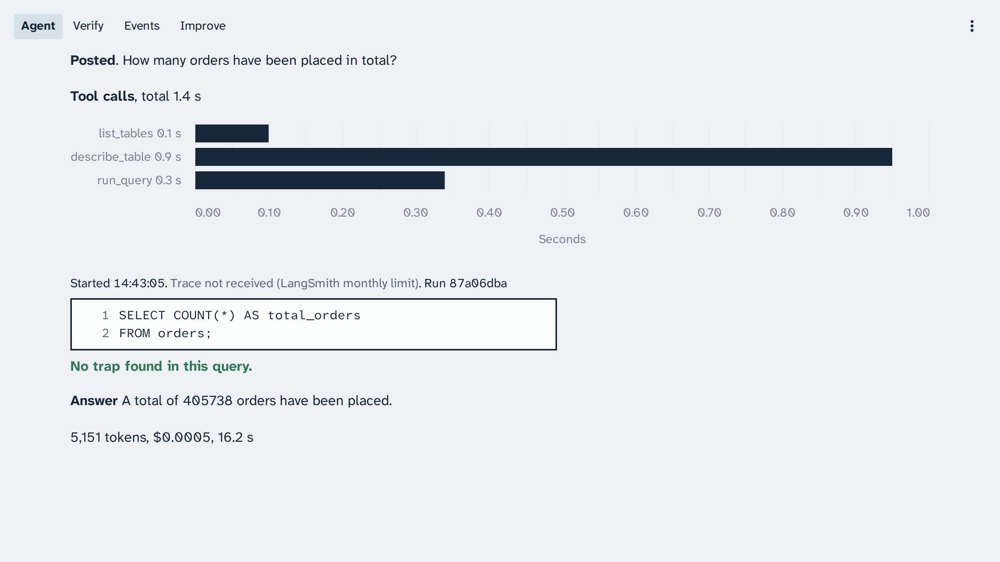

# Module: Loop Engineering - Setup on macOS

> **Terms on this page**
>
> - **Console**: The Streamlit app that shows every loop live, on four pages.
> - **Live session**: Everything that runs between one `make preflight` and the next.
> - **Drift canary**: Three easy questions that must pass and two trap questions that must still fail.
> - **Trace**: The record of one run's steps, each model call and tool call, stored in LangSmith.
>
> All terms: [glossary](../docs/glossary.md).

This page takes a Mac with nothing installed to a first live run, watched on the console.

**Not tested on a Mac.** No command on this page was run on a Mac for the course. Each macOS step
follows the official page linked next to it, read on 2026-10-23. The steps from the clone onwards
are the same commands as on Linux and were run there, in Ubuntu: [setup on Linux](linux.md). If a
step fails on your Mac, bring the exact message to class.

## Before you start

- A macOS release that Docker Desktop supports: it is "supported on the current and two previous
  major macOS releases", with "At least 4 GB of RAM"
  ([Install Docker Desktop on Mac](https://docs.docker.com/desktop/setup/install/mac-install/)).
- Administrator rights on the Mac.
- Free disk for the Postgres image, the DataPilot image, and the two seeded warehouses. On the
  course's build machine (Ubuntu on WSL2), on 25 October 2026, the six class services used about
  625 mebibytes (MiB) of memory; Docker held 4.2 gigabytes (GB) of volumes and 6.6 GB of
  images, and uv's cache 1.2 GB, the build's own assignment and test stacks included
  ([evidence](../docs/evidence/general.md#results)).
- Your OpenAI key from the operations team, or from your own OpenAI project (step 1). LangSmith
  needs no card.

Every command below runs in the Terminal app (Applications, Utilities, Terminal).

> Your output will differ: run times, ids, and the agent's wording change on every run.

## Steps

### Step 1: Get your OpenAI key from the operations team

**Why.** Every agent in DataPilot (the analyst, the schema scout, the reviewer, and the analyzer
team) calls gpt-6-luna (`OPENAI_MODEL` in `.env.example`). The operations team issues your key and
enables gpt-6-luna on it.

**Do this.** Ask the operations team for your key before class day. Keep it private until step 7.
Treat it like a password.

**You should see.** One key, sent to you privately.

**Check it worked.** The real test is `make preflight` in step 10. It asks OpenAI whether the key
works and whether it can use gpt-6-luna. It uses no tokens for that check.

**If it fails.** If the key ever lands in a chat, an issue, or a screenshot, tell the operations
team at once so they replace it.

**Not in a cohort?** Create your own OpenAI project for the course, set its budget to 3
dollars with an alert at 1.50 dollars ([costs](../docs/costs.md#the-learner-key-limit)), and
create a key in that project. `make preflight` tells you if the key cannot use gpt-6-luna.

### Step 2: Create the LangSmith account and a key (no card)

**Why.** Every run sends a trace to LangSmith, and every result on the console links to it. The
free Developer plan is enough: "Personal organizations are limited to 5,000 traces per month until
a credit card is added."
([LangSmith billing](https://docs.langchain.com/langsmith/billing), read 2026-10-23). Without a
card there is nothing to bill. Do not add a card.

**Do this.**

1. Open <https://smith.langchain.com> and sign up. Stay on the free Developer plan.
2. Open the Settings page and select the application programming interface (API) Keys section
   ([Create an account and API key](https://docs.langchain.com/langsmith/create-account-api-key)).
3. Create a Personal Access Token with an expiry after the course.
4. Copy the key right away: "LangSmith will display the API key only once."

**You should see.** The key once, in a dialog.

**Check it worked.** The key is listed under Settings, API Keys. Step 11 opens a trace with it.

**If it fails.** If the key was not copied, create a new one. If your account is in the EU
region, step 7 changes one more line in `.env`.

### Step 3: Install Docker Desktop or Colima

**Why.** `make up` starts six services and the one-shot migrate with Docker Compose
(`compose.yaml`): postgres, migrate, api, worker, scheduler, hill-climbing-runner, and console. You need the `docker` command and its Compose
plugin. Pick one of the two options.

**Do this.** Option A, Docker Desktop (Source 1), which includes Compose:

1. Download the installer for your chip (Apple silicon or Intel) from that page.
2. Open `Docker.dmg` and drag Docker into Applications.
3. Open Docker from Applications and accept the subscription agreement.

The same page says: "Docker Desktop is free for small businesses (fewer than 250 employees AND
less than $10 million in annual revenue), personal use, education, and non-commercial open source
projects." Larger companies need a paid subscription.

Option B, Colima, an open-source runtime started from the terminal
([Colima](https://github.com/abiosoft/colima)). Install Homebrew first with the command from
[Homebrew](https://brew.sh/), then:

```bash
brew install colima docker docker-compose
colima start
```

Homebrew's Compose formula says: "Compose is a Docker plugin. For Docker to find the plugin, add
"cliPluginsExtraDirs" to ~/.docker/config.json"
([docker-compose formula](https://formulae.brew.sh/formula/docker-compose)). Add this to that file,
creating it if it does not exist:

```json
{
  "cliPluginsExtraDirs": ["/opt/homebrew/lib/docker/cli-plugins"]
}
```

On an Intel Mac, Homebrew lives in `/usr/local`, so the folder is
`/usr/local/lib/docker/cli-plugins`. After a restart of the Mac, run `colima start` again before
any course command.

**You should see.** Docker Desktop's whale icon in the menu bar, or Colima's `done` line.

**Check it worked.** Open a new Terminal window and run:

```bash
docker --version
docker compose version
docker info
```

Each prints a version or a `Server:` section with no error. Docker's own check is
`docker run hello-world`.

**If it fails.**

| Problem | Fix |
|---|---|
| `docker: command not found` | Open a new Terminal window; Docker Desktop adds its tools there |
| `Cannot connect to the Docker daemon` | Open Docker Desktop, or run `colima start` |
| `docker: 'compose' is not a docker command` | Colima: add `cliPluginsExtraDirs` as above |

### Step 4: Install git and make

**Why.** You clone the course repository with git. Every course command is a make target, such as
`make up` or `make demo NAME=agent-simple-question`.

**Do this.** Install Apple's Command Line Tools, which include git and make
([Installing Git on macOS](https://git-scm.com/install/mac)):

```bash
xcode-select --install
```

**You should see.** A macOS dialog that asks you to confirm the install.

**Check it worked.** `git --version` and `make --version` each print a version.

**If it fails.** If `xcode-select` says the tools are already installed, there is nothing to do.

The test targets (`make test-integration`, `make test-console`, `make test-security`, and
`make test-stack`) also run `flock`, which macOS does not ship. If you run them, install it with
Homebrew: `brew install flock`. The class commands do not need it.

### Step 5: Install uv

**Why.** uv installs the pinned Python and every package (`uv.lock`), and every make target runs
through `uv run`. `.python-version` pins Python 3.12, and uv downloads it on first use. The
DataPilot image uses uv 0.13.1 (`platform/ops/docker/Dockerfile`).

**Do this.** This installs that version
([Installing uv](https://docs.astral.sh/uv/getting-started/installation/)):

```bash
curl -LsSf https://astral.sh/uv/0.13.1/install.sh | sh
```

Open a new Terminal window afterwards.

**You should see.** The installer ends with a line that says where it put `uv`.

**Check it worked.** `uv --version` prints `uv 0.13.1` and your platform.

**If it fails.** `uv: command not found` means the window started before the install: open a new
one. If it persists, check that `~/.local/bin/uv` exists.

### Step 6: Clone the repository and run make setup

**Why.** The repository holds DataPilot, the Harbor & Pine domain pack, the four sections, and
every make target.

**Do this.** Clone the course repository:

```bash
git clone https://github.com/ANI-IN/loop-engineering.git ~/datapilot
cd ~/datapilot
make setup
```

`make setup` installs the pinned packages with `uv sync --frozen` and copies `.env.example` to
`.env` if `.env` does not exist yet.

**You should see.** uv's install lines, then `+ created .env: add OPENAI_API_KEY and
LANGSMITH_API_KEY`.

**Check it worked.** `ls .env` lists the file.

**If it fails.**

| Problem | Fix |
|---|---|
| `uv: command not found` | Open a new Terminal window (step 5) |
| uv reports the lock file is out of date | You edited `pyproject.toml`; restore it with `git checkout pyproject.toml` |

### Step 7: Put your keys in the .env file

**Why.** Your keys go into `.env` in the repository folder. It is git-ignored, and DataPilot never
prints, logs, or traces them. The Compose services read the same file.

**Do this.** Open the file with `nano .env`. Paste your two keys after the `=`. The values below
are placeholders.

```ini
OPENAI_API_KEY=your-key-from-the-operations-team
LANGSMITH_API_KEY=your-langsmith-key
```

Leave every other line as it is: `OPENAI_MODEL=gpt-6-luna` and `LANGSMITH_TRACING=true` are the
class values. Save with Ctrl+O and Enter, and leave with Ctrl+X. EU LangSmith accounts also set
`LANGSMITH_ENDPOINT=https://eu.api.smith.langchain.com` (no trailing slash).

**You should see.** The two lines filled, with no quotes and no spaces around the `=`.

**Check it worked.** `git check-ignore .env` prints `.env`, so git never commits it.

**If it fails.** Never commit `.env`, paste it anywhere, or share a screenshot of it. If you did,
delete the LangSmith key on its settings page and ask the operations team to replace the OpenAI
key.

### Step 8: Start the services

**Why.** `make up` builds the DataPilot image, then starts Postgres, applies the ops migrations,
and starts the API, the worker, the scheduler, the hill-climbing runner, and the console. It
waits until every service with
a health check is healthy.

**Do this.**

```bash
make up
make ps
```

**You should see.** The image build, then the containers starting. `make ps` lists the six
running services, each as a container named `datapilot-<service>-1`: `api`, `console`,
`hill-climbing-runner`, `postgres`, `scheduler`, and `worker`, each with status `Up`. The
one-shot `migrate` has already exited, so it is not listed. The ports read
`127.0.0.1:5432->5432/tcp`, `127.0.0.1:8000->8000/tcp`, and `127.0.0.1:8501->8501/tcp`: every
port listens on this machine only (`compose.yaml`).

**Check it worked.** Six services show `Up` (postgres, api, worker, scheduler,
hill-climbing-runner, and console), and `api` and `postgres` show `(healthy)`.

**If it fails.**

| Problem | Fix |
|---|---|
| `Bind for 127.0.0.1:5432 failed: port is already allocated` | Another Postgres uses the port: set `POSTGRES_PORT` in `.env` |
| `Cannot connect to the Docker daemon` | Start Docker Desktop, or run `colima start` |
| A service keeps restarting | `make logs NAME=<service>` shows why; the [troubleshooting page](../docs/troubleshooting.md) lists the common lines |

### Step 9: Load the warehouse

**Why.** `make seed` generates the Harbor & Pine data and loads it into two databases: `warehouse`
and the differently seeded `warehouse_alt` that the evaluator compares against. Seeding is
deterministic, so `make check-data` can compare row counts and a content hash with
`platform/packs/datapilot_us/data_generator/expected.yaml`. Neither makes a model call.

**Do this.**

```bash
make seed
make check-data
```

**You should see.** Two lines per warehouse from `make seed`, its row counts and then its content
hash, and `seed: done in ... s`; then the one line of `make check-data`.
The last line of `make check-data` on the course machine:

```text
check-data: both warehouses match expected.yaml
```

**Check it worked.** That exact line, with no `x` line before it.

**If it fails.** An `x` line names the table whose count or hash differs. Run `make seed` again; it
rebuilds both warehouses from the same seed.

### Step 10: Run make preflight

**Why.** One command checks everything so far and starts your live session: the services, the
seeded warehouse, your OpenAI key, the starting knowledge, and the drift canary. gpt-6-luna has no
dated snapshot, so the canary checks that the model still behaves as the course measured it. Runs
belong to the open live session, so a demo needs a preflight first.

**Do this.**

```bash
make preflight PURPOSE=development
```

The canary asks five questions with your key, each one agent run (about 40 model calls, under a
cent). `PURPOSE=development` names a session on
your own machine; on class day you run `make preflight PURPOSE=class`.

**You should see.** One line per check starting with `ok`, one `canary` line per question ending
in `as expected` with its trace link, and a last line that starts with `Live session started at`.
Your key is never printed.

**Check it worked.** The last line starts `Live session started at` and names the model id
`gpt-6-luna`.

**If it fails.**

| Line | Fix |
|---|---|
| `A service is not ready: run make up, then preflight again.` | Step 8, then `make preflight PURPOSE=development` again |
| `Your OpenAI key was not accepted. Check it with the operations team.` | Copy the key into `.env` again; if it still fails, ask the operations team |
| `... The model gpt-6-luna is not available to it.` | Ask the operations team to enable gpt-6-luna on your key |
| `The drift canary failed: ...` | Bring the exact line to the instructor; do not change any setting |

### Step 11: Run the first live demo

**Why.** This is the end-to-end check: a real question from the analyst, answered against the
warehouse with your key, shown live on the console and traced in LangSmith. It is the first demo
of Section 1: Agent loop, the simple question.

**Do this.** Open <http://localhost:8501> in your browser. Then, in the Terminal window:

```bash
make demo NAME=agent-simple-question
```

**You should see.** The terminal prints the demo name with the run it started. On the console's
Agent page the run appears with its tool calls, its Structured Query Language (SQL), its answer,
and a live stamp: the start time in your local time and a trace link.



*The live stamp above the query: this run's start time and its trace link, the link you open in the next check.*

**Check it worked.** The trace link on the console opens the run in LangSmith, in the project
`datapilot-live` (`LANGSMITH_PROJECT` in `.env.example`).

**If it fails.**

| Problem | Fix |
|---|---|
| `No live session is open: run make preflight PURPOSE=class\|rehearsal\|thursday-review\|development first` | Step 10 |
| The console does not open in your browser | Check `make ps`; try <http://127.0.0.1:8501> |
| The run stays in one lane | `make reset NAME=agent-loop`, then the same `make demo` again |

## Common errors

| Symptom | Fix |
|---|---|
| `make: command not found` | Step 4 |
| `uv: command not found` | Open a new Terminal window (step 5) |
| `Cannot connect to the Docker daemon` | Open Docker Desktop, or run `colima start` |
| The console is blank after a restart | Start Docker, run `make up`, then `make preflight PURPOSE=development` |
| A demo ran but the console shows no trace link | Check `LANGSMITH_API_KEY` and `LANGSMITH_TRACING=true` in `.env`, then `make up` |
| `flock: command not found` from a test target | `brew install flock`; only the test targets use it |

Every other message, with its cause and fix: [troubleshooting](../docs/troubleshooting.md).

## You're ready

You are ready when:

- `make ps` shows six services up, with `api` and `postgres` healthy;
- `make check-data` ends with `check-data: both warehouses match expected.yaml`;
- `make preflight PURPOSE=development` ends with `Live session started at`;
- `make demo NAME=agent-simple-question` shows a run with a live stamp on the console.

Next: the [pre-class checklist](pre-class.md), then
[Section 1: Agent loop](../section-1-agent-loop/README.md).

## Sources

- Source 1: Install Docker Desktop on Mac,
  <https://docs.docker.com/desktop/setup/install/mac-install/>, Docker, n.d.
- Source 2: LangSmith billing, <https://docs.langchain.com/langsmith/billing>, LangChain, n.d.
- Source 3: Create an account and API key,
  <https://docs.langchain.com/langsmith/create-account-api-key>, LangChain, n.d.
- Source 4: Colima, <https://github.com/abiosoft/colima>, Abiola Ibrahim, n.d.
- Source 5: Homebrew, <https://brew.sh/>, Homebrew, n.d.
- Source 6: docker-compose formula, <https://formulae.brew.sh/formula/docker-compose>, Homebrew, n.d.
- Source 7: Installing Git on macOS, <https://git-scm.com/install/mac>, Git, n.d.
- Source 8: Installing uv, <https://docs.astral.sh/uv/getting-started/installation/>, Astral, n.d.
